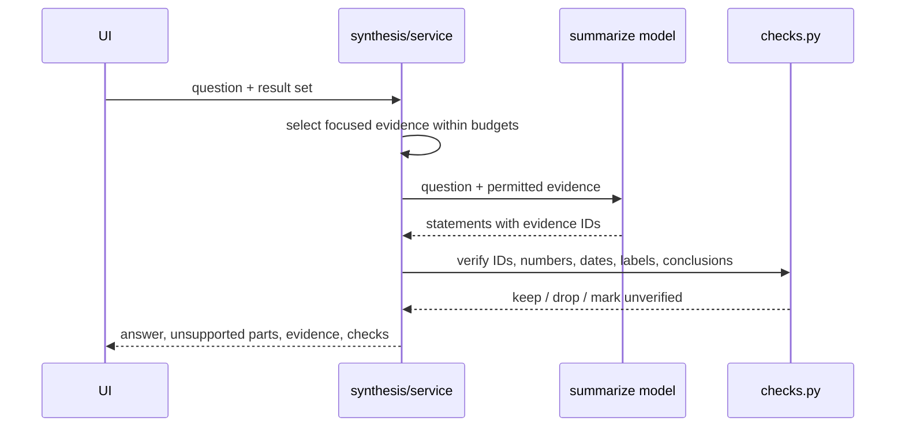

# Design: AI Interpretation and Verified Synthesis

> Spec reconstructed from the implemented code on 2026-11-09. This is not a historical Kiro-generated spec. Evidence is cited by repository path.

## Components

| Concern | Files |
|---|---|
| Orchestration, batching | `backend/app/synthesis/service.py` |
| Question focus | `synthesis/focus.py`, `synthesis/focused.py` |
| Code verification | `synthesis/checks.py` |
| Labels and groups | `synthesis/labels.py`, migration `0013_content_groups` |
| API | `backend/app/api/v1/synthesis.py` |
| Stage routing | `workflow/ai_selection.py`, `model_registry/runtime.py` |
| UI | `frontend/src/components/AiInterpretation.tsx`, `SynthesisPanel.tsx`, `LabelReviewPanel.tsx`, `AiAnswerView.tsx` |

## Sequence

## Decisions

- The model never supplies quotes, node IDs or page numbers; evidence cards are hydrated from stored text.
- Verification is rule-based and cannot prove a statement is legally correct.
- Local runs 10/10 and API runs 11/11 (including three real API calls, 12/12 statements passing checks) were reported in the G4 session; they were not re-run when this spec was written.
