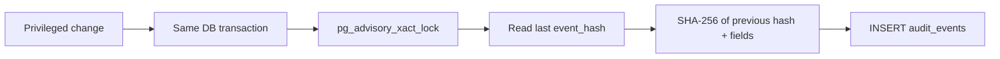

# Design: Hash-chained Audit Log

> Spec reconstructed from the implemented code on 2026-11-09. This is not a historical Kiro-generated spec. Evidence is cited by repository path.

## Components

| Concern | Files |
|---|---|
| Append and verify | `backend/app/audit.py` |
| Read API | `backend/app/api/v1/admin.py` (`GET /audit-events`), `backend/app/admin_services.py` |
| Schema | migration `0001_core.sql` (`audit_events`) |
| UI | "Nhật ký Kiểm toán" tab of the AI & Audit page (`frontend/src/pages/AdminPortal.tsx`) |

## Design

- Timestamp comes from `clock_timestamp()` in the database, not from the client.
- Canonical JSON (`sort_keys`, compact separators, `ensure_ascii=False`) keeps the hash reproducible.
- Verification walks events in `event_order` and recomputes each hash.

## Known limits

The chain detects edits to stored rows; it does not by itself prevent a database owner from rewriting the whole chain. No external anchoring of the head hash exists in the repository.
