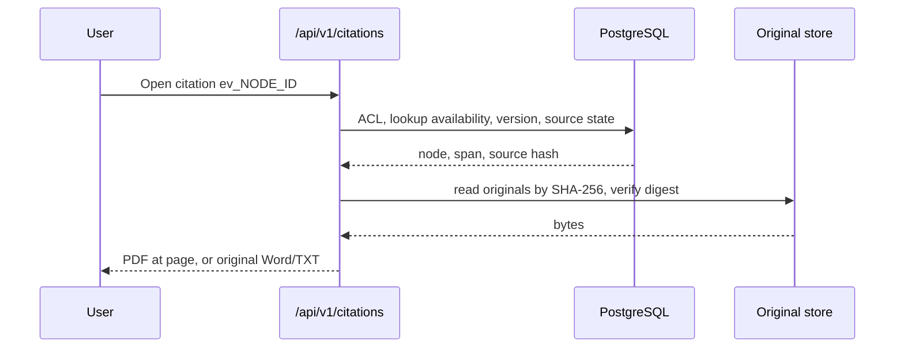

# Design: Citation Pinning

> Spec reconstructed from the implemented code on 2026-11-09. This is not a historical Kiro-generated spec. Evidence is cited by repository path.

## Components

| Concern | Files |
|---|---|
| Authorised citation lookup | `backend/app/storage/citations.py`; routes in `backend/app/main.py` (`/api/v1/citations/{id}`, `/pdf`, `/original`) |
| Immutable source files | `documents/provenance.py` |
| Tree and spans | `documents/tree_parser.py`, `spans.py`, `node_writer.py`, `scripts/rebuild_node_tree.py`, migration `0009_node_structure` |
| Evidence validation | `backend/app/evidence/validators.py`, `mapper.py`, `workflow/evidence_mapper.py` |
| UI | `frontend/src/components/OpenOriginalButton.tsx`, `DocumentCard.tsx` |

## Flow

## Decisions

- Evidence ID embeds the node ID, so no free-text reference from a model can create evidence.
- OCR text coordinates are page-level, not per-character; the UI must not suggest exact word positions.
- The anchor contract notes that no real PDF fixtures in the repository prove highlight accuracy; gates WP 0.3 and 1.5 are recorded as open in `docs/pdf-anchor-coordinate-contract.md`.

## Known limits

0 of 21,724 clauses lacked an anchor in the G0 test corpus (reported by the session, see `KIRO_WORK_SUMMARY.en.md` A8); this was not re-run when this spec was written.
