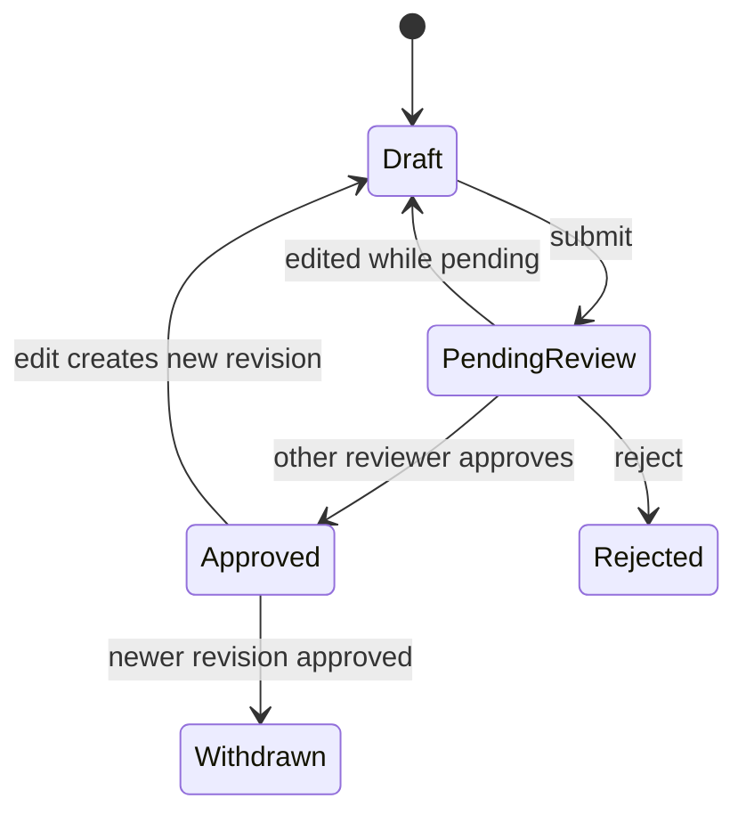

# Design: Document Management

> Spec reconstructed from the implemented code on 2026-11-09. This is not a historical Kiro-generated spec. Evidence is cited by repository path.

## Overview

A FastAPI layer (`backend/app/api/v1/admin.py`) delegates to three modules in `backend/app/documents/`, and a React page renders the result.

| Layer | Files |
|---|---|
| API | `backend/app/api/v1/admin.py` (`/documents`, `/documents/{id}`, `/documents/actions`, `.../original`) |
| Read | `documents/management_read.py` (`list_documents`, `detail`, `original`) |
| Write | `documents/management_write.py` (`change_version`, `change_availability`) |
| Access | `documents/management_access.py` (`managed_read_sql`, `version_scope`, `lock_review_version`) |
| Visibility | `storage/lookup_visibility.py`, migration `0016_document_management` |
| UI | `frontend/src/pages/AdminPortal.tsx`, `components/AdminDocumentManager.tsx`, `AdminDocumentDetail.tsx` |

## Design decisions

- A correction never mutates an approved version. `_new_revision` copies metadata into a new draft that points to the same immutable original (`originals/<sha256>.pdf`).
- Lifecycle actions, editors and reviewers take the document row lock first (`lock_review_version`) so concurrent actions serialise.
- A per-version review revision number detects stale screens.
- Lookup status (`suspended`, `deleted`) is separate from legal effectivity and does not delete vectors or files.
- Search accent-folding uses a SQL `translate` fold on Vietnamese characters (`_folded`).

## Data

Migration `0016_document_management.sql` adds management fields and the lookup-visibility counter. OCR text before and after editing is stored in PostgreSQL.

## Error handling

Stale revision, category change during approval and missing permission return coded 4xx errors; the UI asks the user to reload the detail.

## Testing (existing)

`backend/tests/test_document_management.py`, `test_lookup_visibility.py`, `frontend/src/pages/AdminDocuments.test.tsx`.
