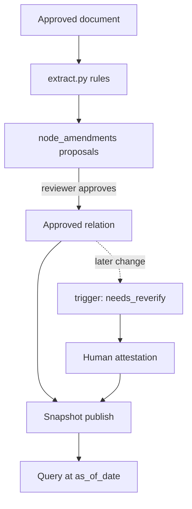

# Design: Effectivity

> Spec reconstructed from the implemented code on 2026-11-09. This is not a historical Kiro-generated spec. Evidence is cited by repository path.

## Components

| Concern | Files |
|---|---|
| Rule reader | `backend/app/effectivity/extract.py` |
| Hard rules, status computation | `effectivity/resolver.py`, test `backend/tests/test_effectivity_rules.py` |
| Storage, target matching | `effectivity/store.py`, `effectivity/service.py` |
| Clause paths | `effectivity/node_paths.py`, `documents/node_effectivity.py` |
| AI proposals (propose only) | `effectivity/ai.py` |
| API | `backend/app/api/v1/effectivity.py` (`/admin/effectivity/proposals`, `/attestations`, `/extract`, `/ai-proposals`, `/snapshots/publish`, `/effectivity/documents/{id}`) |
| Schema | migration `0011_effectivity.sql` |
| UI | `frontend/src/components/EffectivityReviewPanel.tsx`, `EffectivityBadges.tsx`, `effectivityLabels.ts` |
| Measurement | `evaluation/coverage/measure_g3_relations.py`, `g3_relations_reference.json` |

## Model

## Decisions

- All decisions are recorded in ADR-008. Terminating relations once approved give axis B "verified"; a partial amendment gives axis A "partially amended" and axis B "unverified".
- Hard rules live in code and a trigger, not in model output; AI may only propose.
- API changes are additive: `effectivity` field, `clause_level_warning`, `data_date`; `amendment_state` is unchanged.

## Known limits

On the 286-document test store, 671 relation proposals and 293 related relations were produced, and most targets are "not in store". 31/31 clause relations matched a reference set drafted by an agent and not confirmed by subject-matter experts (`docs/implementation-status.md`).
