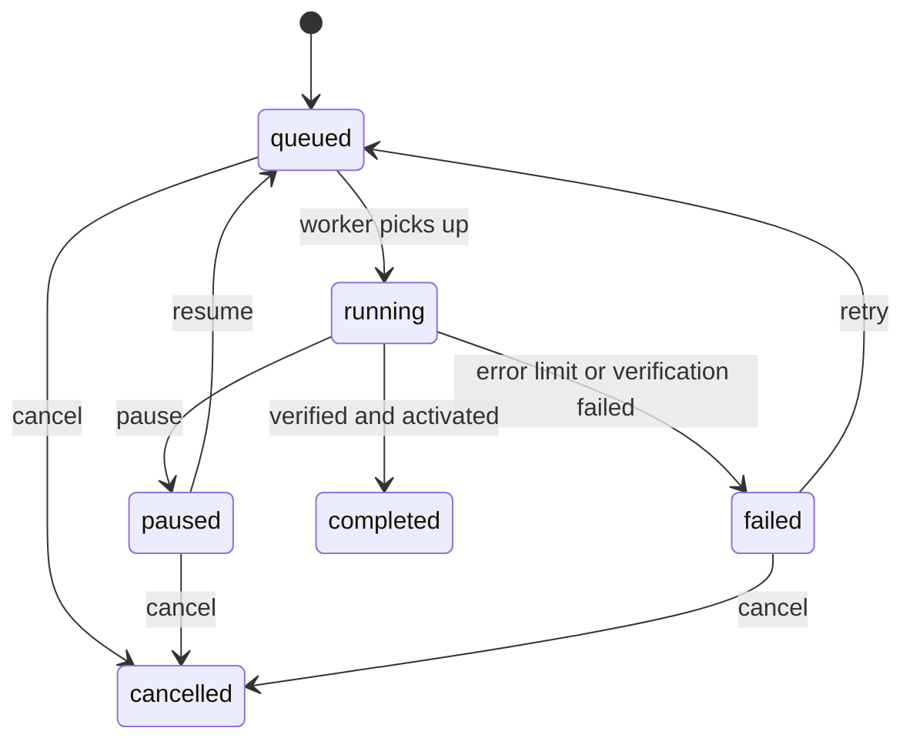

# Design: Embedding Management

> Spec reconstructed from the implemented code on 2026-11-09. This is not a historical Kiro-generated spec. Evidence is cited by repository path.

## Components

| Concern | Files |
|---|---|
| Vector storage and search | `backend/app/storage/embeddings.py`, migration `0012_comprehensive_search` |
| Jobs, preflight, worker | `storage/embedding_jobs.py`, migration `0014_embedding_jobs` |
| API | `api/v1/admin.py` (`/embeddings`, `/embeddings/preflight`, `/embeddings/jobs`, `/embeddings/jobs/{id}/{action}`) |
| CLI | `scripts/build_embeddings.py` (`--rebuild`) |
| UI | `frontend/src/components/EmbeddingManager.tsx` |
| Reference model | `qwen3-embedding:0.6b`, 1024 dimensions, through Ollama (ADR-009) |

## Job lifecycle

## Decisions

- The old index keeps serving while the new one is built; activation happens only after index report and sample check pass.
- Indices are history; the application never deletes them.
- Remote embedding requires API mode plus both remote-processing and remote-embedding flags in the endpoint policy.

## Known limits

The session report for this feature records a run with real Ollama; it was not re-run when this spec was written (`docs/evidence/2026-11-07-embedding-admin/REPORT.md`).
