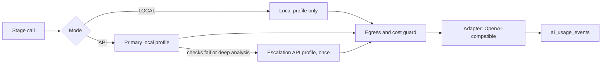

# Design: Model Registry

> Spec reconstructed from the implemented code on 2026-11-09. This is not a historical Kiro-generated spec. Evidence is cited by repository path.

## Components

| Concern | Files |
|---|---|
| Profiles and routes | `backend/app/model_registry/profiles.py`, `runtime.py` |
| Stages and policy | `model_registry/stages.py`, migration `0010_ai_policy`, `backend/app/ai_limits.py` |
| Provider adapter | `model_registry/adapters/base.py`, `openai_compatible.py` |
| Diagnostics | `model_registry/diagnostics.py` |
| Key storage | `model_registry/secret_store.py` |
| Stage selection in the pipeline | `backend/app/workflow/ai_selection.py` |
| API | `backend/app/api/v1/admin.py` (`/model-registry*`) |
| UI | `frontend/src/components/ai/` (`ModelProfilesPanel`, `AssignmentsPanel`, `ProfileEditor`, `CheckResult`, `aiConfig.ts`) |
| Config templates | `configs/model-registry.example.yaml`, `ai-runtime.env.example`, `security-policy.example.yaml` |
| Guidance | `docs/ai-model-recommendations.md`, `docs/HUONG_DAN_SU_DUNG_VA_CAU_HINH_AI.md` |

## Routing

## Decisions

- Hard rules (egress, escalation, local-only stages) live in code, not in prompts or per-profile switches.
- Endpoint `localhost` is interpreted from the backend host, not from the client.
- Saving a profile that fails testing is possible only with explicit consent and never makes it usable.

## Known limits

The Model Registry UI report states that real OpenAI and Gemini calls were not verified and the Tauri shell was not checked (`docs/evidence/2026-11-08-model-registry-ui/REPORT.md`). The Hybrid Auto API run in the G4 report used real API calls, as recorded there; neither was re-run when this spec was written.
