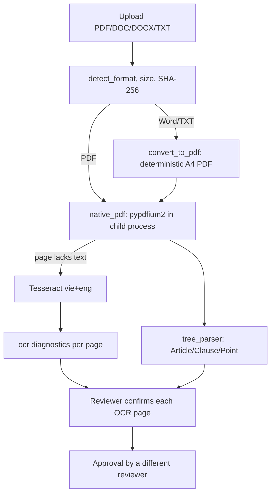

# Design: PDF Intake, Conversion and OCR

> Spec reconstructed from the implemented code on 2026-11-09. This is not a historical Kiro-generated spec. Evidence is cited by repository path.

## Components

| Concern | Files |
|---|---|
| Format detection and conversion | `backend/app/documents/convert.py` (uses fpdf2, olefile, defusedxml; font `fonts/Tinos-*.ttf`) |
| Immutable storage | `documents/provenance.py` |
| Deduplication | `documents/deduplication.py` |
| Native extraction | `documents/native_pdf.py`, `pdf_worker.py`, `isolated.py` |
| OCR | `documents/ocr.py` (`TesseractOcr`, `diagnose`, `suspect_tokens`, `marker_anomalies`) |
| Draft and review | `documents/draft.py`, `draft_read.py`, `review.py`, `preview.py`, `reextract.py` |
| Schema | migrations `0008_source_format`, `0015_ocr_page_review` |
| UI | `frontend/src/components/DraftReviewPanel.tsx` |
| Bulk import | `scripts/import_official_corpus.py`, `test-data/README.md` |

## Decisions

- Isolation: PDF parsing runs in a child process so a malformed file cannot take down the API (`isolated.py`).
- Determinism: converted PDFs render identically each time, so hashes and citations stay stable.
- OCR is derived data; the scan is unchanged. The OCR runtime (Tesseract, language data) is configured outside the code; the portable package ships it for LAN Portable.
- The Windows `deploy/portable` package does not include Tesseract (`deploy/windows/README.md`).

## Known limits

OCR can misread document numbers and conditions. The reports record scanned-PDF OCR trials on the development machine (`docs/evidence/2026-11-08-ai-ocr/REPORT.md`); those were not re-run when this spec was written.
