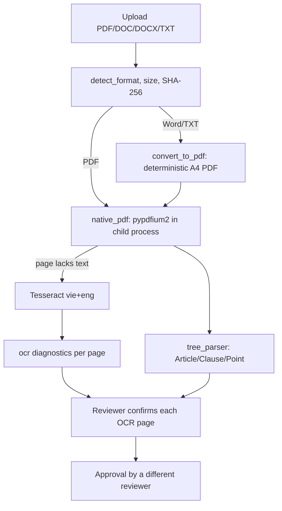
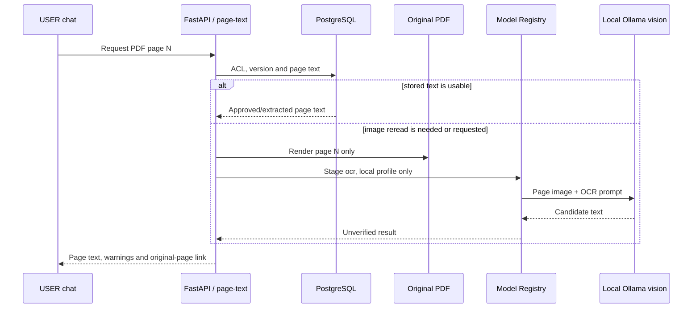

# Design: PDF Intake, Conversion and OCR

> Initially reconstructed from implemented code on 2026-11-09 and updated against the source on 2026-11-17. This is not a historical Kiro-generated spec. Evidence is cited by repository path.

## On-demand page text and OCR AI (added 2026-11-17)

This is separate from ingestion OCR. A USER request first checks access and the current source revision, then returns stored extracted/reviewed text when usable. If the page has no usable text or the user explicitly requests a reread from the scan, the backend renders only the requested PDF page and sends that image through the local `ocr` Model Registry stage. It does not send the whole PDF and has no external-API image fallback. The worker is disabled by default (`EVIDENCE_OCR_AI_ENABLED=false`). Results are temporary, marked unverified, include warnings and expire after one hour; they do not mutate source text, citations or vectors.

The Admin flow creates a separate OCR proposal. A CURATOR compares the page image, current text and model output, can edit the candidate and applies it as a new draft version. The approved version remains unchanged; another REVIEWER must review and approve the draft. The proposal records the source/page and model/profile/prompt snapshot so stale work cannot be applied after the source or model configuration changes.

## Components

| Concern | Files |
|---|---|
| Format detection and conversion | `backend/app/documents/convert.py` (uses fpdf2, olefile, defusedxml; font `fonts/Tinos-*.ttf`) |
| Immutable storage | `documents/provenance.py` |
| Deduplication | `documents/deduplication.py` |
| Native extraction | `documents/native_pdf.py`, `pdf_worker.py`, `isolated.py` |
| OCR | `documents/ocr.py` (`TesseractOcr`, `diagnose`, `suspect_tokens`, `marker_anomalies`) |
| On-demand page OCR | `documents/page_text.py`, `ocr_ai.py`, `ocr_ai_jobs.py`, `model_registry/runtime.py`; API routes `api/v1/page_text.py`, `api/v1/ocr_ai.py` |
| Draft and review | `documents/draft.py`, `draft_read.py`, `review.py`, `preview.py`, `reextract.py` |
| Schema | migrations `0008_source_format`, `0015_ocr_page_review`, `0017_ocr_ai_proposals` |
| UI | `DraftReviewPanel.tsx`, `PageTextPanel.tsx`, `OcrAiPanel.tsx`, `EvidenceChat.tsx`, `AdminDocumentDetail.tsx` |
| Bulk import | `scripts/import_official_corpus.py`, `test-data/README.md` |

## Decisions

- Isolation: PDF parsing runs in a child process so a malformed file cannot take down the API (`isolated.py`).
- Determinism: converted PDFs render identically each time, so hashes and citations stay stable.
- OCR is derived data; the scan is unchanged. The OCR runtime (Tesseract, language data) is configured outside the code; the portable package ships it for LAN Portable.
- OCR AI uses only a configured/assigned local Ollama vision profile; the model ID is stored in Model Registry rather than hard-coded. `qwen3.5:4b` was exercised in a synthetic-image PDF test. Changing a text generation/OCR profile does not recreate embeddings; changing the embedding model uses the separate index workflow.
- The source includes the new flow, but Portable r4 has not been rebuilt from it. A source-level launcher/probe update is not proof that a new ZIP contains the model or passes offline relocation checks.
- The Windows `deploy/portable` package does not include Tesseract (`deploy/windows/README.md`).

## Known limits

OCR can misread document numbers, dates, table cells and conditions. The 2026-11-17 review tested one synthetic 20-page image-only PDF and read page 17 with a local model; it is not broad OCR quality acceptance. See `docs/evidence/qwen35-upgrade/REVIEW_FIXES_2026-11-17.md`. Windows portability on a separate machine and a new offline Portable ZIP remain unverified.
