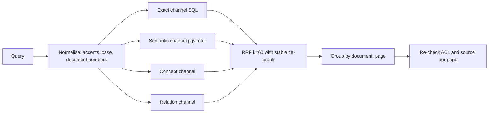

# Design: Search and Grounded Q&A

> Spec reconstructed from the implemented code on 2026-11-09. This is not a historical Kiro-generated spec. Evidence is cited by repository path.

## Components

| Concern | Files |
|---|---|
| Keyword search (Search v1) | `backend/app/storage/search.py`, `search_paging.py`, `normalization.py`, migration `0006_search_index`, `0007_normalization_revision` |
| ACL-first retrieval | `storage/authorized_search.py` |
| Comprehensive search and RRF | `storage/comprehensive.py`, `api/v1/comprehensive.py`, migration `0012_comprehensive_search` |
| Vectors | `storage/embeddings.py`, `scripts/build_embeddings.py` |
| Chat retrieval and answer | `storage/chat_retrieval.py`, `storage/relevance.py`, `workflow/fixed_pipeline.py`, `workflow/chat_answer.py`, `api/v1/user.py` |
| Optional rerank | `storage/cross_encoder.py`, `scripts/local_reranker_server.py` |
| UI | `frontend/src/pages/SearchPage.tsx`, `EvidenceChat.tsx`, `components/DocumentCard.tsx` |
| Evaluation | `evaluation/coverage/*`, `scripts/benchmark_search.py` |

## Flow

## Decisions

- Recorded in ADR-005 (Search v1), ADR-006 (accuracy bounds, AI resilience) and ADR-009 (four channels, RRF, rerank optional).
- Reranking measured on 100 documents showed no statistically meaningful gain over plain RRF and cost 32 to 48 s per query on CPU, so RRF stays the default (`docs/evidence/2026-11-07-g5-rerank/REPORT.md`).
- The 8,000 cap, semantic threshold (relative 0.8 in the last reported configuration) and timeouts bound each query; they also bound completeness.

## Known limits

Two required provisions out of 42 were not found in the G5 coverage run; the report attributes them to candidate retrieval (semantic threshold), not ranking. Required provisions and reference queries were drafted by an agent and not confirmed by subject-matter experts.
