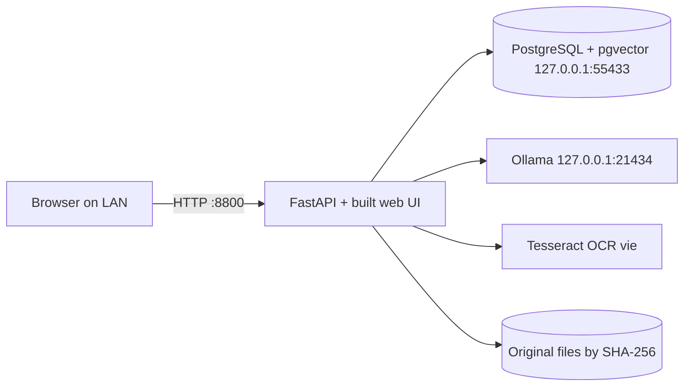

# Design: Windows LAN Portable

> Spec reconstructed from the implemented code on 2026-11-09. This is not a historical Kiro-generated spec. Evidence is cited by repository path.

## Layout (source in `deploy/lan-portable/`)

| Item | Role |
|---|---|
| `Start-Server.bat`, `Stop-Server.bat` | Operator entry points |
| `Backup-Data.bat`, `Restore-Data.bat` | Backup and guarded restore |
| `tools/portable.ps1`, `tools/portable-lib.ps1` | Launcher logic |
| `tools/Allow-LAN-Firewall.bat`, `Status.bat`, `Verify-Package.bat` | Firewall rule, status, checksum check |
| `config/evidence.env` | Ports, bind addresses, AI mode, limits |
| `README.txt` | Operator guide (Vietnamese); `README.en.txt` English |
| `scripts/build-lan-portable.ps1` | Builder, run on the development machine |

The simpler single-folder package lives in `deploy/portable/` (`start.cmd`, `stop.cmd`, `evidence.ps1`, built by `scripts/package-portable.ps1`). It has no OCR (Tesseract) and no desktop app, and it creates an empty database on first run.

## Runtime

## Decisions

- Relative paths only; IP detected at each run, so the folder can move between drives and machines.
- Seed restore instead of re-ingestion, to avoid repeating OCR and embedding.
- The launcher verifies models listed in the release manifest. A model added manually is not covered by the manifest checksum (user guide section 7).

## Verified and unverified (from the reports)

Verified on the development machine: running from another folder or drive, and acceptance tests recorded in the session. Not verified: moving to another physical Windows machine, a pristine Windows install, and antivirus behaviour on a target machine (`deploy/lan-portable/README.txt` section 6; `deploy/windows/README.md`).
