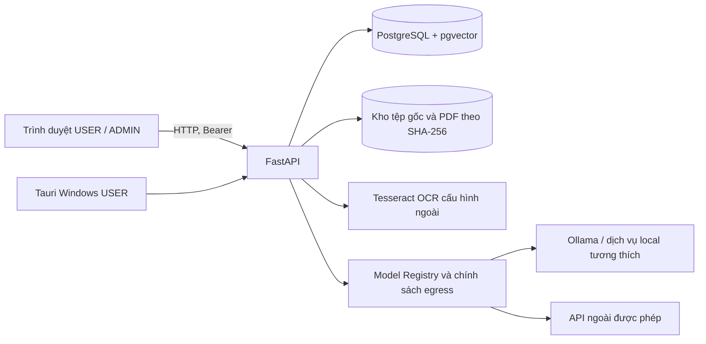
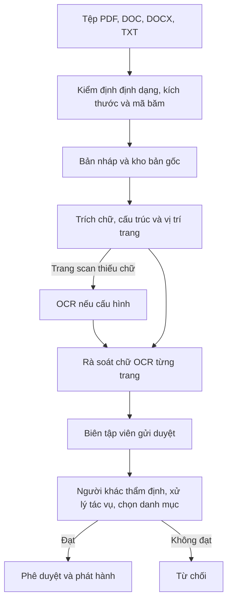
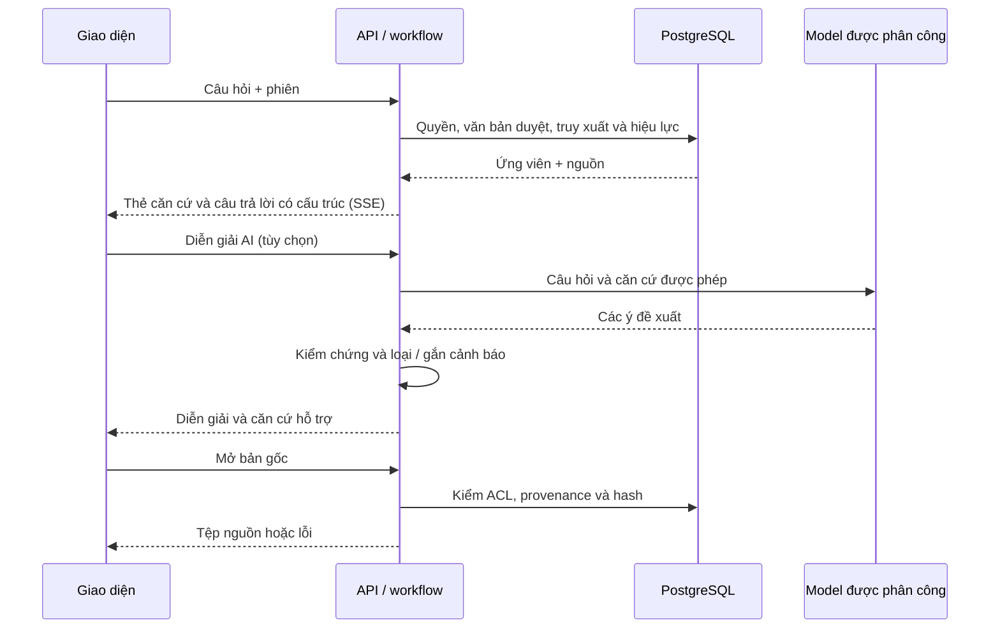

# Tài liệu mô tả hệ thống Evidence RAG

Đối chiếu source ngày 08/11/2026. Tài liệu mô tả mã trong repository; cấu hình, dữ liệu và phiên bản thực tế của từng gói triển khai có thể khác. Hướng dẫn thao tác ở [HUONG_DAN_SU_DUNG_VA_CAU_HINH_AI.md](HUONG_DAN_SU_DUNG_VA_CAU_HINH_AI.md).

## Mục lục

1. [Mục tiêu và phạm vi](#1-mục-tiêu-và-phạm-vi)
2. [Kiến trúc](#2-kiến-trúc)
3. [Người dùng, quản trị và phân quyền](#3-người-dùng-quản-trị-và-phân-quyền)
4. [Nhập và duyệt tài liệu](#4-nhập-và-duyệt-tài-liệu)
5. [Hỏi đáp, tìm kiếm và diễn giải](#5-hỏi-đáp-tìm-kiếm-và-diễn-giải)
6. [Truy xuất, hiệu lực và chỉ mục](#6-truy-xuất-hiệu-lực-và-chỉ-mục)
7. [Model Registry và AI](#7-model-registry-và-ai)
8. [Dữ liệu và bảo mật](#8-dữ-liệu-và-bảo-mật)
9. [Triển khai và vận hành](#9-triển-khai-và-vận-hành)
10. [Giới hạn và kiểm chứng](#10-giới-hạn-và-kiểm-chứng)

## 1. Mục tiêu và phạm vi

Evidence RAG hỗ trợ tra cứu văn bản tiếng Việt có căn cứ. Người dùng hỏi hoặc tìm trong kho được cấp quyền, xem đoạn và vị trí nguồn rồi mở tệp gốc. Diễn giải AI là thao tác riêng, dựa trên căn cứ đã truy xuất và được kiểm tra tự động; kết quả vẫn cần người có chuyên môn đối chiếu. Ứng dụng không tự tạo thẩm quyền pháp lý cho một kết luận hay biến một bản nháp thành nguồn đã duyệt.

Đối tượng gồm người tra cứu; biên tập viên nhập và chuẩn bị tài liệu; người thẩm định nguồn, OCR và hiệu lực; quản trị viên tài khoản, danh mục và AI; kiểm toán viên xem nhật ký. Một tài khoản có thể mang nhiều vai trò, nhưng thao tác cụ thể vẫn chịu kiểm tra quyền và phạm vi tài liệu.

## 2. Kiến trúc

React/TypeScript trong `frontend/` cung cấp Hỏi đáp, Tìm kiếm và Admin Portal; Tauri trong `src-tauri/` là vỏ desktop USER. `backend/app/` chứa API FastAPI, xác thực, tài liệu, workflow, tìm kiếm, hiệu lực và registry. PostgreSQL lưu trạng thái nghiệp vụ, quyền, trích đoạn, chỉ mục, vector và audit; kho tệp lưu bản PDF và nguồn gốc. Backend gọi OCR hoặc model qua cấu hình; máy trạm không kết nối trực tiếp cơ sở dữ liệu. `backend/app/migrations/` chứa migration tiến và lùi, `deploy/` và `scripts/` chứa nguồn triển khai/vận hành.

## 3. Người dùng, quản trị và phân quyền

| Vai trò | Chức năng và giới hạn |
|---|---|
| USER | Đăng nhập, hỏi đáp, tìm kiếm, xem căn cứ và mở tệp được phép; quyền đọc được lọc theo ACL, không theo vai trò một cách đơn thuần. |
| CURATOR | Nhập tệp, tạo nháp, kiểm tra/trích xuất lại, gửi duyệt. Người tạo không tự phê duyệt nháp của mình. |
| REVIEWER | Rà soát tác vụ nguồn và trang OCR, chọn danh mục, ghi chú, duyệt hoặc từ chối; xử lý đề xuất hiệu lực và nhãn. |
| SYS_ADMIN | Quản lý danh mục, tài khoản, vai trò và quyền theo danh mục; quản lý registry, phân công AI và embedding. SYS_ADMIN không mặc nhiên có quyền đọc mọi nội dung hoặc hỏi đáp. |
| AUDITOR | Xem chức năng kiểm toán theo quyền được cấp; không suy ra quyền sửa cấu hình AI hay đọc mọi tài liệu. |

Backend kiểm tra phiên, quyền thao tác RBAC và phạm vi ABAC/ACL ở phía server, trước truy xuất và trước khi mở trích dẫn. Danh mục có cờ cho phép xử lý từ xa: quyền tài khoản, chính sách vận hành và cấu hình model vẫn là các điều kiện độc lập. Quản trị có thể tạo/sửa danh mục, xóa mềm và thu hồi ACL; quản lý tài khoản, vai trò, trạng thái và phạm vi; giao diện thay đổi theo quyền thực tế.

## 4. Nhập và duyệt tài liệu

Upload tạo phiên bản và mã SHA-256; trùng byte bị chặn, trùng nội dung có cảnh báo. Với PDF có lớp chữ, bộ trích xuất tạo các nút và liên kết văn bản đến trang, đoạn nguồn. Word/TXT được chuyển thành PDF có lớp chữ để xử lý và trích dẫn thống nhất, đồng thời giữ tệp gốc và hash riêng; Word chỉ chứa ảnh không được OCR như PDF scan. `.doc` giả dạng HTML/RTF và văn bản rỗng có thể bị từ chối.

Với trang PDF scan, OCR chạy khi runtime được cấu hình, có chẩn đoán và xử lý xoay trang; chữ OCR phải được reviewer đối chiếu ảnh gốc và xác nhận từng trang trước khi dùng làm căn cứ. Tọa độ của chữ OCR được mô tả tới trang, không nên hiểu là vị trí chính xác từng chữ. Hàng đợi hiển thị tác vụ cần rà soát; người duyệt chọn danh mục, ghi chú, giải quyết tác vụ còn mở rồi phê duyệt hoặc từ chối. Quy trình không tự phê duyệt.

Parser tạo cây Chương/Mục/Điều/Khoản/Điểm khi nhận diện được, lưu nhãn trích dẫn, quan hệ cha và các span nguồn theo trang; khoản dài hoặc qua nhiều trang có thể có nhiều đoạn neo. Các trường hợp mơ hồ cần rà soát. Tệp nguồn bất biến theo hash; khi mở, backend kiểm lại quyền, phiên bản, nguồn và SHA-256 thay vì tin đường dẫn do trình duyệt cung cấp.

## 5. Hỏi đáp, tìm kiếm và diễn giải

### Hỏi đáp có căn cứ

1. USER gửi câu hỏi từ giao diện; API xác thực, xác định phạm vi được phép và phân tích cụm từ, số hiệu hoặc Điều được nêu.
2. Backend truy xuất ứng viên trong kho đã duyệt, lọc quyền và hiệu lực, kiểm nguồn và chọn căn cứ. Kết quả trả qua luồng SSE; giao diện có dừng/thử lại và quản lý nội dung phiên trong RAM.
3. Câu trả lời có cấu trúc được dựng từ metadata và căn cứ, kèm thẻ văn bản, Điều/Khoản/Điểm, đoạn trích và tình trạng hiệu lực. Trường hợp chỉ nhắc đến chủ đề được phân biệt với điều khoản trực tiếp. Câu hỏi đòi hỏi mức phạt, thời hạn hoặc vấn đề chặt mà không có khoản phù hợp có thể trả “chưa tìm thấy”, không suy đoán.
4. **Mở văn bản gốc** gọi API trích dẫn; PDF mở ở trang liên quan, Word/TXT tải tệp đã nạp. Quyền và hash được kiểm lại khi mở.

### Tìm kiếm văn bản

Trang tìm theo nghĩa, đủ các từ hoặc chính xác cụm từ; có bộ lọc danh mục, loại văn bản, ngày hiệu lực và phạm vi thời gian. Kết quả nhóm theo văn bản, hiển thị các khoản khớp và phân trang. Khớp một phần hoặc văn bản hết hiệu lực được trình bày theo nhóm/trạng thái riêng tùy kết quả. Tìm theo nghĩa phụ thuộc chỉ mục và model embedding khả dụng; các kênh từ khóa vẫn có thể hoạt động khi kênh này không khả dụng. Giới hạn và thông báo khi số lượng lớn không đồng nghĩa với đã duyệt hết toàn bộ kho.

### Diễn giải AI

Nút **Diễn giải AI** lấy tập căn cứ liên quan đến câu hỏi, phân biệt vấn đề cần trả lời với nội dung chỉ cùng chủ đề và gửi các khoản được chọn tới model của giai đoạn `summarize`. Mỗi ý trả về được đối chiếu mã căn cứ, con số, ngày, nhãn Điều/Khoản, chủ đề, mức hỗ trợ và dấu hiệu phủ định/ngoại lệ; ý không đạt có thể bị loại hoặc đánh dấu cần đối chiếu. Giao diện hiển thị câu trả lời, số dẫn, phần chưa đủ căn cứ, căn cứ hỗ trợ và thông tin kiểm tra; **Diễn giải tiếp** xử lý thêm văn bản chưa xử lý. Model lỗi hoặc không có đủ căn cứ không làm biến mất các căn cứ gốc. Kiểm tra bằng quy tắc không bảo đảm diễn giải đúng về pháp lý.

## 6. Truy xuất, hiệu lực và chỉ mục

Backend kết hợp các kênh lexical như cụm từ, từ khóa có/không dấu, tiêu đề, số hiệu và kênh ngữ nghĩa khi có embedding. RRF hợp nhất thứ hạng các kênh; rerank bằng LLM hoặc cross-encoder là tùy chọn, không nên mặc định rằng mọi bản đang bật. Cấu hình được báo cáo gần nhất dùng RRF, ngưỡng ngữ nghĩa tương đối 0,8 và tắt rerank; cấu hình thực tế phải kiểm tra tại máy chạy. Các giới hạn ứng viên, thời gian và đồng thời nhằm giữ hệ thống đáp ứng; chúng cũng giới hạn độ đầy đủ của từng truy vấn.

Hiệu lực được mô hình hóa bằng khoảng thời gian, trạng thái xác minh và quan hệ sửa đổi/thay thế. Hệ thống phân biệt đề xuất máy đọc với trạng thái đã xác minh, cho reviewer xử lý trong mục **Hiệu lực**; một thông tin chưa xác minh không được trình bày như kết luận chắc chắn. Truy xuất chọn phiên bản phù hợp theo thời điểm và chính sách đang dùng; đối chiếu lịch sử có thể hiển thị kết quả khác tìm mặc định.

Embedding biến nút đã duyệt thành vector lưu trong PostgreSQL/pgvector với chỉ mục HNSW theo model và số chiều. Khi đổi model, preflight thử kết nối, vector, chiều, quyền và số nút; sau xác nhận, worker tạo/bổ sung vector, xây và kiểm chỉ mục mới. Chỉ chuyển khi kiểm tra thành công; chỉ mục cũ được giữ và tiếp tục phục vụ trong thời gian tạo. Có thể tạm dừng, tiếp tục, thử lại hoặc hủy tác vụ. Nút được duyệt sau đó có thể được bổ sung; model câu hỏi phải khớp chỉ mục đang phục vụ.

## 7. Model Registry và AI

Registry lưu hồ sơ model: adapter, endpoint, model ID, khả năng, phiên bản, vùng dữ liệu, trạng thái phê duyệt và kết nối; route gắn từng chức năng với hồ sơ theo chế độ. Giao diện chia **1. Mô hình AI**, **2. Phân công AI**, **Embedding** và **Nhật ký Kiểm toán**. Hồ sơ Local hỗ trợ Ollama hoặc endpoint tương thích vLLM/llama.cpp; API hỗ trợ nhà cung cấp tương thích được cấu hình. Kiểm tra thử đánh giá cấu hình, egress, khóa, kết nối và phản hồi model; lưu được phép ở trạng thái chưa sẵn sàng khi người quản trị chọn rõ.

Phân công có model chính và tùy chọn dự phòng/nâng cấp trong giới hạn chính sách; model lỗi hoặc quá thời gian có thể bị bỏ qua và luồng trả về giảm chức năng. Đổi model **Diễn giải AI** thay route sinh văn bản, không tạo lại vector. Đổi model **Embedding** cần quy trình tạo/kiểm chỉ mục nêu trên. Gửi ra API ngoài còn phụ thuộc chế độ API, allowlist endpoint, chính sách egress và quyền dữ liệu; không hiểu “đã lưu hồ sơ” là chắc chắn có thể gửi mọi tài liệu.

## 8. Dữ liệu và bảo mật

| Nhóm | Nội dung chính |
|---|---|
| Danh tính và quyền | Tài khoản, vai trò, danh mục và ACL, phiên; mật khẩu băm scrypt, khóa sau nhiều lần sai, chính sách đổi mật khẩu. |
| Kho văn bản | Document/version, metadata, hash và provenance, bản gốc, nháp, tác vụ duyệt, nút cấu trúc và span nguồn. |
| Tìm kiếm | Trường chuẩn hóa, chỉ mục từ khóa, vector/model/số chiều, trạng thái chỉ mục và tác vụ embedding. |
| Hiệu lực | Trạng thái, ngày, quan hệ và lịch sử rà soát/đề xuất. |
| Quản trị | Hồ sơ model, route, trạng thái kiểm tra, audit có liên kết hash. |

API dùng Bearer token; kiểm quyền phía server và kiểm lại tại điểm mở nguồn. Khóa API nhập qua Admin Portal được mã hóa bằng Windows DPAPI gắn tài khoản chạy server khi kho khóa khả dụng, không trả lại khóa qua API; chuyển tài khoản Windows có thể cần nhập lại. Chế độ LAN Portable dùng HTTP: thông tin đăng nhập và khóa gửi từ trình duyệt không được TLS bảo vệ trên đường truyền, chỉ sử dụng trong mạng tin cậy hoặc triển khai bảo vệ truyền tải phù hợp. Dữ liệu phiên hỏi đáp theo thiết kế ở RAM; không coi đây là cơ chế sao lưu.

## 9. Triển khai và vận hành

`deploy/lan-portable/` chứa nguồn launcher Windows LAN: khởi động/dừng server, PostgreSQL/pgvector, Ollama và kiểm sẵn sàng; máy trạm truy cập web theo địa chỉ LAN in ra. PostgreSQL và Ollama được thiết kế nghe loopback, cổng web có thể nghe LAN. Gói cụ thể cần có runtime/model/tessdata, dữ liệu và manifest phù hợp: source launcher không chứng minh mọi gói hiện có đã chứa đủ thành phần hay cập nhật cùng revision source.

Backup tạo bản chụp DB và kho tệp kèm hash; restore kiểm bản sao, yêu cầu xác nhận và giữ bản dữ liệu trước phục hồi theo launcher. Cần bảo vệ bản sao lưu như dữ liệu nghiệp vụ. Quy trình thao tác chi tiết và giới hạn từng gói xem [hướng dẫn sử dụng](HUONG_DAN_SU_DUNG_VA_CAU_HINH_AI.md) và `deploy/lan-portable/README.txt`.

## 10. Giới hạn và kiểm chứng

- Chưa có cơ sở kết luận ứng dụng đã nghiệm thu nghiệp vụ hay bộ Gold được chuyên gia xác nhận. Mức bao phủ và chất lượng phụ thuộc kho, quyền, metadata, hiệu lực và câu hỏi.
- Báo cáo source ngày 08/11 ghi đã thử OCR scan, model Ollama local, UI Chrome và bộ kiểm thử; đây là bằng chứng lịch sử, không phải kiểm thử lại trong lần biên soạn này. Báo cáo Model Registry ghi chưa thử OpenAI/Gemini thật và chưa kiểm trong Tauri.
- Báo cáo Portable ghi đã thử đổi thư mục/ổ trên máy phát triển, chưa xác nhận chuyển sang máy Windows vật lý khác; tính sẵn có của model, runtime và dữ liệu cần kiểm tra gói thực tế.
- OCR có thể sai, đặc biệt số hiệu và điều kiện; reviewer phải đối chiếu. Kiểm tra diễn giải tự động không thay thế thẩm định pháp lý. Có giới hạn truy xuất, timeout, đồng thời và thiếu chỉ mục có thể ảnh hưởng kết quả.
- Nguồn chi tiết: [trạng thái triển khai](implementation-status.md), [báo cáo AI/OCR](evidence/2026-11-08-ai-ocr/REPORT.md), [Model Registry](evidence/2026-11-08-model-registry-ui/REPORT.md), [Embedding](evidence/2026-11-07-embedding-admin/REPORT.md), [threat model](threat-model.md) và source tương ứng. Các báo cáo có ngày khác nhau; ưu tiên mã và cấu hình đang triển khai khi có khác biệt.
