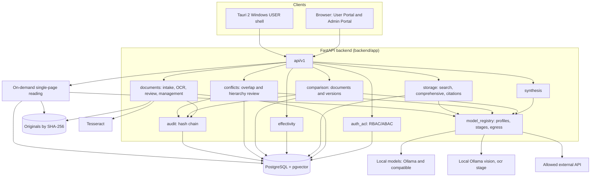

# Architecture Overview

**Language / Ngôn ngữ:** [Tiếng Việt](../vi/ARCHITECTURE_OVERVIEW.md) · English

A short architecture overview for reviewers, written on 2026-11-09 from the repository code and documents; Kiro-use dates and spec update history were added on 2026-11-11; one-page reading/OCR AI flows were updated on 2026-11-17; Document Comparison and Conflict & Authority Review were updated on 2026-11-27. Details: [System description](SYSTEM_DESCRIPTION.md), the ADRs in `docs/architecture-decisions/` (Vietnamese) and the specs in `.kiro/specs/`.

## Components

## Main flows

1. **Intake**: file → format and hash check → draft → extraction/OCR → tree and page spans → human review (a different person) → approval → effectivity proposals → snapshot.
2. **Lookup**: query → normalisation → ACL in SQL → four channels fused with RRF → grouped results → evidence cards.
3. **Open a source**: evidence ID → ACL, availability, version and SHA-256 re-check → PDF page or original file.
4. **AI interpretation** (optional): permitted evidence → `summarize` model → code checks → answer with supporting evidence.
5. **Read one scanned page in chat**: USER selects a document/page → API checks ACL and revision → prefers stored text; if image reading is needed, it renders only that page → local Ollama vision profile → temporary unverified output, without changing sources or vectors. The worker is disabled by default.
6. **Admin OCR correction**: CURATOR selects a page → AI creates a proposal → user compares/edits → apply as a new draft → a different REVIEWER checks and approves.
7. **Document comparison**: USER picks one of 3 modes (versions, base vs. amending/supplementing, cross-document) → API checks ACL → aligns clauses and extracts deterministic normative signals → per-page original view or optional citation-checked AI summary.
8. **Conflict & authority review**: USER selects 2–20 documents or 1 category → API/worker runs deterministic clause matching and evaluates `legal_authority_rules` → optional AI screening runs only when all source categories allow remote processing → CURATOR/REVIEWER triages in Admin, creating `draft` amendment proposals only.

## Principles and where they live

| Principle | Where |
|---|---|
| Permission before retrieval | `storage/authorized_search.py` |
| Quotes come from stored text | `storage/citations.py`, `evidence/validators.py`, `synthesis/checks.py` |
| Immutable, hashed originals | `documents/provenance.py` |
| Separation of duties in approval | `documents/review.py`, `documents/management_access.py` |
| Two-axis effectivity; human-only "verified" | `effectivity/resolver.py`, ADR-008 |
| Egress blocked by default; local-only embedding and rerank | `model_registry/stages.py`, ADR-004, ADR-007 |
| Tamper-evident audit | `audit.py` |
| Only the requested page image uses a local profile; output does not become approved evidence automatically | `documents/page_text.py`, `documents/ocr_ai_jobs.py`, `model_registry/runtime.py` |
| Deterministic diff with quote verification; per-page original check enforces ACL/SHA-256 | `analysis/signals.py`, `comparison/`, `api/v1/compare.py` |
| Conflict findings & hierarchy are advisory; triage writes `draft` proposals only | `conflicts/precedence.py`, `conflicts/detector.py`, `conflicts/worker.py`, `api/v1/conflicts.py` |

## Deployment shapes

- Development stack: `scripts/start-local-stack.ps1` (optionally `-Lan`).
- Clean portable package: `deploy/portable/`.
- Offline LAN package with local models: `deploy/lan-portable/`.

The source now includes a one-page OCR AI flow (tested with `qwen3.5:4b`), Document & Version Comparison, and Conflict & Authority Review (updated 2026-11-27); the active model remains a Model Registry setting. Portable r4 has not been rebuilt from this source. See the [2026-11-17 review report](../evidence/qwen35-upgrade/REVIEW_FIXES_2026-11-17.md) and [implementation status](../implementation-status.md) (Vietnamese).

## How Kiro fits

Per the project owner, Kiro (Claude Sonnet 5.5 and Claude Opus 5.5) continued to be used through the 2026-11-11 snapshot; Kiroween remains open until its 2026-12-04 deadline. The stored logs cover 7 sessions from 2026-11-05 through the 2026-11-09 review on one machine. See [`KIRO_WORK_SUMMARY.en.md`](../../KIRO_WORK_SUMMARY.en.md) for evidence and owner-confirmed work. The `.kiro/specs` were initially reconstructed on 2026-11-09; effectivity and citation-pinning specs were updated on 2026-11-11. OCR and Model Registry specs were synchronized to the upgraded source on 2026-11-17, outside the recorded Kiro sessions.
