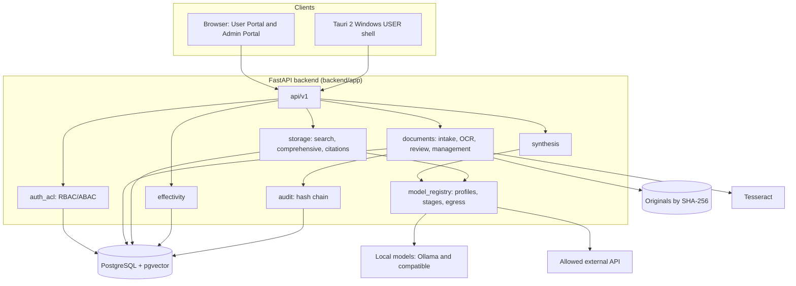

# Architecture Overview

**Language / Ngôn ngữ:** [Tiếng Việt](../vi/ARCHITECTURE_OVERVIEW.md) · English

A short overview for reviewers, written on 2026-11-09 from the repository code and documents. Details: [System description](SYSTEM_DESCRIPTION.md), the ADRs in `docs/architecture-decisions/` (Vietnamese) and the specs in `.kiro/specs/`.

## Components

## Main flows

1. **Intake**: file → format and hash check → draft → extraction/OCR → tree and page spans → human review (a different person) → approval → effectivity proposals → snapshot.
2. **Lookup**: query → normalisation → ACL in SQL → four channels fused with RRF → grouped results → evidence cards.
3. **Open a source**: evidence ID → ACL, availability, version and SHA-256 re-check → PDF page or original file.
4. **AI interpretation** (optional): permitted evidence → `summarize` model → code checks → answer with supporting evidence.

## Principles and where they live

| Principle | Where |
|---|---|
| Permission before retrieval | `storage/authorized_search.py` |
| Quotes come from stored text | `storage/citations.py`, `evidence/validators.py`, `synthesis/checks.py` |
| Immutable, hashed originals | `documents/provenance.py` |
| Separation of duties in approval | `documents/review.py`, `documents/management_access.py` |
| Two-axis effectivity; human-only "verified" | `effectivity/resolver.py`, ADR-008 |
| Egress blocked by default; local-only embedding and rerank | `model_registry/stages.py`, ADR-004, ADR-007 |
| Tamper-evident audit | `audit.py` |

## Deployment shapes

- Development stack: `scripts/start-local-stack.ps1` (optionally `-Lan`).
- Clean portable package: `deploy/portable/`.
- Offline LAN package with local models: `deploy/lan-portable/`.

## How Kiro fits

Kiro (Claude Sonnet 5.5 and Claude Opus 5.5) was used from 2026-10-30 to 2026-11-09 per the project owner. Logs on hand cover 7 sessions from 2026-11-05 on one machine. See [`KIRO_WORK_SUMMARY.en.md`](../../KIRO_WORK_SUMMARY.en.md) for what is evidenced, what rests on the owner's confirmation and what is reconstructed. The `.kiro/specs` in this repository describe the code as implemented and were reconstructed on 2026-11-09.
