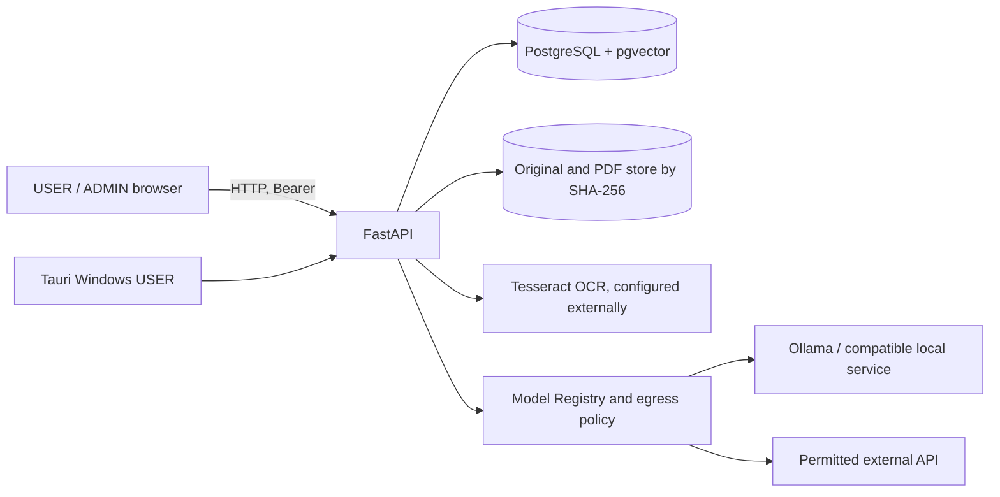
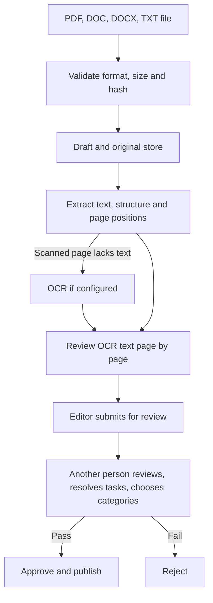
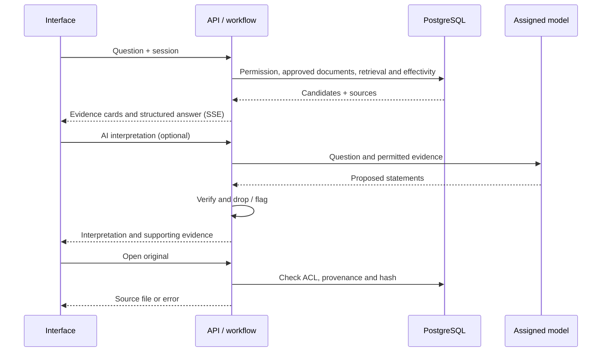

# Evidence RAG System Description

**Language / Ngôn ngữ:** [Tiếng Việt](../TAI_LIEU_MO_TA_HE_THONG.md) · English

English counterpart of `docs/TAI_LIEU_MO_TA_HE_THONG.md` (the Vietnamese original). Checked against the source on 2026-11-08. This document describes the code in the repository; configuration, data and versions of an actual deployment package may differ. Step-by-step operation is in [USER_ADMIN_AND_AI_GUIDE.md](USER_ADMIN_AND_AI_GUIDE.md).

## Contents

1. [Purpose and scope](#1-purpose-and-scope)
2. [Architecture](#2-architecture)
3. [Users, administration and permissions](#3-users-administration-and-permissions)
4. [Document intake and review](#4-document-intake-and-review)
5. [Q&A, search and interpretation](#5-qa-search-and-interpretation)
6. [Retrieval, effectivity and indexes](#6-retrieval-effectivity-and-indexes)
7. [Model Registry and AI](#7-model-registry-and-ai)
8. [Data and security](#8-data-and-security)
9. [Deployment and operation](#9-deployment-and-operation)
10. [Limits and verification](#10-limits-and-verification)

## 1. Purpose and scope

Evidence RAG supports grounded lookup of Vietnamese documents. Users ask or search the store they are permitted to read, see the passage and its source location, then open the original file. AI interpretation is a separate action based on retrieved evidence and checked automatically; a qualified person must still verify the result. The application does not create legal authority for a conclusion and does not turn a draft into an approved source.

The audience is: lookup users; editors who ingest and prepare documents; reviewers of sources, OCR and effectivity; administrators of accounts, categories and AI; auditors who read the log. One account may hold several roles, but each action is still checked against permission and document scope.

## 2. Architecture

React/TypeScript in `frontend/` provides Q&A, Search and the Admin Portal; Tauri in `src-tauri/` is the USER desktop shell. `backend/app/` holds the FastAPI API, authentication, documents, workflow, search, effectivity and the registry. PostgreSQL stores business state, permissions, extracts, indexes, vectors and audit; the file store keeps PDFs and provenance. The backend calls OCR or models through configuration; client machines never connect to the database directly. `backend/app/migrations/` holds forward and rollback migrations; `deploy/` and `scripts/` hold deployment and operation sources.

## 3. Users, administration and permissions

| Role | Functions and limits |
|---|---|
| USER | Log in, ask, search, view evidence and open permitted files; read access is filtered by ACL, not by role alone. |
| CURATOR | Ingest files, create drafts, verify/re-extract, submit for review. The creator does not approve their own draft. |
| REVIEWER | Review source tasks and OCR pages, choose categories, add notes, approve or reject; handle effectivity proposals and labels. |
| SYS_ADMIN | Manage categories, accounts, roles and per-category permissions; manage the registry, AI assignment and embedding. SYS_ADMIN does not by default read all content or use Q&A. |
| AUDITOR | View audit functions as granted; no implied right to change AI configuration or read all documents. |

The backend checks the session, RBAC action permission and ABAC/ACL scope on the server, before retrieval and before opening a citation. A category has a flag allowing remote processing; account permission, operating policy and model configuration remain independent conditions. Administrators can create/edit categories, soft-delete and revoke ACLs; manage accounts, roles, status and scope; the interface changes with the actual permissions.

## 4. Document intake and review

An upload creates a version and a SHA-256; byte-identical files are blocked, content duplicates produce a warning. For text-layer PDFs the extractor creates nodes and links text to pages and source spans. Word/TXT are converted to a text-layer PDF so processing and citation are uniform, while the original and its own hash are kept; a Word file holding only images is not OCR'd like a scanned PDF. A `.doc` that is really HTML/RTF, and empty text, may be rejected.

For scanned PDF pages, OCR runs when the runtime is configured, with diagnostics and rotation handling; the reviewer must compare OCR text with the scan and confirm each page before it is used as evidence. OCR coordinates are described to page level and should not be read as exact word positions. The queue shows tasks needing review; the reviewer chooses categories, adds notes, resolves open tasks, then approves or rejects. The process never approves automatically.

The parser builds a Chapter/Section/Article/Clause/Point tree where it can, stores citation labels, parent links and per-page source spans; a long or multi-page clause may have several anchor spans. Ambiguous cases need review. Source files are immutable by hash; on opening, the backend re-checks permission, version, source and SHA-256 instead of trusting a path from the browser.

### Document management

The Admin Portal has a paginated document list, search by number or title, and filters by body, type, issue date, approval status, effectivity and lookup status. SYS_ADMIN manages the list and lookup status store-wide. Permission to view source files, OCR and the Article/Clause/Point tree is checked separately. For documents with an assigned scope, the system uses category ACL or document ACL. A REVIEWER approves corrections in categories where they hold approval permission. A CURATOR edits their own drafts and resubmits them for another person to review.

For a correction that already has categories, the reviewer needs approval permission on all assigned categories. Changing categories while a correction is being approved is rejected so the reviewer reloads and checks. SYS_ADMIN's list may show store-wide metadata, while content and original files require scoped access permission.

Editing metadata or OCR text of an approved version creates a new draft that reuses the immutable original. After the corrected version is approved, the previous version of the same file is withdrawn from lookup and kept in history. A new file can be ingested into the same document through the existing intake flow. A version from a new file becomes searchable from the confirmed issue date, or from the approval date if there is no issue date. Hand-edited OCR text must be re-confirmed page by page. Node-level effectivity relations pointing to a withdrawn version go back into the review queue; old node-level attestations are marked for re-verification. Metadata and action history use the hash-chained audit log. OCR text before and after editing is stored separately in PostgreSQL.

While a correction awaits approval, the previously approved version keeps serving lookup if the document is active and the user still has permission. Editing a draft that is awaiting approval returns it to draft and requires resubmission. A review revision number detects actions from a stale screen.

Suspending lookup and soft deletion keep the source file, vectors, categories and history. After restoring a deleted document, an earlier suspension flag stays in force. Lookup status is independent of legal effectivity. Migration `0016` adds the management fields and a lookup-version counter in PostgreSQL. Q&A, search, AI interpretation and the citation API re-check accessibility. Old result sets expire when the counter changes across backend processes. Indexes and embedding models continue to be managed by the existing Model Registry flow.

## 5. Q&A, search and interpretation

### Grounded Q&A

1. A USER sends a question from the interface; the API authenticates, determines the permitted scope and analyses any phrase, document number or Article mentioned.
2. The backend retrieves candidates from the approved store, filters by permission and effectivity, checks sources and selects evidence. Results stream over SSE; the interface has stop/retry and manages session content in RAM.
3. A structured answer is built from metadata and evidence, with a document card, Article/Clause/Point, excerpt and effectivity status. Provisions that merely mention the topic are distinguished from direct provisions. A question about a penalty, deadline or other strict matter with no suitable clause may return "not found" instead of a guess.
4. **Open original** calls the citation API; PDFs open at the relevant page, Word/TXT download the uploaded file. Permission and hash are re-checked on open.

### Document search

The page searches by meaning, all words or exact phrase, with filters for category, document type, effectivity date and time range. Results are grouped by document, show matching clauses and are paged. Partial matches or expired documents appear in separate groups or states depending on the result. Semantic search depends on an available index and embedding model; keyword channels can still work when it is unavailable. Limits and notices for large counts do not mean the whole store was examined.

### AI interpretation

The **AI interpretation** button takes the evidence relevant to the question, separates what must be answered from what only shares the topic, and sends the selected clauses to the model of the `summarize` stage. Each returned statement is checked against evidence IDs, numbers, dates, Article/Clause labels, topic, level of support and signs of negation/exception; failing statements may be dropped or marked for checking. The interface shows the answer, citation numbers, parts lacking evidence, supporting evidence and check information; **Continue interpreting** processes more unprocessed documents. If the model fails or evidence is insufficient, the original evidence does not disappear. Rule-based checks do not guarantee a legally correct interpretation.

## 6. Retrieval, effectivity and indexes

The backend combines lexical channels such as phrases, accented/unaccented keywords, titles and document numbers with a semantic channel when embeddings exist. RRF fuses the channel rankings; reranking by LLM or cross-encoder is optional, and it should not be assumed enabled everywhere. The most recently reported configuration used RRF, a relative semantic threshold of 0.8 and rerank off; the actual configuration must be checked on the running machine. Candidate, time and concurrency limits keep the system responsive; they also limit the completeness of each query.

Effectivity is modelled with time intervals, verification state and amendment/replacement relations. The system distinguishes a machine proposal from a verified state and lets reviewers handle it in the **Hiệu lực** (Effectivity) section; unverified information is never presented as a firm conclusion. Retrieval picks the version suitable for the date and policy in use; historical comparison may show results different from the default search.

Embedding turns approved nodes into vectors stored in PostgreSQL/pgvector with an HNSW index per model and dimension. When the model changes, preflight tests connectivity, vector output, dimension, permission and node count; after confirmation a worker creates/fills vectors and builds and checks the new index. The switch happens only if checks succeed; the old index is kept and keeps serving during the build. A job can be paused, resumed, retried or cancelled. Nodes approved later can be filled in; the query model must match the serving index.

## 7. Model Registry and AI

The registry stores model profiles: adapter, endpoint, model ID, capabilities, version, data zone, approval status and connection; routes bind each function to a profile per mode. The interface is split into **1. AI models**, **2. AI assignment**, **Embedding** and **Audit log**. Local profiles support Ollama or vLLM/llama.cpp-compatible endpoints; API supports configured compatible providers. A test evaluates configuration, egress, key, connection and model response; saving in a not-ready state is allowed only when the administrator explicitly chooses it.

An assignment has a primary model and an optional fallback/escalation within policy; a model that fails or times out may be skipped and the flow returns reduced functionality. Changing the **AI interpretation** model changes the text-generation route and does not recreate vectors. Changing the **Embedding** model needs the index creation/verification process above. Sending to an external API also depends on API mode, endpoint allow-list, egress policy and data permission; "profile saved" does not mean any document can certainly be sent.

## 8. Data and security

| Group | Main content |
|---|---|
| Identity and permission | Accounts, roles, categories and ACL, sessions; scrypt password hashes, lockout after repeated failures, password change policy. |
| Document store | Document/version, metadata, hash and provenance, originals, drafts, review tasks, structure nodes and source spans. |
| Search | Normalised fields, keyword indexes, vector/model/dimension, index state and embedding jobs. |
| Effectivity | State, dates, relations and review/proposal history. |
| Administration | Model profiles, routes, test state, hash-linked audit. |

The API uses Bearer tokens; permission is checked on the server and again where a source is opened. API keys entered through the Admin Portal are encrypted with Windows DPAPI bound to the server's account when the key store is available, and are never returned through the API; changing the Windows account may require re-entering them. LAN Portable mode uses HTTP: credentials and keys sent from the browser are not protected by TLS in transit, so use it only in a trusted network or add suitable transport protection. By design Q&A session data lives in RAM; do not treat it as a backup mechanism.

## 9. Deployment and operation

`deploy/lan-portable/` holds the Windows LAN launcher source: start/stop of the server, PostgreSQL/pgvector, Ollama and readiness checks; client machines open the web app at the printed LAN address. PostgreSQL and Ollama are designed to listen on loopback, while the web port can listen on the LAN. A concrete package needs the runtime, models, tessdata, data and a suitable manifest: launcher source does not prove that every existing package already contains all components or was updated to the same source revision.

Backup creates a snapshot of the database and file store with hashes; restore verifies the copy, requires confirmation and keeps the pre-restore data according to the launcher. Protect backups like business data. Detailed procedures and per-package limits: see the [user guide](USER_ADMIN_AND_AI_GUIDE.md) and `deploy/lan-portable/README.en.txt`.

## 10. Limits and verification

- There is no basis to conclude that the application passed domain acceptance. No Gold question set is used to score the AI (ADR-010): the AI only assists and the domain staff decide. Coverage and quality depend on the store, permissions, metadata, effectivity and questions.
- The 11-08 source reports state that scanned-PDF OCR, local Ollama models, the Chrome UI and the test suites were tried; this is historical evidence, not re-testing in this documentation pass. The Model Registry report states that real OpenAI/Gemini were not tried and the Tauri shell was not checked.
- The Portable report states that moving to another folder/drive on the development machine was tried; moving to another physical Windows machine is not confirmed. Availability of models, runtime and data must be checked in the actual package.
- OCR can be wrong, especially document numbers and conditions; the reviewer must compare. Automatic interpretation checks do not replace legal review. Retrieval limits, timeouts, concurrency and missing indexes can affect results.
- Detailed sources: [implementation status](../implementation-status.md), [AI/OCR report](../evidence/2026-11-08-ai-ocr/REPORT.md), [Model Registry](../evidence/2026-11-08-model-registry-ui/REPORT.md), [Embedding](../evidence/2026-11-07-embedding-admin/REPORT.md), [threat model](../threat-model.md) and the corresponding source. The reports have different dates; when they differ, prefer the code and configuration actually deployed.
