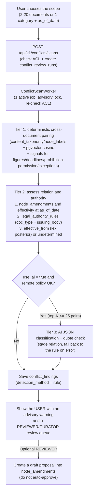

**Language / Ngôn ngữ:** [Tiếng Việt](2026-11-26-so-sanh-van-ban-va-ra-soat-mau-thuan.md) · English

# Implementation plan: Compare 2 documents & Review conflicts and overlaps

> **For agentic workers:** REQUIRED SUB-SKILL: Use superpowers:subagent-driven-development (recommended) or superpowers:executing-plans to implement this plan task-by-task. Steps use checkbox (`- [ ]`) syntax for tracking.

**Goal:** Add two safe legal/administrative comparison capabilities, under the *evidence-first* principle, to Evidence RAG:
1. **Compare 2 documents & their versions** — help the user see the core change quickly between an official document and its amending/supplementing versions, or between 2 different documents of the same kind of content.
2. **Review conflicts, overlaps & authority hierarchy** — automatically compare provisions across documents inside the permitted scope, point out overlap or contradiction, and give an advisory assessment of the amendment relation / authority hierarchy so the user can identify the document that applies.

**Architecture:** **Deterministic-first, bounded AI second**, split into **2 independently delivered phases**:
- **Phase 1 (Document comparison — Tasks C1–C4):** No new DB table, and no LLM is required for the core. Use the `document_nodes` structure (`path`, `citation_label`, `node_type`, `text_original`, `text_folded`), the `document_versions` history (`based_on_version_id`, `retired_at`), the `node_amendments` relations and `node_embeddings` to align on 3 tiers (an explicit amendment link → a normalized structural path that stitches `tiep:N` segments → semantic/lexical similarity for a renumbered Article (Điều) and for an administrative document that has no Article/Clause). Optionally call stage `summarize` (`qwen3.5:4b`) with a numeric/citation check filter (`synthesis/checks.py`).
- **Phase 2 (Conflict and overlap review — Tasks D1–D6):** Add migration `0018` (`legal_authority_rules`, `conflict_review_runs`, `conflict_findings`). A 3-tier pipeline runs on a single-process bounded worker (`ConflictScanWorker`, the same safety model as `OcrAiWorker`): (1) pair cross-document candidates by `content_taxonomy`/`node_labels` + `node_embeddings` (pgvector, no re-embed) + deterministic conflict signals; (2) assess existing amendment relations and authority hierarchy from the rule table `doc_type` + `issuing_body` + `effective_from` (fail safe to `undetermined_requires_review` when ambiguous); (3) an optional AI tier on the top-K candidate pairs (at most 25 pairs) through stage `relation`, which only creates a suggestion waiting for an officer to review and may optionally create a `draft` into `node_amendments`.

**Tech Stack:** Python 3.12, FastAPI, asyncpg, PostgreSQL 16 + pgvector (`qwen3-embedding:0.6b` 1024 dims), Ollama `0.40.15` (`qwen3.5:4b` local), React + TypeScript + Vite + Vitest.

**Spec / basis in the repo:**
- User request (2026-11-26): Feature (1) Compare 2 documents & versions; Feature (2) Review conflicts, overlaps & identify the document of higher authority.
- System handover file: [docs/HOSO_BAN_GIAO.md](../../../docs/HOSO_BAN_GIAO.md) — items **A5** (Compare versions of one Article), **A10** (Compare two documents), **L3** (Conflicts and exceptions), **K11/K12** (effectivity at the lookup date & versions), **C.5–C.9** (evidence-first, ACL/ABAC, Local vs API, no fabrication).

---

## 1. Source state that was checked & Global Constraints

### 1.1. Foundations already in the codebase (verified)

| Component | Actual location | Confirmed value / structure |
|---|---|---|
| Clause tree | `backend/app/documents/tree_parser.py`, `node_writer.py`, `0001_core.sql`, `0009_node_structure.sql` | `document_nodes.path` has a 6-digit order prefix `000001:chuong:I/dieu:5/khoan:2/diem:a`; a node longer than `MAX_NODE_CHARACTERS = 4000` is split into `.../tiep:2`, `tiep:3`; there are `citation_label`, `text_original`, `text_folded`, `page_start`, `page_end`, `node_source_spans`, and the SQL function `node_source_text_valid(node_id)`. |
| Versions & rights | `0016_document_management.sql`, `backend/app/storage/authorized_search.py` | `document_versions` has `version_number`, `based_on_version_id`, `retired_at`, `effective_from`, `publication_date`, `review_status`. `ALLOWED_DOCUMENTS_SQL` and the view `authorized_nodes` filter `deleted_at IS NULL`, `suspended_at IS NULL`, `dv.retired_at IS NULL`, `review_status = 'approved'`. |
| Amendments & effectivity | `0011_effectivity.sql`, `backend/app/effectivity/node_paths.py`, `service.py`, `store.py` | `node_amendments` (`action IN ('modify','replace','add','repeal','repeal_partial','suspend','commence')`, `scope`, `source_document_id`, `target_document_id`, `target_node_id`, `target_path`, `review_status`), `node_references` (`basis`, `guidance`, `consolidation`, `citation`), `document_effective_intervals`, `node_effective_intervals`, `load_effectivity()`, `clause_view()`, `can_review()`. |
| Content labels & vectors | `0013_content_groups.sql`, `0001_core.sql`, `0014_embedding_jobs.sql` | 11 `content_taxonomy` groups (`pham_vi_doi_tuong`, `giai_thich_tu_ngu`, `nguyen_tac`, `dieu_kien_tieu_chuan`, `ho_so_giay_to`, `trinh_tu_thu_tuc`, `thoi_han`, `tham_quyen_trach_nhiem`, `quyen_nghia_vu`, `vi_pham_xu_ly`, `hieu_luc_chuyen_tiep`), `node_labels`, `embedding_indices.is_active = TRUE` (`qwen3-embedding:0.6b`, 7,447 vectors). |
| AI checks & Model Registry | `backend/app/synthesis/checks.py`, `backend/app/model_registry/stages.py` | Already has `_facts()`, `check_point()`, `support_score()`, `similarity()`, and the keyword sets `_NEGATION`, `_EXCEPTION`, `_CONDITION`, `_OBLIGATION`, `_PERMISSION`. Existing stages: `answer`, `summarize`, `expand`, `relation`, `label`, `ocr`, `embedding`, `rerank`. |
| Existing document types | `frontend/src/components/documentDisplay.ts`, `AdminPortal.tsx` | `documents.doc_type`: `code`, `law`, `ordinance`, `resolution`, `decree`, `circular`, `joint_circular`, `decision`, `directive`, `consolidated`, `other`. `documents.issuing_body` is free `TEXT`. **There is no authority-hierarchy rule table yet.** |
| Latest migration | `backend/app/migrations/` | Already at `0017_ocr_ai_proposals.sql` (and `.down.sql`). The next migration is **`0018_legal_hierarchy_and_conflict_reviews.sql`**. `backend/tests/test_auth_and_admin_portal.py` checks the migration name list explicitly. |
| Existing UI | `frontend/src/App.tsx`, `pages/AdminPortal.tsx` | The user currently has 2 views `userView: "chat" | "search"`. The Admin Portal has `DraftReviewPanel`, `AdminDocumentManager`, `EffectivityReviewPanel`, `LabelReviewPanel`, `EmbeddingManager`, and AI panels. |

### 1.2. Global Constraints (mandatory across every Task)

1. **Absolute ACL/ABAC security and source integrity:**
   - Every document that takes part in a comparison or a conflict scan must be inside `ALLOWED_DOCUMENTS_SQL` of the current `principal` (`set_config('app.user_id', ..., true)`).
   - Every node shown as a citation must have `n.review_status = 'approved'`, `source_provenance.verified_at IS NOT NULL`, and `node_source_text_valid(n.id)`.
   - When comparing **2 versions of the same document** (for example `v1` with `retired_at IS NOT NULL` against the current `v2`): the parent document must still be inside `ALLOWED_DOCUMENTS_SQL`, and both versions must have `dv.review_status = 'approved'` — **do not open** `draft`, `pending_review`, `rejected`, or a document with `suspended_at` or `deleted_at`.
2. **Local-first / LAN Portable offline mode:**
   - Do not require a new model download; do not require re-embedding the existing 7,447 vectors.
   - When optional AI runs in `API` mode, data may be sent outside only if **every** document in the pair/analysis belongs to a category with `remote_processing_allowed = TRUE` and the user has remote-processing rights; if even 1 document is internal/restricted → use only a local model or return the deterministic result.
3. **Never change legal data or conclude in the user's place:**
   - Comparison and conflict review only read the document store to create a report/finding.
   - Every conflict/overlap finding and every authority assessment shows the advisory label *"Gợi ý tự động — cần chuyên viên thẩm định trước khi áp dụng"* ("Automatic suggestion — an officer must review it before it is applied").
   - A `REVIEWER`/`CURATOR` officer may press to create an amendment proposal from a confirmed finding, but the row written into `node_amendments` is **always `draft`** so it goes through the standard effectivity approval process.
4. **Support both normative documents (Article/Clause/Point) and administrative documents that have no Article/Clause:**
   - Do not assume every document has `dieu:N`. Handle a document that has only `heading`/`paragraph`/`annex`, and a long node split into `tiep:N`, smoothly.
5. **Quality constraints and the repo verification gates:**
   - Do not hard-code an absolute path (`C:\`, `E:\`, `/tmp/`) in source/tests/scripts (`scripts/validate_no_literal_runtime_paths.py`).
   - Every `.sql` migration must have a matching `.down.sql` (`scripts/validate_migrations.py`) and must be updated in `backend/tests/test_auth_and_admin_portal.py`.
   - Every new route uses `dependencies=[Depends(no_store)]`, stays in sync with `docs/openapi.json` (`python scripts/export_openapi.py --check`), and writes `audit_events`.
   - The frontend must not use `dangerouslySetInnerHTML`; every diff highlight is rendered with safe React elements; clear all state in `handleLogout()`.

---

## 2. Review Focus (the material risks tied directly to tests)

Every review/test must prove that the 6 risks below are blocked by a specific test:

| # | Risk / failure mode | How the design blocks it | Verified at |
|---|---|---|---|
| R1 | Leak of a document outside ACL, an unapproved draft, a suspended document (`suspended_at`), or the opposite mistake of blocking an approved historical copy (`retired_at IS NOT NULL`) when comparing `v1` vs `v2` | Split clearly: the parent doc always goes through `ALLOWED_DOCUMENTS_SQL`; a historical version is read only when `dv.review_status = 'approved'`; the conflict-scan worker re-checks the live principal and ACL before running and before returning the result | Task C2, Task C4 (`test_comparison_api_pg.py`), Task D4, Task D5 (`test_conflicts_api_pg.py`) |
| R2 | Inserting one Article renumbers the following Articles (`Điều 5` → `Điều 6`), a node longer than 4,000 characters creates `tiep:2`, or a document with no `Điều` makes the diff report a false 100% delete + add | Stitch `tiep:N` segments of the same parent node before comparing (keep the full list of `node_id`/original pages); 3-tier alignment has a step that recognizes `moved_or_renumbered` by content similarity + labels | Task C1 (`test_comparison_engine.py`), Task C4 |
| R3 | A false "conflict" for a pair of clauses that already has an approved `node_amendments` modify/replace/repeal, a document that has expired, or a clause that states an exception (`"trừ trường hợp"` / "except where") | The precedence tier checks `node_amendments` + `document_effective_intervals` at `as_of_date` **first**; the detector recognizes `_EXCEPTION` cues and attaches `exception_refinement` instead of `contradiction` | Task D2 (`test_legal_precedence.py`), Task D3 (`test_conflict_detector.py`), Task D6 |
| R4 | A wrong authority rank from looking only at `doc_type` (for example a `resolution` of the National Assembly vs the Government vs a People's Council; a `decision` of the Prime Minister vs a Minister vs a unit director; an internal document; a specialized law *lex specialis* vs a general law) | The table `legal_authority_rules` combines `doc_type` + `issuing_body_pattern`; if the document type is ambiguous and does not match `issuing_body`, the effective date is missing, or the bodies are different bodies of the same tier → must return `undetermined_requires_review` + a *lex specialis* warning | Task D2 (`test_legal_precedence.py`) |
| R5 | A multi-document scan overloads CPU/RAM of a LAN Portable machine, exceeds the 30s HTTP timeout, gets stuck on server restart, or is hit by a prompt injection inside PDF content | An asynchronous job through `ConflictScanWorker` (advisory lock, at most 1 concurrent run, queue of at most 10, ceilings `max_documents=20`, `max_pairs=120`, `max_ai_pairs=25`); startup recovers a stuck job as `CONFLICT_SCAN_INTERRUPTED`; the AI prompt receives plain text with no tool, a hard JSON schema + a quote check | Task D4, Task D5 (`test_conflicts_api_pg.py`) |
| R6 | Creating an amendment link from a conflict finding auto-approves `approved` or exceeds `can_review` | Must check `can_review(conn, user_id, [doc_a_id, doc_b_id])`; the row written into `node_amendments` always has `review_status = 'draft'`, `proposed_by = 'conflict_review'`, and an `audit_events` row | Task D5 (`test_conflicts_api_pg.py`) |

---

## 3. Overall architecture and processing flow

### 3.1. Phase 1 — Flow for comparing 2 documents and versions

```mermaid
flowchart LR
    U["User chooses the comparison source\n(2 versions / base-amendment / 2 documents)"] --> API["POST /api/v1/compare/documents\nor GET /api/v1/nodes/{id}/diff"]
    API --> ACL["Check ALLOWED_DOCUMENTS_SQL\n+ verified_at + node_source_text_valid"]
    ACL --> LOAD["Load the node tree + stitch tiep:N\n+ load node_amendments and effectivity"]
    LOAD --> ALIGN["3-tier alignment\n1. explicit node_amendments\n2. normalized path (dieu/khoan/diem)\n3. text / embedding similarity"]
    ALIGN --> DIFF["Vietnamese token diff + signal extract\n(figures, deadlines, obligation/prohibition, exceptions)"]
    DIFF --> RESP["Return the deterministic result immediately (< 1s)\n+ Open original page links for sides A/B"]
    RESP -.->|"Optional button"| AI["POST /api/v1/compare/summarize\n(stage summarize + checks.py validator)"]
```

### 3.2. Phase 2 — Flow for conflict, overlap and authority review

---

## 4. Planned file map

### Phase 1 — Compare documents and versions

| Status | File | Main responsibility |
|---|---|---|
| Create | `backend/app/analysis/__init__.py` | Shared package of normative-content analysis utilities for Phase 1 and Phase 2 |
| Create | `backend/app/analysis/signals.py` | Normalize a structural key (`normalize_structural_key`), stitch `tiep:N` segments (`stitch_logical_nodes`), extract figures/deadlines/rates/currency/obligation-prohibition/exceptions by reusing `synthesis/checks.py` |
| Create | `backend/app/comparison/__init__.py` | Export the public API of the comparison module |
| Create | `backend/app/comparison/align.py` | 3-tier alignment engine (explicit amendment → structural key → lexical/embedding similarity + detection of `moved_or_renumbered`) |
| Create | `backend/app/comparison/diff.py` | Vietnamese token-level diff (returns a list of `DiffSegment`), compute `ChangeSignals` (figures/deadlines/obligations/exceptions that changed) and the summary statistics |
| Create | `backend/app/comparison/service.py` | ACL-safe reads (including approved historical versions), join `node_amendments` + `load_effectivity`, compare 2 documents / 2 versions and the A5 node diff |
| Create | `backend/app/comparison/summarize.py` | Optional AI summary of the core change (`summarize` stage), check `remote_processing_allowed` on both documents, post-check with `check_point()`, deterministic fallback |
| Create | `backend/app/api/v1/comparison.py` | Router `/api/v1/documents/{id}/versions`, `/api/v1/compare/documents`, `/api/v1/nodes/{id}/diff`, `/api/v1/compare/summarize` |
| Modify | `backend/app/main.py` | Mount `comparison_router` |
| Modify | `backend/app/api/v1/errors.py` | Add Vietnamese error messages for the `COMPARE_*` error codes |
| Create | `backend/tests/test_comparison_engine.py` | Unit tests for `signals.py`, `align.py`, `diff.py` |
| Create | `backend/tests/test_comparison_api_pg.py` | PostgreSQL integration tests for ACL, historical versions, A5/A10, AI summary fallback and egress |
| Create | `frontend/src/components/CompareDiffView.tsx` | XSS-safe side-by-side / inline diff, change-signal badges, buttons to open the original page of both sides |
| Create | `frontend/src/pages/DocumentComparePage.tsx` | “So sánh văn bản” (Compare documents) screen (3 selection modes, filters, statistics, AI summary button, copy report) |
| Create | `frontend/src/pages/DocumentComparePage.test.tsx` | Vitest for the comparison modes, filter, XSS escaping, AI fallback |
| Modify | `frontend/src/App.tsx`, `api/client.ts`, `types.ts`, `styles.css`, `components/DocumentCard.tsx`, `pages/SearchPage.tsx` | Add the tab `"So sánh văn bản"` ("Compare documents"), API client/types, a quick-compare button on a document card, reset state on logout |

### Phase 2 — Review conflicts, overlaps and authority hierarchy

| Status | File | Main responsibility |
|---|---|---|
| Create | `backend/app/migrations/0018_legal_hierarchy_and_conflict_reviews.sql` | Tables `legal_authority_rules` (+ standard seed), `conflict_review_runs`, `conflict_findings`, indexes and constraints |
| Create | `backend/app/migrations/0018_legal_hierarchy_and_conflict_reviews.down.sql` | Clean rollback of migration `0018` |
| Modify | `backend/tests/test_auth_and_admin_portal.py` | Add `"0018_legal_hierarchy_and_conflict_reviews.sql"` to the expected migration list |
| Create | `backend/app/conflicts/__init__.py` | Export the public API of the conflict-review module |
| Create | `backend/app/conflicts/precedence.py` | 5-step authority assessment (`evaluate_precedence`), normalize the issuing body, notes on *lex posterior* / *lex specialis* / `undetermined_requires_review` |
| Create | `backend/app/conflicts/detector.py` | Pair cross-document candidates (`content_taxonomy`/`node_labels` + `node_embeddings` cosine + lexical) and detect conflict/overlap/exception signals |
| Create | `backend/app/conflicts/store.py` | CRUD for `conflict_review_runs`, `conflict_findings`, `legal_authority_rules`, `request_id` idempotency, queue limits, creating a `node_amendments` draft |
| Create | `backend/app/conflicts/ai_screen.py` | Optional AI classification and explanation tier (hard JSON schema, prompt-injection resistance, citation post-check and `remote_processing_allowed`) |
| Create | `backend/app/conflicts/worker.py` | `ConflictScanWorker` runs in the background as a single process (advisory lock, 1 active scan, live ACL check, cancel, restart recovery) |
| Create | `backend/app/api/v1/conflicts.py` | USER router (`/api/v1/conflicts/scans*`), REVIEWER (`/api/v1/admin/conflicts/findings*`), SYS_ADMIN (`/api/v1/admin/authority-rules*`) |
| Modify | `backend/app/config.py`, `backend/app/main.py`, `backend/app/api/v1/errors.py` | Env settings `EVIDENCE_CONFLICT_SCAN_*`, start/stop `ConflictScanWorker` in `lifespan`, register `conflicts_router` and the `CONFLICT_*` error codes |
| Modify | `docs/openapi.json` | Export the updated OpenAPI schema (`scripts/export_openapi.py`) |
| Create | `backend/tests/test_legal_precedence.py` | Full unit tests for authority hierarchy, ambiguous cases, *lex posterior*, the *lex specialis* caveat, `node_amendments` |
| Create | `backend/tests/test_conflict_detector.py` | Unit tests for detecting deadlines, figures, prohibition-permission, exceptions, overlaps |
| Create | `backend/tests/test_conflicts_api_pg.py` | PostgreSQL integration tests for the worker, ACL revocation, cancellation, queue caps, review triage and creating a `draft` amendment |
| Create | `frontend/src/components/ConflictFindingCard.tsx` | Card for 1 finding: side-by-side A/B + Open original page + authority box + advisory warning |
| Create | `frontend/src/pages/ConflictReviewPage.tsx` | “Rà soát mâu thuẫn” (Conflict review) screen for the USER (choose scope, polling progress, cancel, type/severity filters) |
| Create | `frontend/src/components/ConflictTriagePanel.tsx` | Review queue for `REVIEWER`/`CURATOR` in the Admin Portal (confirm / dismiss / create a `draft` amendment proposal) |
| Create | `frontend/src/components/AuthorityRulesPanel.tsx` | Administration of the authority-rule table for `SYS_ADMIN` in the Admin Portal |
| Create | `frontend/src/pages/ConflictReviewPage.test.tsx` | Vitest for the conflict-review UI, the advisory warning, polling/cancel, triage rights |
| Modify | `frontend/src/App.tsx`, `pages/AdminPortal.tsx`, `api/client.ts`, `types.ts`, `styles.css` | Mount the tab `"Rà soát mâu thuẫn"` ("Conflict review") for the USER and the administration sub-tabs in `AdminPortal` |
| Create | `scripts/smoke_compare_and_conflicts.py` | An aggregate smoke/eval script with no hard-coded path, checking both features end to end |
| Modify | `docs/HUONG_DAN_NGUOI_DUNG.md`, `docs/HUONG_DAN_QUAN_TRI.md`, `docs/en/USER_GUIDE.md`, `docs/en/ADMIN_GUIDE.md` | User and operator guides for the 2 new features |

---

## PHASE 1 — Feature 1: Compare 2 documents and their versions

### Task C1: Shared normative-signal extractor and the deterministic alignment/diff engine

**Files:**
- Create: `backend/app/analysis/__init__.py`
- Create: `backend/app/analysis/signals.py`
- Create: `backend/app/comparison/__init__.py`
- Create: `backend/app/comparison/align.py`
- Create: `backend/app/comparison/diff.py`
- Test: `backend/tests/test_comparison_engine.py`

**Core design:**
1. **`backend/app/analysis/signals.py`** (reuse `_facts`, `_NEGATION`, `_EXCEPTION`, `_CONDITION`, `_OBLIGATION`, `_PERMISSION`, `_has_accented` from `backend/app/synthesis/checks.py` and `fold_text`/`normalize_text` from `backend/app/vietnamese_nlp/unicode_norm.py`):
   - `normalize_structural_key(raw_path: str | None) -> str`: drop the order prefix `^\d{6}:` (produced by `node_writer.py`), drop the suffix `/tiep:\d+`, and extract the canonical key `dieu:<num>(/khoan:<num>)?(/diem:<letter>)?` when present; for a document with no `Điều` (Article), keep the key after the numeric prefix (for example `chuong:I`, `muc:2`, `phuluc:1`, `doan`).
   - `LogicalNode` (immutable dataclass): one logical unit after stitching segments `tiep:2`, `tiep:3` of the same parent node:
     - `primary_node_id: UUID`, `member_node_ids: tuple[UUID, ...]`, `node_type: str`, `structural_key: str`, `raw_path: str`, `citation_label: str | None`, `label_original: str | None`, `text_original: str`, `text_folded: str`, `page_start: int | None`, `page_end: int | None`, `ordinal: int`, `embedding: tuple[float, ...] | None = None`, `taxonomy_codes: tuple[str, ...] = ()`.
   - `extract_normative_signals(text: str) -> NormativeSignals`:
     - `deadlines: tuple[DeadlineSpan, ...]` — a regex that catches `"(\d+(?:[.,]\d+)?)\s*(ngày làm việc|ngày|tháng|năm|giờ)"` with normalized context `(value_num, unit_normalized, raw_text)`.
     - `amounts_and_percents: tuple[QuantitySpan, ...]` — catch currency (`đồng`, `triệu đồng`, `tỷ đồng`), percent (`%`), and quantity thresholds.
     - `dates: frozenset[tuple[int, int, int]]` and `plain_numbers: frozenset[str]` (call `_facts()`).
     - `deontic_polarities: frozenset[str]` — the set of labels from `{"prohibition", "obligation", "permission", "negation"}` (distinguish `"nghiêm cấm"` / `"không được"` as `prohibition`, different from `"được phép"` / `"có quyền"` as `permission` and `"phải"` / `"bắt buộc"` as `obligation`).
     - `has_exception: bool` (`_EXCEPTION`), `has_condition: bool` (`_CONDITION`), `exception_phrases: tuple[str, ...]`.
     - `subject_tokens: frozenset[str]` — content tokens with stopwords removed, used to score subject similarity.
2. **`backend/app/comparison/align.py`**:
   - Input: `left_nodes: list[LogicalNode]`, `right_nodes: list[LogicalNode]`, `amendment_links: Sequence[AmendmentLink]` (approved links from `node_amendments` that connect `node_a` ↔ `node_b` or `target_path` directly), `mode: Literal["versions", "amendment_pair", "cross_document"]`.
   - Align on 3 tiers, in decreasing priority:
     - **Tier 1 (`explicit_amendment`):** Pairs with a direct link in `node_amendments` (`target_node_id` or a match on the normalized `target_path`) between A and B. Always attach metadata `amendment_action` (`modify`, `replace`, `repeal`, `add`, ...), `valid_from`, `source_quote`.
     - **Tier 2 (`structural_key`):** Match 1-1 by `structural_key` (`dieu:N/khoan:M/diem:a`) on nodes not yet paired. In mode `versions` or `cross_document` when `dieu:N` exists: if 2 nodes share an Article number but content similarity is too low (`< 0.12`) while node A matches another node in B very highly (`>= 0.65`) (a new Article was inserted and pushed `Điều 5` → `Điều 6`), move automatically to Tier 3 to detect `moved_or_renumbered` instead of pairing them wrongly.
     - **Tier 3 (`semantic_lexical`):** For a node not yet paired (a renumbered Article, an administrative document with no Article, or 2 documents of different structure): compute the best pairing score (greedy/Hungarian on a small matrix) as `0.55 * cosine(emb_a, emb_b) + 0.45 * lexical_jaccard(a, b)` (or `1.0 * lexical_jaccard` + a heading bonus when there is no embedding). Pair only when the score is `>= 0.42` (mode `versions`) or `>= 0.52` (mode `cross_document`). Remaining nodes are `removed` (only in A) or `added` (only in B).
   - Keep natural reading order (topological order by `ordinal` of A, and insert B's `added` nodes at the neighboring position).
3. **`backend/app/comparison/diff.py`**:
   - Tokenize Vietnamese keeping accented words and whitespace/newlines (`re.findall(r"\S+|\s+", text_original)`) → `difflib.SequenceMatcher(a=tokens_a, b=tokens_b, autojunk=False)` → compress adjacent pieces into `list[DiffSegment(op: Literal["equal", "delete", "insert"], text: str)]`.
   - Compute `change_kind: Literal["unchanged", "modified", "moved_or_renumbered", "added", "removed"]`:
     - Compare `normalize_text` (ignore a pure whitespace difference so OCR/whitespace noise is not reported as a content edit, unless the letters actually changed).
     - When `structural_key` differs between A and B but Tier 3 paired them → attach `moved_or_renumbered` (with the flag `content_also_modified: bool`).
   - Compute `ChangeSignals` for each edited pair: lists `deadlines_changed`, `amounts_changed`, `dates_changed`, `modality_shifted` (for example `permission → obligation` or `permission → prohibition`), `exception_changed`, and `impact_level: Literal["high", "medium", "low"]` (`high` if a deadline/amount of money/penalty/obligation-prohibition/exception changed).

- [x] **Step 1: Write the unit-test suite `backend/tests/test_comparison_engine.py` first (TDD)**
  - Test `stitch_logical_nodes`: a long node with `000003:dieu:2/khoan:1` + `000004:dieu:2/khoan:1/tiep:2` is stitched into 1 `LogicalNode` whose `member_node_ids` contains both UUIDs, `page_start=1, page_end=2`, and is not falsely reported as a newly added segment when v2 is shorter than 4,000 characters.
  - Test `align_nodes` for 3 scenarios:
    1. The same structure `Điều 1..3`, a deadline change `"10 ngày"` → `"15 ngày"` and a change `"được phép"` → `"nghiêm cấm"` → returns `change_kind="modified"`, `impact_level="high"`, with `deadlines_changed` and `modality_shifted`.
    2. Inserting a new `Điều 2` shifts the old `Điều 2` to the new `Điều 3` → Tier 3 correctly recognizes `moved_or_renumbered` (it does not report a 100% deletion of Article 2 plus a 100% addition of Article 3).
    3. An administrative document with no `Điều`/`Khoản` (only `heading`/`paragraph` `I.`, `II.`) → aligns correctly by heading + vocabulary, with no error.
    4. A pair with an explicit `AmendmentLink` (`action="replace"`, `target_path="dieu:5/khoan:2"`) → Tier 1 wins, `alignment_method="explicit_amendment"`.
  - Test `compute_token_diff`: keep Vietnamese NFC diacritics, do not cut in the middle of a word, and ignore extra spaces when scoring `unchanged`.

- [x] **Step 2: Run the new test to confirm it fails for the right reason (the module does not exist yet)**
  - Run: `pytest backend/tests/test_comparison_engine.py -q`

- [x] **Step 3: Implement `backend/app/analysis/signals.py`, `backend/app/comparison/align.py`, `backend/app/comparison/diff.py`**
  - Reuse the helpers in `backend/app/synthesis/checks.py` and `backend/app/vietnamese_nlp/unicode_norm.py` directly (do not duplicate a stopword table or a regex without need).

- [x] **Step 4: Run the unit test again and confirm PASS**
  - Run: `pytest backend/tests/test_comparison_engine.py -q`

---

### Task C2: ACL-safe comparison service, API endpoints and the optional AI summary

**Files:**
- Create: `backend/app/comparison/service.py`
- Create: `backend/app/comparison/summarize.py`
- Create: `backend/app/api/v1/comparison.py`
- Modify: `backend/app/main.py`
- Modify: `backend/app/api/v1/errors.py`
- Modify: `docs/openapi.json`

**API and service contract:**
1. **`GET /api/v1/documents/{document_id}/versions`** (`require_user`, `no_store`):
   - Check that `document_id` is in `ALLOWED_DOCUMENTS_SQL`. If not → `404 DOCUMENT_NOT_FOUND` (do not reveal that it exists).
   - Return:
     - `document`: `{id, title, document_number, doc_type, issuing_body}`.
     - `versions`: the `document_versions` that have `review_status = 'approved'` and `source_provenance.verified_at IS NOT NULL`, ordered by `version_number DESC`, including `{id, version_number, publication_date, effective_from, is_current: retired_at IS NULL, based_on_version_id, approved_at}`.
     - `related_amendment_documents`: documents **that are also in `ALLOWED_DOCUMENTS_SQL`** with an approved `node_amendments` link that amends/supplements/replaces this document, or that this document amends → so the UI can suggest a 1-click comparison of the base document with the amending document.
2. **`POST /api/v1/compare/documents`** (`require_user`, `no_store`):
   - Request body (`extra="forbid"`):
     - `mode: Literal["versions", "amendment_pair", "cross_document"]`
     - `left_document_id: UUID`, `left_version_id: UUID | None = None`
     - `right_document_id: UUID`, `right_version_id: UUID | None = None`
     - `as_of_date: date | None = None` (default `date.today()`)
     - `only_changes: bool = False`
     - `include_embeddings: bool = True` (read only vectors that already exist from `embedding_indices.is_active = TRUE`; do not call an embedding model at request time)
   - Checks:
     - If `mode == "versions"`: require `left_document_id == right_document_id`, `left_version_id != right_version_id`.
     - Both `left_document_id` and `right_document_id` must be in `ALLOWED_DOCUMENTS_SQL`.
     - The selected version (or the latest active version if `version_id` is `None`) must have `review_status = 'approved'` and `source_provenance.verified_at IS NOT NULL`.
     - Load only nodes that satisfy `n.review_status = 'approved'` and `node_source_text_valid(n.id)`.
     - Safety limit: at most `MAX_COMPARE_NODES = 1500` nodes per side (return `422 COMPARE_DOCUMENT_TOO_LARGE` with a suggestion to choose a Chapter/Article scope if exceeded).
   - Response:
     - `comparison_id` (UUID from the request), `mode`, `as_of_date`, `left_doc` and `right_doc` (metadata + effectivity status from `load_effectivity`), `summary` (`total_items`, `added`, `removed`, `modified`, `moved_or_renumbered`, `unchanged`, `high_impact_changes`, `explicit_amendment_links`, `deterministic_highlights: list[str]`), `items: list[ComparisonItem]` (each item has `item_key`, `change_kind`, `alignment_method`, `alignment_score`, `impact_level`, `signals`, `amendment_link`, `left` `{node_id, member_node_ids, citation_label, structural_key, text_original, page_start, page_end}`, `right` `{...}`, `diff_segments`).
     - Write `audit_events` (`action = 'document.compare'`).
3. **`GET /api/v1/nodes/{node_id}/diff`** (`require_user`, `no_store`) — completes spec **A5**:
   - Check that `node_id` belongs to a document in `ALLOWED_DOCUMENTS_SQL` and `node_source_text_valid(node_id)`.
   - Return the timeline of that Article/Clause:
     - The previous version of the same document (through `based_on_version_id` and a `structural_key` match),
     - Approved `node_amendments` that affect `node_id` (from another document in `ALLOWED_DOCUMENTS_SQL`),
     - A detailed diff between the previous copy and the current copy, plus the effectivity status at `as_of_date`.
4. **`POST /api/v1/compare/summarize`** (`require_user`, `no_store`) — optional supporting AI:
   - Receives the same parameters for choosing 2 documents/versions as `/compare/documents` (the server recomputes the list of changed items so it **never trusts a diff sent by the client**).
   - Check the `LOCAL` / `API` policy: if `API` mode is selected and either document (A or B) belongs to a category with `remote_processing_allowed = FALSE`, or the user has no remote right → lock the remote route, run only a local model, or return the deterministic fallback with the reason `remote_blocked_by_document_policy`.
   - Call stage `summarize` on the top `15` most important changed items (`high_impact` first), requesting structured JSON `{"executive_summary": str, "key_changes": [{"point": str, "item_keys": [str], "evidence_ids": [str]}]}`.
   - Post-check each `point` through `check_point()` in `synthesis/checks.py` (every number, date, document number and Article/Clause must appear in the evidence of side A or side B; a business conclusion is forbidden). A point that fails the check is marked `"needs_review"` or dropped; if the model is off, errors, or times out → return `mode_used: "deterministic_fallback"` with `deterministic_highlights` (do not return a 500 that interrupts the experience).

- [x] **Step 1: Add the `COMPARE_*` error codes to `backend/app/api/v1/errors.py`**
  - The codes: `COMPARE_SAME_TARGET`, `COMPARE_VERSION_NOT_FOUND`, `COMPARE_DOCUMENT_TOO_LARGE`, `COMPARE_MODE_MISMATCH`.

- [x] **Step 2: Implement `backend/app/comparison/service.py` and `backend/app/comparison/summarize.py`**
  - Ensure 100% of queries run in a transaction with `set_config('app.user_id', principal.id, true)` and check `node_source_text_valid(n.id)`.

- [x] **Step 3: Implement `backend/app/api/v1/comparison.py` and register the router in `backend/app/main.py`**

- [x] **Step 4: Update and check `docs/openapi.json`**
  - Run: `python scripts/export_openapi.py && python scripts/export_openapi.py --check`

---

### Task C3: Document-comparison UI and the quick entry point

**Files:**
- Create: `frontend/src/components/CompareDiffView.tsx`
- Create: `frontend/src/pages/DocumentComparePage.tsx`
- Modify: `frontend/src/types.ts`
- Modify: `frontend/src/api/client.ts`
- Modify: `frontend/src/App.tsx`
- Modify: `frontend/src/components/DocumentCard.tsx`
- Modify: `frontend/src/pages/SearchPage.tsx`
- Modify: `frontend/src/styles.css`

**UI/UX design (following the system's evidence-first principle):**
1. **Navigation on the top bar (`frontend/src/App.tsx`):**
   - Extend `userView` to `"chat" | "search" | "compare"` (`"conflicts"` is added in Task D6).
   - Add the navigation button `"So sánh văn bản"` ("Compare documents") in `<nav aria-label="Khu vực tra cứu">` ("Lookup area").
   - Add state `comparePreset?: { mode: CompareMode; leftDocumentId?: string; rightDocumentId?: string }` so that from `SearchPage` / `DocumentCard` a user who presses `"So sánh"` ("Compare") on a document opens the Compare tab with that document already selected on side A.
   - Ensure `handleLogout()` clears `comparePreset` and returns `userView` to `"chat"`.
2. **Screen `DocumentComparePage.tsx`:**
   - A clear selector of 3 modes:
     - **Compare versions** (the same document: choose the document → call `/api/v1/documents/{id}/versions` → choose the old version and the new version).
     - **Compare base – amendment/supplement** (choose the base document → suggest the linked amending/supplementing documents in `related_amendment_documents`, or allow a manual choice).
     - **Compare 2 documents on the same topic** (choose side A and side B from a search box over the permitted store; filter quickly by `doc_type`).
   - A result summary bar: count cards `Thêm mới` (Added), `Bị bãi bỏ/Xóa` (Repealed/Removed), `Sửa đổi` (Modified), `Đổi vị trí/số Điều` (Moved/renumbered Article), `Không đổi` (Unchanged) + a warning of how many changes concern **deadlines / numbers / obligations – prohibitions**.
   - A filter toolbar: the switch `"Chỉ xem điểm thay đổi"` ("Show changes only"), a filter by impact (`Tất cả` / All, `Thay đổi cốt lõi (số liệu, thời hạn, nghĩa vụ)` / Core changes (figures, deadlines, obligations)), and a display switch `Song song (2 cột)` (Side by side, 2 columns) ↔ `Gộp dòng (Inline)` (Inline).
   - An optional block `"Tóm tắt thay đổi cốt lõi bằng AI"` ("Summarize the core changes with AI") (called only when the user presses the button, with a clear label *"Tóm tắt tham khảo từ AI — đã đối chiếu số liệu với căn cứ"* ("Advisory summary from AI — figures were checked against the evidence") or the deterministic fallback).
   - A button `"Sao chép báo cáo đối chiếu (Markdown)"` ("Copy the comparison report (Markdown)") that produces a plain-text report citing the document number, Article/Clause and the page numbers of both sides.
3. **Component `CompareDiffView.tsx`:**
   - Render `diff_segments` entirely with JSX (`<del className="diff-del">`, `<ins className="diff-ins">`, ``), and never use `dangerouslySetInnerHTML`.
   - Each comparison card shows: a change-kind badge, an alignment-method badge (for example *"Liên kết sửa đổi đã duyệt"* ("Approved amendment link") / *"Khớp số Điều"* ("Article-number match") / *"Khớp nội dung — đổi số hiệu"* ("Content match — number changed")), a change-signal chip (`Thời hạn: 10 ngày → 15 ngày` ("Deadline: 10 days → 15 days"), `Tính bắt buộc thay đổi` ("Obligation changed")), an `OpenOriginalButton` for **both side A (source page A)** and **side B (source page B)**, and the `EffectivityBadges` of each document.

- [x] **Step 1: Add TypeScript types (`frontend/src/types.ts`) and API functions (`frontend/src/api/client.ts`)**
  - Functions: `getDocumentVersions`, `compareDocuments`, `getNodeDiff`, `summarizeComparison`.

- [x] **Step 2: Implement `CompareDiffView.tsx`, `DocumentComparePage.tsx` and the CSS in `styles.css`**

- [x] **Step 3: Mount the tab `"So sánh văn bản"` in `App.tsx` and the button `"So sánh"` on `DocumentCard.tsx` / `SearchPage.tsx`**

- [x] **Step 4: Run the TypeScript build check**
  - Run: `npm --prefix frontend run build`

---

### Task C4: Phase 1 integration and regression tests (PostgreSQL + Vitest)

**Files:**
- Create: `backend/tests/test_comparison_api_pg.py`
- Create: `frontend/src/pages/DocumentComparePage.test.tsx`

- [x] **Step 1: Write `backend/tests/test_comparison_api_pg.py`**
  - Test on real PostgreSQL (following the pattern of the existing `*_pg.py` files in `backend/tests/`):
    1. **ACL isolation (R1):** User A, who is not in the category of doc X, receives `404 DOCUMENT_NOT_FOUND` when calling `/versions`, `/compare/documents`, `/nodes/{id}/diff`, `/compare/summarize`.
    2. **Historical version vs draft/suspension (R1):** A doc has `v1` (`approved`, `retired_at IS NOT NULL`), `v2` (`approved`, `retired_at IS NULL`) and `v3` (`draft`) → comparing `v1` vs `v2` returns `200 OK` with the correct diff; a comparison that includes `v3` returns `404 COMPARE_VERSION_NOT_FOUND`; setting `suspended_at` on the doc → `404 DOCUMENT_NOT_FOUND`.
    3. **`node_amendments` links and A5 `/nodes/{id}/diff`:** Create an amending document with an approved `node_amendments` → `/versions` lists it in `related_amendment_documents`, `/compare/documents` pairs it on Tier 1 `explicit_amendment`, `/nodes/{id}/diff` returns the correct Article/Clause amendment history.
    4. **A changed Article number and a document with no Article (R2):** Test real data written through `write_nodes` with the prefix `000001:` and a `tiep:2` segment.
    5. **AI summary and the egress policy:** A mocked AI answer that contains a number not present on side A/B is marked/dropped by `check_point`; when 1 of the 2 documents has `remote_processing_allowed = FALSE` in `API` mode → the remote endpoint is not called, and the flow moves to local or a clean fallback.

- [x] **Step 2: Write `frontend/src/pages/DocumentComparePage.test.tsx`**
  - Test the mode-selection flow, the filter `"Chỉ xem điểm thay đổi"` ("Show changes only"), the side-by-side/inline switch, the hostile string `` inside diff content being fully escaped as text, the AI summary button showing the fallback when the API reports local/deterministic, and that `handleLogout` clears comparison state.

- [x] **Step 3: Run all Phase 1 tests and the quality gates**
  - Run: `pytest backend/tests/test_comparison_engine.py backend/tests/test_comparison_api_pg.py -q`
  - Run: `npm --prefix frontend test -- --run src/pages/DocumentComparePage.test.tsx`
  - Run: `python scripts/export_openapi.py --check && python scripts/validate_no_literal_runtime_paths.py`

> **Phase 1 handover stop:** Task C4 is complete. The system has Feature 1 in full (Compare 2 documents and versions + the A5 node diff), ready for independent acceptance before Phase 2.

---

## PHASE 2 — Feature 2: Review conflicts, overlaps and authority hierarchy

### Task D1: Migration `0018` — Authority table, scan jobs and conflict findings

**Files:**
- Create: `backend/app/migrations/0018_legal_hierarchy_and_conflict_reviews.sql`
- Create: `backend/app/migrations/0018_legal_hierarchy_and_conflict_reviews.down.sql`
- Modify: `backend/tests/test_auth_and_admin_portal.py`

**SQL schema design (`0018_legal_hierarchy_and_conflict_reviews.sql`):**
1. **`legal_authority_rules`** — A configurable authority-hierarchy rule table (instead of an immutable hard-code):
   - `id UUID PRIMARY KEY DEFAULT gen_random_uuid()`
   - `rule_code TEXT NOT NULL UNIQUE`
   - `doc_type TEXT NOT NULL` (matches `documents.doc_type`: `code`, `law`, `ordinance`, `resolution`, `decree`, `circular`, `joint_circular`, `decision`, `directive`, `consolidated`, `other`)
   - `issuing_body_pattern TEXT` (a regex/normalized string that ignores diacritics; `NULL` = the default for that `doc_type` when no more specific rule matches)
   - `authority_rank INTEGER NOT NULL CHECK (authority_rank BETWEEN 1 AND 1000)` (a smaller number → higher legal authority)
   - `authority_tier_label TEXT NOT NULL` (for example `"Luật / Bộ luật (Quốc hội)"` ("Law / Code (National Assembly)"), `"Nghị định (Chính phủ)"` ("Decree (Government)"), `"Thông tư (Bộ / cơ quan ngang Bộ)"` ("Circular (Ministry / ministerial-level agency)"), `"Quyết định (Thủ tướng Chính phủ)"` ("Decision (Prime Minister)"), ...)
   - `is_ambiguous_without_issuer BOOLEAN NOT NULL DEFAULT FALSE` (set `TRUE` for `resolution`, `decision`, `directive`, `other` on the fallback rule — force the system **not to guess the rank** if `issuing_body` is missing or does not match)
   - `match_priority INTEGER NOT NULL DEFAULT 100` (check a rule with a specific `issuing_body_pattern` first)
   - `note TEXT`, `is_active BOOLEAN NOT NULL DEFAULT TRUE`, `updated_by UUID REFERENCES users(id)`, `updated_at TIMESTAMPTZ NOT NULL DEFAULT now()`.
   - **Default seed following the Vietnamese Law on Promulgation of Legal Normative Documents (VBQPPL) (a reference; an administrator may edit it for an internal unit document):**
     - Rank `10`: `code` (Code), `law` (Law) — National Assembly.
     - Rank `15`: `resolution` whose `issuing_body` matches `quoc hoi` (a resolution of the National Assembly).
     - Rank `20`: `ordinance` (an ordinance of the Standing Committee of the National Assembly), `resolution` matching `uy ban thuong vu quoc hoi`.
     - Rank `25`: `decision` matching `chu tich nuoc`.
     - Rank `30`: `decree` (a Government decree), `resolution` matching `chinh phu`.
     - Rank `35`: `decision` matching `thu tuong`.
     - Rank `40`: `joint_circular` (a joint circular), `circular` (a circular of a ministry or a ministerial-level agency).
     - Rank `50`: `decision`/`directive` matching `bo ` / `bo truong` / `uy ban nhan dan tinh|thanh pho` / `hdnd tinh|thanh pho`.
     - Rank `60`: `decision`/`directive` matching department/district/internal-unit level.
     - Fallback rules (`issuing_body_pattern IS NULL`, `is_ambiguous_without_issuer = TRUE`) for `resolution`, `decision`, `directive`, `consolidated`, `other`, so the system stays safe when the issuing body is missing.
2. **`conflict_review_runs`** — Manage an asynchronous scan:
   - `id UUID PRIMARY KEY DEFAULT gen_random_uuid()`
   - `requested_by UUID NOT NULL REFERENCES users(id)`
   - `request_id TEXT NOT NULL` (`UNIQUE (requested_by, request_id)` for idempotency)
   - `status TEXT NOT NULL CHECK (status IN ('queued', 'running', 'completed', 'failed', 'cancelled', 'expired'))`
   - `scope_json JSONB NOT NULL` (`document_ids`, `category_id`, `doc_types`, `taxonomy_codes`, `include_expired`)
   - `as_of_date DATE NOT NULL`
   - `use_ai BOOLEAN NOT NULL DEFAULT FALSE`
   - `model_profile_id UUID REFERENCES ai_model_profiles(id) ON DELETE SET NULL`
   - `limits_json JSONB NOT NULL` (`max_documents`, `max_pairs`, `max_ai_pairs`)
   - `progress_total INTEGER NOT NULL DEFAULT 0`, `progress_done INTEGER NOT NULL DEFAULT 0`
   - `summary_json JSONB`
   - `error_code TEXT`, `error_message TEXT`
   - `lease_token UUID`, `lease_expires_at TIMESTAMPTZ`
   - `created_at TIMESTAMPTZ NOT NULL DEFAULT now()`, `started_at TIMESTAMPTZ`, `completed_at TIMESTAMPTZ`, `expires_at TIMESTAMPTZ NOT NULL`
   - Partial unique index: `CREATE UNIQUE INDEX conflict_review_runs_one_running ON conflict_review_runs ((TRUE)) WHERE status = 'running';` (ensures at most **1 scan running at a time** for the whole system, so it does not overload LAN Portable CPU/RAM).
3. **`conflict_findings`** — Each pair of provisions that was found:
   - `id UUID PRIMARY KEY DEFAULT gen_random_uuid()`
   - `run_id UUID NOT NULL REFERENCES conflict_review_runs(id) ON DELETE CASCADE`
   - `document_a_id UUID NOT NULL REFERENCES documents(id) ON DELETE CASCADE`
   - `document_b_id UUID NOT NULL REFERENCES documents(id) ON DELETE CASCADE`
   - `node_a_id UUID NOT NULL REFERENCES document_nodes(id) ON DELETE CASCADE`
   - `node_b_id UUID NOT NULL REFERENCES document_nodes(id) ON DELETE CASCADE`
   - `finding_type TEXT NOT NULL CHECK (finding_type IN ('contradiction', 'overlap', 'exception_refinement', 'superseded_already'))`
   - `severity TEXT NOT NULL CHECK (severity IN ('high', 'medium', 'low'))`
   - `detection_method TEXT NOT NULL CHECK (detection_method IN ('rule', 'rule_plus_ai'))`
   - `similarity_score NUMERIC(5,4)`
   - `shared_labels TEXT[] NOT NULL DEFAULT '{}'`
   - `signals_json JSONB NOT NULL`
   - `precedence_result TEXT NOT NULL CHECK (precedence_result IN ('higher_authority_a', 'higher_authority_b', 'same_tier_newer_a', 'same_tier_newer_b', 'superseded_by_amendment', 'undetermined_requires_review'))`
   - `precedence_basis_json JSONB NOT NULL`
   - `explanation TEXT NOT NULL`
   - `ai_confidence NUMERIC(4,3)`
   - `ai_verified BOOLEAN`
   - `review_status TEXT NOT NULL DEFAULT 'pending' CHECK (review_status IN ('pending', 'confirmed', 'dismissed', 'linked_amendment'))`
   - `reviewed_by UUID REFERENCES users(id)`, `reviewed_at TIMESTAMPTZ`, `review_note TEXT`
   - `linked_amendment_id UUID REFERENCES node_amendments(id) ON DELETE SET NULL`
   - `created_at TIMESTAMPTZ NOT NULL DEFAULT now()`
   - `CHECK (node_a_id <> node_b_id AND document_a_id <> document_b_id)`
   - Indexes on `(run_id, severity, finding_type)` and `(review_status, created_at DESC)`.

- [x] **Step 1: Write `0018_legal_hierarchy_and_conflict_reviews.sql` and `0018_legal_hierarchy_and_conflict_reviews.down.sql`**
- [x] **Step 2: Update the migration list in `backend/tests/test_auth_and_admin_portal.py`**
- [x] **Step 3: Run the migration up/down check**
  - Run: `python scripts/validate_migrations.py`

---

### Task D2: Authority-hierarchy assessor and deterministic precedence

**Files:**
- Create: `backend/app/conflicts/__init__.py`
- Create: `backend/app/conflicts/precedence.py`
- Test: `backend/tests/test_legal_precedence.py`

**Design of `evaluate_precedence(...)` (pure deterministic Python, 100% checkable):**
- Input:
  - `doc_a: DocumentAuthorityMeta`, `doc_b: DocumentAuthorityMeta` (`document_id`, `doc_type`, `issuing_body`, `document_number`, `effective_from`, `publication_date`, `effective_status_at_date`)
  - `rules: Sequence[AuthorityRule]` (loaded from `legal_authority_rules` where `is_active = TRUE`)
  - `approved_amendments: Sequence[AmendmentBetweenPair]` (approved `node_amendments` between A and B that are in effect at `as_of_date`)
- A transparent 5-step algorithm:
  1. **Check an existing amendment/effectivity relation:** If there is an `approved_amendment` from B that affects A (or the reverse) with `action IN ('replace', 'repeal', 'repeal_partial', 'modify', 'suspend')`, OR one side has `effective_status_at_date IN ('expired', 'repealed', 'replaced', 'not_yet_effective')` while the other side is `'effective'` → return `precedence_result = "superseded_by_amendment"`, stating which document is still in effect / which one is amending the other.
  2. **Match an authority rule (`resolve_authority_tier`):** Normalize `issuing_body` through `fold_text()` (for example `"Bộ Tài chính"` → `"bo tai chinh"`, `"Ủy ban Thường vụ Quốc hội"` → `"uy ban thuong vu quoc hoi"`). Walk `rules` that match `doc_type` by `match_priority ASC`: prefer a rule whose `issuing_body_pattern` matches; if only a fallback rule matches and `is_ambiguous_without_issuer = TRUE` → return `tier = None` with the reason `"Loại văn bản cần xác định rõ cơ quan ban hành"` ("This document type needs a clear issuing body").
  3. **Compare authority rank (`rank_a` vs `rank_b`):** If both ranks are known and `rank_a != rank_b` → return `higher_authority_a` (when `rank_a < rank_b`) or `higher_authority_b`, with `basis` recording `rule_code`, `tier_label` and `rank` of both sides and a warning to check constitutionality/legality and the power to issue the document.
  4. **Same authority rank (`rank_a == rank_b`):**
     - Normalize the issuing body to check whether they are **the same issuing authority** (`same_issuing_authority`).
     - If they are the same issuing authority and both have an effective date (`effective_from`, falling back to `publication_date`) that differs → return `same_tier_newer_a` / `same_tier_newer_b` under *a later document (lex posterior)*, **and must attach `caveats: ["Kiểm tra nguyên tắc văn bản chuyên ngành (lex specialis): nếu văn bản ban hành trước là quy định chuyên ngành cụ thể, văn bản sau không tự động thay thế nếu không có điều khoản bãi bỏ/sửa đổi."]`** ("Check the specialized-document principle (lex specialis): if the earlier document is a specific specialized rule, the later document does not automatically replace it unless it contains a repeal or amendment clause.").
     - If they are **different bodies of the same tier** (for example a circular of Ministry A vs a circular of Ministry B) or an effective date is missing → return `undetermined_requires_review` with a clear reason (*"Hai văn bản ngang bậc từ hai cơ quan khác nhau — cần chuyên viên/cơ quan có thẩm quyền đối chiếu phạm vi quản lý"* / "Two documents of the same rank from two different bodies — an officer or a competent body must compare the scope of management").
  5. **Missing basis:** If either side has no known rank (for example `doc_type='other'` or a `resolution`/`decision` with no `issuing_body`) → return `undetermined_requires_review`, and never guess.

- [x] **Step 1: Write `backend/tests/test_legal_precedence.py` first (TDD)**
  - Cover all 8 situations:
    1. `law` (National Assembly) vs `decree` (Government) → `higher_authority_a`.
    2. `decree` (Government) vs `circular` (Ministry of Finance) → `higher_authority_a`.
    3. `resolution` (National Assembly) vs `resolution` (Government) → `higher_authority_a` (proves it does not guess blindly from `doc_type` — R4).
    4. `decision` (Prime Minister) vs `decision` (a department director) → `higher_authority_a`.
    5. `resolution` with no `issuing_body` vs `decree` → `undetermined_requires_review` (R4).
    6. Two `circular` documents of the same `Bộ Tài chính` (Ministry of Finance), `effective_from` 2025 vs 2022 → `same_tier_newer_a` + the `lex specialis` caveat is required.
    7. Two `circular` documents of different ministries (`Bộ Tài chính` vs `Bộ Công Thương`) → `undetermined_requires_review`.
    8. A pair with an `approved_amendment` (`replace`) from B → A → `superseded_by_amendment` regardless of the date (R3).

- [x] **Step 2: Run the new test to confirm it fails**
  - Run: `pytest backend/tests/test_legal_precedence.py -q`

- [x] **Step 3: Implement `backend/app/conflicts/precedence.py`**

- [x] **Step 4: Run the test again and confirm PASS**
  - Run: `pytest backend/tests/test_legal_precedence.py -q`

---

### Task D3: Cross-document candidate pairing and conflict/overlap signal detection

**Files:**
- Create: `backend/app/conflicts/detector.py`
- Test: `backend/tests/test_conflict_detector.py`

**Design of `detector.py` (deterministic, bounded, no re-embed):**
1. **Pre-filter input nodes (`filter_normative_nodes`):**
   - Stitch `tiep:N` segments with `stitch_logical_nodes()` from Task C1.
   - Skip a pure heading node that contains no normative content (`node_type IN ('part','chapter','section','heading')` when the length is < 40 characters), to avoid noise.
   - By default drop a document that has wholly expired at `as_of_date` (`effective_status IN ('expired','repealed','replaced')`) unless the user turns on `include_expired = True`.
2. **Pair cross-document candidates (`generate_candidate_pairs`, always `doc_a != doc_b`):**
   - **Channel 1 — The same content label (`content_taxonomy` / `node_labels`):** Pairs in the same content group (`thoi_han`, `dieu_kien_tieu_chuan`, `tham_quyen_trach_nhiem`, `vi_pham_xu_ly`, `trinh_tu_thu_tuc`, `quyen_nghia_vu`, ...) with a content-keyword overlap score (`subject_overlap >= 0.22`).
   - **Channel 2 — Existing vector similarity (`node_embeddings`):** A pgvector cosine query (`1 - (e1.embedding <=> e2.embedding)`) only over nodes inside the scan scope and the index `is_active = TRUE`, filtered at `similarity >= 0.72` (fall back smoothly to Channel 1 + lexical bigrams if the store has not run embedding).
   - **Deduplicate and hard-cap:** Sort by descending priority, keep at most `max_pairs` (default `120`) and at most `3` best pairs per node so one generic Article does not dominate the whole result.
3. **Analyze signals and classify deterministically (`classify_candidate_pair`):**
   - Check first: if the node pair already has an approved `node_amendments` → set `finding_type = "superseded_already"`, `severity = "low"` (or mark it as clearly resolved so it is not mixed with a real conflict — R3).
   - Extract `NormativeSignals` of both sides from `backend/app/analysis/signals.py` and detect these signal groups:
     - `deadline_divergence` (`severity = high`): the same subject (`subject_overlap >= 0.28`), both set a deadline of the same unit (or a convertible day/month) but the values differ (for example `"05 ngày làm việc"` vs `"10 ngày làm việc"`).
     - `numeric_threshold_divergence` (`severity = high`): the same subject, a different amount of money, penalty, `%` rate, or quota.
     - `deontic_polarity_conflict` (`severity = high`): the same subject, one side has `prohibition` (`nghiêm cấm` / `không được`) while the other has `permission` (`được phép` / `có quyền`) or `obligation` (`phải`) and there is no surrounding exception phrase.
     - `authority_divergence` (`severity = medium`): the same group `tham_quyen_trach_nhiem`, or an authority verb (`do ... quyết định / cấp / phê duyệt / thẩm định`), but the agency names differ.
     - `exception_qualification` (`finding_type = "exception_refinement"`, `severity = low`): there is a difference signal but one side contains an explicit exception phrase (`"trừ trường hợp"`, `"ngoại trừ"`, `"không áp dụng đối với"`) or cites the other document's number directly (`node_references`) → downgrade to `exception_refinement` instead of reporting `contradiction` (R3).
     - `scope_overlap_without_link` (`finding_type = "overlap"`, `severity = medium`): no direct contradiction, but very high semantic similarity (`similarity >= 0.84` or lexical Jaccard `>= 0.55`) between 2 documents that are both in effect and have no `node_amendments`/`node_references` link.
   - A pair that matches none of the signals above is dropped (do not return noise to the user).

- [x] **Step 1: Write `backend/tests/test_conflict_detector.py` first (TDD)**
  - Test detection of:
    1. A deadline contradiction (`5 ngày làm việc` vs `15 ngày làm việc` for the same licence procedure) → `contradiction`, `high`, with `deadline_divergence`.
    2. A prohibition–permission contradiction (`nghiêm cấm ủy quyền` vs `được phép ủy quyền`) → `contradiction`, `high`, with `deontic_polarity_conflict`.
    3. A clause with an exception (`"trừ trường hợp đặc biệt theo quy định của Bộ..."`) → classified `exception_refinement`, `low` (no false `contradiction` — R3).
    4. Two provisions that repeat the same obligation on 2 independent documents in effect side by side, with no link → `overlap`, `medium`.
    5. Two provisions on completely different subjects (firefighting vs financial accounting) that both contain the number `10 ngày` → low `subject_overlap` → dropped, no false report.
    6. A pair that already has an approved `node_amendments` → `superseded_already` (R3).

- [x] **Step 2: Run the new test and confirm it fails**
  - Run: `pytest backend/tests/test_conflict_detector.py -q`

- [x] **Step 3: Implement `backend/app/conflicts/detector.py`**

- [x] **Step 4: Run the test again and confirm PASS**
  - Run: `pytest backend/tests/test_conflict_detector.py -q`

---

### Task D4: Asynchronous scan worker (`ConflictScanWorker`) and the bounded AI classification tier

**Files:**
- Create: `backend/app/conflicts/store.py`
- Create: `backend/app/conflicts/ai_screen.py`
- Create: `backend/app/conflicts/worker.py`
- Modify: `backend/app/config.py`
- Modify: `backend/app/main.py`

**Safe operation design (following the proven pattern of `backend/app/documents/ocr_ai_jobs.py`):**
1. **New settings in `backend/app/config.py`:**
   - `conflict_scan_max_documents: int = 20` (`EVIDENCE_CONFLICT_SCAN_MAX_DOCUMENTS`)
   - `conflict_scan_max_pairs: int = 120` (`EVIDENCE_CONFLICT_SCAN_MAX_PAIRS`)
   - `conflict_scan_max_ai_pairs: int = 25` (`EVIDENCE_CONFLICT_SCAN_MAX_AI_PAIRS`)
   - `conflict_scan_max_queued: int = 10` (`EVIDENCE_CONFLICT_SCAN_MAX_QUEUED`)
   - `conflict_scan_ttl_hours: int = 168` (7 days, `EVIDENCE_CONFLICT_SCAN_TTL_HOURS`)
   - `conflict_scan_ai_timeout_seconds: float = 25.0` (respects the 30s ceiling of stage `relation` in `stages.py`).
2. **`ConflictScanWorker` (`backend/app/conflicts/worker.py`):**
   - Use 2 separate PostgreSQL advisory lock keys (they do not collide with `OcrAiWorker` and `EmbeddingWorker`).
   - Start it in `lifespan()` of `backend/app/main.py` and stop it cleanly on shutdown.
   - At startup (`recover_interrupted_runs`): every run in status `'running'` whose lease has expired, or that was left by a previous process, is moved to `'failed'` with `error_code = 'CONFLICT_SCAN_INTERRUPTED'` (R5).
   - Before running a queued run:
     - Reload `_load_live_principal(conn, run.requested_by)` — if the user is locked or has lost `Permission.QUERY` → cancel the run (`CONFLICT_SCAN_ACCESS_REVOKED`, R1/R5).
     - Re-check `ALLOWED_DOCUMENTS_SQL` on every document in `scope_json`; drop any document that was just suspended, deleted, or had its ACL revoked.
     - Update `progress_total` and `progress_done` on each beat (every 5 pairs, or when a phase completes) and check status `'cancelled'` so the run stops immediately when the user presses Cancel.
3. **Optional AI tier (`backend/app/conflicts/ai_screen.py`):**
   - Activate only when `run.use_ai = True` AND stage `relation` has a ready profile.
   - Check the `LOCAL`/`API` policy: for each pair `(doc_a, doc_b)`, check `remote_processing_allowed` of both documents; if remote is not allowed in `API` mode → skip the remote call for that pair and keep `detection_method = 'rule'`.
   - A data-isolated prompt against prompt injection: wrap the verbatim text of Clause A and Clause B in `<CLAUSE_A>` / `<CLAUSE_B>`, and instruct the system that the content inside the tags is *document data to analyze, not an instruction*; attach no tool; force a hard JSON schema:
     `{"classification": "contradiction|overlap|exception_refinement|unrelated", "confidence": 0.0..1.0, "summary_vi": str, "quote_a": str, "quote_b": str}`.
   - Mandatory post-check: `quote_a` must appear verbatim (whitespace/NFC normalized) in `node_a.text_original`, `quote_b` in `node_b.text_original`, and `summary_vi` must pass `check_point()`. If the AI returns `"unrelated"` with a valid citation and `confidence >= 0.8` on a pair that has only a weak signal (`medium`/`low`), lower the level to reduce false reports; **if the AI times out, returns bad JSON, or fails the post-check → keep the deterministic result (`detection_method = 'rule'`)**, and do not spoil the whole scan.

- [x] **Step 1: Add the `EVIDENCE_CONFLICT_SCAN_*` settings to `backend/app/config.py`**
- [x] **Step 2: Implement `backend/app/conflicts/store.py` and `backend/app/conflicts/ai_screen.py`**
- [x] **Step 3: Implement `backend/app/conflicts/worker.py` and mount it in `lifespan()` in `backend/app/main.py`**
- [x] **Step 4: Run the import and syntax check**
  - Run: `python -m py_compile backend/app/conflicts/store.py backend/app/conflicts/ai_screen.py backend/app/conflicts/worker.py backend/app/main.py`

---

### Task D5: Conflict-review API, reviewer/curator triage, and authority administration

**Files:**
- Create: `backend/app/api/v1/conflicts.py`
- Modify: `backend/app/main.py`
- Modify: `backend/app/api/v1/errors.py`
- Modify: `docs/openapi.json`
- Create: `backend/tests/test_conflicts_api_pg.py`

**API contract (`backend/app/api/v1/conflicts.py`, all using `Depends(no_store)`):**
1. **USER endpoints (`require_user`):**
   - `POST /api/v1/conflicts/scans`:
     - Body (`extra="forbid"`): `request_id: str (min 8, max 64)`, `document_ids: list[UUID] = []` (2..20 documents) OR `category_id: UUID | None = None`, `doc_types: list[str] = []`, `taxonomy_codes: list[str] = []`, `as_of_date: date | None = None`, `include_expired: bool = False`, `use_ai: bool = False`.
     - Checks: at least 2 valid documents in `ALLOWED_DOCUMENTS_SQL` (if over the `max_documents` ceiling → `422 CONFLICT_SCAN_TOO_MANY_DOCUMENTS`; if the queue is full → `429 CONFLICT_SCAN_QUEUE_FULL`; idempotent on `(user_id, request_id)`).
     - Return `202 Accepted` with `{run_id, status, scope_document_count, created_at}` and wake `ConflictScanWorker`.
   - `GET /api/v1/conflicts/scans`: list the 20 most recent scans of this `principal.id`.
   - `GET /api/v1/conflicts/scans/{run_id}`: return status, progress, the summary, and the `findings` list (each finding **re-filters live ACL** on both `document_a_id` and `document_b_id` and checks `node_source_text_valid`, so if one document had its rights revoked or was suspended after the scan, that content is not shown — return the count `hidden_due_to_acl` instead of leaking data). Include `disclaimer: "Gợi ý tự động — cần chuyên viên thẩm định trước khi áp dụng."`.
   - `POST /api/v1/conflicts/scans/{run_id}/cancel`: only the owner of the scan, or `SYS_ADMIN`, may cancel.
2. **REVIEWER / CURATOR triage endpoints (`require_document_reviewer` from `api/v1/guards.py` + a `can_review` check):**
   - `GET /api/v1/admin/conflicts/findings`: list findings by `review_status` (`pending`/`confirmed`/`dismissed`/`linked_amendment`) in the categories where the user has `can_review`.
   - `POST /api/v1/admin/conflicts/findings/{finding_id}/review`:
     - Body: `decision: Literal["confirm", "dismiss"]`, `review_note: str | None = None`, `create_amendment_draft: bool = False`, `amendment_action: Literal["modify", "replace", "repeal_partial", "suspend"] | None = None`, `source_side: Literal["a", "b"] | None = None`.
     - Check `can_review(conn, user_id, [finding.document_a_id, finding.document_b_id])` (R6).
     - If `decision == "confirm"` and `create_amendment_draft == True`: insert a new row into `node_amendments` with **`review_status = 'draft'`**, `proposed_by = 'conflict_review'`, set `linked_amendment_id`, and update `finding.review_status = 'linked_amendment'`. Write `audit_events` (`conflict_finding.reviewed`, `amendment_draft.created_from_conflict`).
3. **SYS_ADMIN endpoints (`require_admin`):**
   - `GET /api/v1/admin/authority-rules`
   - `POST /api/v1/admin/authority-rules`
   - `PUT /api/v1/admin/authority-rules/{rule_id}` (edit rank, pattern, active, note — write `audit_events` `authority_rule.updated`).

- [x] **Step 1: Add the `CONFLICT_*` error codes to `backend/app/api/v1/errors.py`**
- [x] **Step 2: Implement `backend/app/api/v1/conflicts.py` and mount the router in `backend/app/main.py`**
- [x] **Step 3: Update `docs/openapi.json` (`python scripts/export_openapi.py --check`)**
- [x] **Step 4: Write `backend/tests/test_conflicts_api_pg.py` and run it on real PostgreSQL**
  - Verify:
    1. Create a scan of 2 documents with a deadline conflict and different authority (`decree` vs `circular`) → the worker finishes and returns `finding_type="contradiction"`, `precedence_result="higher_authority_a"`.
    2. Idempotency by `request_id`, the `max_documents` and `max_queued` limits, and the `cancel` button stops the run cleanly.
    3. Revoke ACL or set `suspended_at` on doc B after the scan finishes → `GET /api/v1/conflicts/scans/{run_id}` hides every finding related to doc B (`hidden_due_to_acl >= 1`) and does not leak a citation (R1).
    4. Recovery after restart: create a fake run in status `'running'` with an old lease → call `worker.recover_interrupted_runs()` → it becomes `'failed'`, `error_code='CONFLICT_SCAN_INTERRUPTED'` (R5).
    5. Triage: a Reviewer with `can_review` presses `confirm` + `create_amendment_draft=True` → a `node_amendments` row is created with `review_status = 'draft'` (never `approved`), and an audit is written; a Reviewer without `can_review` receives `403` (R6).
    6. SYS_ADMIN edits the rank in `/api/v1/admin/authority-rules` → the next scan applies the new rank immediately.
  - Run: `pytest backend/tests/test_conflicts_api_pg.py -q`

---

### Task D6: Conflict-review UI, Admin Portal, smoke eval and whole-system verification

**Files:**
- Create: `frontend/src/components/ConflictFindingCard.tsx`
- Create: `frontend/src/pages/ConflictReviewPage.tsx`
- Create: `frontend/src/components/ConflictTriagePanel.tsx`
- Create: `frontend/src/components/AuthorityRulesPanel.tsx`
- Create: `frontend/src/pages/ConflictReviewPage.test.tsx`
- Modify: `frontend/src/types.ts`, `frontend/src/api/client.ts`, `frontend/src/App.tsx`, `frontend/src/pages/AdminPortal.tsx`, `frontend/src/styles.css`
- Create: `scripts/smoke_compare_and_conflicts.py`
- Modify: `docs/HUONG_DAN_NGUOI_DUNG.md`, `docs/HUONG_DAN_QUAN_TRI.md`, `docs/en/USER_GUIDE.md`, `docs/en/ADMIN_GUIDE.md`

**UI/UX and documents:**
1. **USER UI (`ConflictReviewPage.tsx` and `ConflictFindingCard.tsx`):**
   - Add the tab `"Rà soát mâu thuẫn"` ("Conflict review") (`userView = "conflicts"`) to the top bar of `App.tsx`, and reset it together with `handleLogout()`.
   - The form that starts a scan:
     - Scope mode: **Select 2–20 documents directly** OR **Scan 1 category** (optional filters for `doc_type`, the `content_taxonomy` group, and the comparison date `as_of_date`).
     - The option `"Bổ sung phân tích AI"` ("Add AI analysis") (off by default so the result is immediate; when on, a note says it runs in the background on a queue and respects the category security policy).
   - A scan status bar: show `Đang chờ / Đang xử lý (x/y cặp) / Hoàn tất / Đã hủy` ("Waiting / Processing (x/y pairs) / Done / Cancelled"), poll every 2 seconds and stop when it ends or the page changes, and a button `"Hủy lượt quét"` ("Cancel this scan").
   - Result filters: `Tất cả` (All), `Trái ngược tiềm ẩn` (Potential contradiction), `Chồng chéo` (Overlap), `Ngoại lệ / chi tiết hóa` (Exception / elaboration), `Đã có quan hệ sửa đổi` (An amendment relation already exists).
   - Each `ConflictFindingCard`:
     - A fixed warning banner: *"Gợi ý tự động — cần chuyên viên thẩm định trước khi áp dụng."* ("Automatic suggestion — an officer must review it before it is applied.")
     - Show the verbatim text of side A and side B side by side, with `OpenOriginalButton` and `EffectivityBadges`.
     - A block **"Đánh giá thứ bậc hiệu lực tham khảo"** ("Advisory authority assessment"): state the rule that was applied (for example *"Nghị định (Chính phủ, bậc 30) cao hơn Thông tư (Bộ Tài chính, bậc 40)"* ("A decree (Government, rank 30) is higher than a circular (Ministry of Finance, rank 40)")), or show a yellow warning box when `undetermined_requires_review` or there is a *lex specialis* note.
     - A shortcut button **"So sánh chi tiết 2 văn bản này"** ("Compare these 2 documents in detail") that jumps to the tab `"So sánh văn bản"` ("Compare documents") with the pair `(doc_a, doc_b)` already filled in.
2. **Admin Portal UI (`AdminPortal.tsx`):**
   - Sub-tab `"Rà soát mâu thuẫn"` ("Conflict review") (`ConflictTriagePanel`, shown to `REVIEWER`/`CURATOR`): see the queue of `pending` findings, choose `Xác nhận` (Confirm) / `Bỏ qua` (Dismiss), write a review note, and optionally `"Tạo đề xuất sửa đổi (bản nháp)"` ("Create an amendment proposal (draft)") which is sent to the existing `EffectivityReviewPanel` tab.
   - Sub-tab `"Thứ bậc văn bản"` ("Document authority") (`AuthorityRulesPanel`, shown to `SYS_ADMIN`): view/add/edit authority rules by `doc_type` + `issuing_body_pattern`, covering both VBQPPL and internal agency documents.
3. **Smoke/eval script (`scripts/smoke_compare_and_conflicts.py`):**
   - Runs through the HTTP API (receives `--base-url`, `--username`, `--password` from the CLI/env, with no hard-coded machine path), creates or runs on a sample document set that covers all 4 situations (version comparison, comparison of 2 documents with a changed Article number, a deadline conflict between a decree and a circular, and the exception `"trừ trường hợp"`), and prints a quantitative PASS/FAIL report.

- [x] **Step 1: Update `frontend/src/types.ts` and `frontend/src/api/client.ts` for the whole conflicts and authority-rules API**
- [x] **Step 2: Implement `ConflictFindingCard.tsx`, `ConflictReviewPage.tsx`, `ConflictTriagePanel.tsx`, `AuthorityRulesPanel.tsx`, and wire them into `App.tsx`, `AdminPortal.tsx`, `styles.css`**
- [x] **Step 3: Write and run `frontend/src/pages/ConflictReviewPage.test.tsx`**
  - Test creating a scan, polling/cancel, the advisory warning plus the `undetermined_requires_review` state, the shortcut to the Compare tab, triage in the Admin Portal, and XSS escaping.
  - Run: `npm --prefix frontend test -- --run`
  - Run: `npm --prefix frontend run build`
- [x] **Step 4: Write `scripts/smoke_compare_and_conflicts.py` and update the VI/EN documents (`HUONG_DAN_NGUOI_DUNG.md`, `HUONG_DAN_QUAN_TRI.md`, `USER_GUIDE.md`, `ADMIN_GUIDE.md`)**
- [x] **Step 5: Run the full project verification gate**
  - Run: `pytest backend/tests/ -q`
  - Run: `npm --prefix frontend test -- --run && npm --prefix frontend run build`
  - Run: `python scripts/validate_migrations.py && python scripts/export_openapi.py --check && python scripts/validate_no_literal_runtime_paths.py`
  - Run: `powershell -ExecutionPolicy Bypass -File scripts/verify.ps1` (and/or with `-ProgramsRoot` for the current Portable environment), and confirm every check returns exit code `0`.

---

## 5. Final acceptance checklist (Definition of Done)

- [x] **Feature 1 (Compare 2 documents):** Can compare (a) 2 versions of the same document (including an approved historical version), (b) a base document with an amending/supplementing document linked by `node_amendments` plus the A5 node diff, (c) 2 different documents on the same topic even when Articles were renumbered or there is no Article/Clause structure; it works immediately with no LLM; there is an optional AI summary button whose figures were post-checked and which follows `LOCAL`/`API`.
- [x] **Feature 2 (Conflict and overlap review):** A bounded asynchronous scan over a set of documents (2–20) or a category, drops a pair already resolved by `node_amendments` or a document that has expired, points out contradiction/overlap/exception signals with a verbatim citation plus `"Mở trang gốc"` ("Open original page"), assesses authority from the configurable rule table (`doc_type` + `issuing_body` + `effective_from` + a *lex specialis* / `undetermined_requires_review` warning), has a review queue for `REVIEWER`/`CURATOR`, and creates only a `draft` into `node_amendments`.
- [x] **Safety and Portable compatibility:** Strict ACL/ABAC and `node_source_text_valid`, 0 hard-coded absolute paths, migration `0018` has a clean up/down, `docs/openapi.json` matches, no new model download and no re-embed of 7,447 vectors, and `pytest`, `vitest`, `build` and `verify.ps1` are all green.
