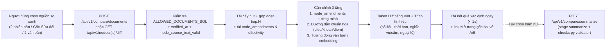
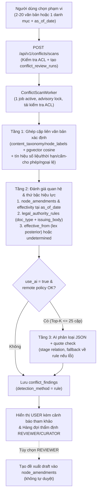

# Kế hoạch triển khai: So sánh 2 văn bản & Rà soát mâu thuẫn, chồng chéo

> **For agentic workers:** REQUIRED SUB-SKILL: Use superpowers:subagent-driven-development (recommended) or superpowers:executing-plans to implement this plan task-by-task. Steps use checkbox (`- [ ]`) syntax for tracking.

**Goal:** Bổ sung hai năng lực phân tích đối chiếu pháp lý/hành chính an toàn theo nguyên tắc *chứng cứ trước (evidence-first)* vào Evidence RAG:
1. **So sánh 2 văn bản & các phiên bản** — giúp người dùng nhận diện nhanh thay đổi cốt lõi giữa văn bản chính thức và các phiên bản sửa đổi/bổ sung, hoặc giữa 2 văn bản khác nhau có cùng loại nội dung.
2. **Rà soát mâu thuẫn, chồng chéo & thứ bậc hiệu lực** — tự động đối chiếu quy định giữa các văn bản trong phạm vi được phép để chỉ ra điểm chồng chéo hoặc trái ngược, đánh giá quan hệ sửa đổi/thứ bậc hiệu lực tham khảo nhằm hỗ trợ xác định văn bản áp dụng chính xác.

**Architecture:** Thiết kế **xác định trước — AI bổ trợ có kiểm chứng (Deterministic-first, Bounded AI second)**, chia thành **2 pha độc lập bàn giao tuần tự**:
- **Pha 1 (So sánh văn bản — Tasks C1–C4):** Không cần bảng DB mới, không cần LLM để chạy cốt lõi. Tận dụng cấu trúc `document_nodes` (`path`, `citation_label`, `node_type`, `text_original`, `text_folded`), lịch sử `document_versions` (`based_on_version_id`, `retired_at`), quan hệ `node_amendments` và `node_embeddings` để căn chỉnh 3 tầng (liên kết sửa đổi tường minh → đường dẫn cấu trúc chuẩn hóa có gộp đoạn `tiep:N` → khớp tương đồng ngữ nghĩa/từ vựng cho Điều bị đánh số lại và văn bản hành chính không có Điều/Khoản). Tùy chọn gọi stage `summarize` (`qwen3.5:4b`) có bộ lọc kiểm chứng số liệu/trích dẫn (`synthesis/checks.py`).
- **Pha 2 (Rà soát mâu thuẫn, chồng chéo — Tasks D1–D6):** Thêm migration `0018` (`legal_authority_rules`, `conflict_review_runs`, `conflict_findings`). Pipeline 3 tầng chạy qua nền worker đơn tiến trình có giới hạn (`ConflictScanWorker`, cùng mô hình an toàn với `OcrAiWorker`): (1) ghép cặp ứng viên liên văn bản theo `content_taxonomy`/`node_labels` + `node_embeddings` (pgvector, không cần re-embed) + phát hiện tín hiệu xung đột xác định; (2) đánh giá quan hệ sửa đổi sẵn có & thứ bậc hiệu lực theo bảng quy tắc `doc_type` + `issuing_body` + `effective_from` (rơi an toàn về `undetermined_requires_review` khi mơ hồ); (3) tầng AI tùy chọn trên top-K cặp ứng viên (tối đa 25 cặp) qua stage `relation`, chỉ tạo gợi ý chờ chuyên viên thẩm định và tùy chọn sinh bản nháp `draft` vào `node_amendments`.

**Tech Stack:** Python 3.12, FastAPI, asyncpg, PostgreSQL 16 + pgvector (`qwen3-embedding:0.6b` 1024 dims), Ollama `0.40.15` (`qwen3.5:4b` cục bộ), React + TypeScript + Vite + Vitest.

**Spec / Cơ sở đối chiếu trong repo:**
- Yêu cầu người dùng (2026-11-26): Tính năng (1) So sánh 2 văn bản & phiên bản; Tính năng (2) Rà soát mâu thuẫn, chồng chéo & xác định văn bản hiệu lực cao hơn.
- Hồ sơ bàn giao hệ thống: [docs/HOSO_BAN_GIAO.md](../../../docs/HOSO_BAN_GIAO.md) — các mục **A5** (So sánh phiên bản một Điều), **A10** (So sánh hai văn bản), **L3** (Mâu thuẫn và ngoại lệ), **K11/K12** (hiệu lực tại ngày tra cứu & phiên bản), **C.5–C.9** (evidence-first, ACL/ABAC, Local vs API, không bịa đặt).

---

## 1. Hiện trạng mã nguồn đã đối chiếu & Ràng buộc toàn cục (Global Constraints)

### 1.1. Nền tảng sẵn có trong codebase (đã kiểm chứng)

| Thành phần | Vị trí thực tế | Giá trị / cấu trúc đã xác nhận |
|---|---|---|
| Cây điều khoản | `backend/app/documents/tree_parser.py`, `node_writer.py`, `0001_core.sql`, `0009_node_structure.sql` | `document_nodes.path` có tiền tố thứ tự 6 số `000001:chuong:I/dieu:5/khoan:2/diem:a`; nút dài > `MAX_NODE_CHARACTERS = 4000` được tách thành `.../tiep:2`, `tiep:3`; có `citation_label`, `text_original`, `text_folded`, `page_start`, `page_end`, `node_source_spans`, hàm SQL `node_source_text_valid(node_id)`. |
| Phiên bản & quyền | `0016_document_management.sql`, `backend/app/storage/authorized_search.py` | `document_versions` có `version_number`, `based_on_version_id`, `retired_at`, `effective_from`, `publication_date`, `review_status`. `ALLOWED_DOCUMENTS_SQL` & view `authorized_nodes` lọc `deleted_at IS NULL`, `suspended_at IS NULL`, `dv.retired_at IS NULL`, `review_status = 'approved'`. |
| Sửa đổi & hiệu lực | `0011_effectivity.sql`, `backend/app/effectivity/node_paths.py`, `service.py`, `store.py` | `node_amendments` (`action IN ('modify','replace','add','repeal','repeal_partial','suspend','commence')`, `scope`, `source_document_id`, `target_document_id`, `target_node_id`, `target_path`, `review_status`), `node_references` (`basis`, `guidance`, `consolidation`, `citation`), `document_effective_intervals`, `node_effective_intervals`, `load_effectivity()`, `clause_view()`, `can_review()`. |
| Nhãn nội dung & vector | `0013_content_groups.sql`, `0001_core.sql`, `0014_embedding_jobs.sql` | 11 nhóm `content_taxonomy` (`pham_vi_doi_tuong`, `giai_thich_tu_ngu`, `nguyen_tac`, `dieu_kien_tieu_chuan`, `ho_so_giay_to`, `trinh_tu_thu_tuc`, `thoi_han`, `tham_quyen_trach_nhiem`, `quyen_nghia_vu`, `vi_pham_xu_ly`, `hieu_luc_chuyen_tiep`), `node_labels`, `embedding_indices.is_active = TRUE` (`qwen3-embedding:0.6b`, 7.447 vectors). |
| Kiểm chứng AI & Model Registry | `backend/app/synthesis/checks.py`, `backend/app/model_registry/stages.py` | Đã có `_facts()`, `check_point()`, `support_score()`, `similarity()`, các tập từ khóa `_NEGATION`, `_EXCEPTION`, `_CONDITION`, `_OBLIGATION`, `_PERMISSION`. Stages hiện hữu: `answer`, `summarize`, `expand`, `relation`, `label`, `ocr`, `embedding`, `rerank`. |
| Loại văn bản hiện hữu | `frontend/src/components/documentDisplay.ts`, `AdminPortal.tsx` | `documents.doc_type`: `code`, `law`, `ordinance`, `resolution`, `decree`, `circular`, `joint_circular`, `decision`, `directive`, `consolidated`, `other`. `documents.issuing_body` là `TEXT` tự do. **Chưa có bảng quy tắc thứ bậc hiệu lực.** |
| Migration gần nhất | `backend/app/migrations/` | Đã đến `0017_ocr_ai_proposals.sql` (và `.down.sql`). Migration kế tiếp là **`0018_legal_hierarchy_and_conflict_reviews.sql`**. `backend/tests/test_auth_and_admin_portal.py` kiểm tra danh sách tên migration tường minh. |
| Giao diện hiện hữu | `frontend/src/App.tsx`, `pages/AdminPortal.tsx` | Người dùng hiện có 2 view `userView: "chat" | "search"`. Admin Portal có `DraftReviewPanel`, `AdminDocumentManager`, `EffectivityReviewPanel`, `LabelReviewPanel`, `EmbeddingManager`, AI panels. |

### 1.2. Global Constraints (Bắt buộc tuân thủ xuyên suốt mọi Task)

1. **Bảo mật ACL/ABAC & toàn vẹn nguồn tuyệt đối:**
   - Mọi văn bản tham gia so sánh hoặc quét mâu thuẫn phải nằm trong `ALLOWED_DOCUMENTS_SQL` của `principal` hiện tại (`set_config('app.user_id', ..., true)`).
   - Mọi nút hiển thị trích dẫn phải có `n.review_status = 'approved'`, `source_provenance.verified_at IS NOT NULL`, và `node_source_text_valid(n.id)`.
   - Khi so sánh **2 phiên bản của cùng 1 văn bản** (ví dụ `v1` đã `retired_at IS NOT NULL` với `v2` hiện hành): văn bản cha vẫn bắt buộc nằm trong `ALLOWED_DOCUMENTS_SQL`, và cả 2 phiên bản phải có `dv.review_status = 'approved'` — **tuyệt đối không mở** `draft`, `pending_review`, `rejected`, văn bản bị `suspended_at` hoặc `deleted_at`.
2. **Chế độ Local-first / LAN Portable Offline:**
   - Không yêu cầu tải thêm model mới; không yêu cầu re-embed 7.447 vector hiện hữu.
   - Khi chạy AI tùy chọn ở chế độ `API`, chỉ cho phép gửi dữ liệu ra ngoài nếu **tất cả** văn bản trong cặp/lượt phân tích đều thuộc danh mục có `remote_processing_allowed = TRUE` và người dùng có quyền remote processing; nếu có dù chỉ 1 văn bản nội bộ/hạn chế → chỉ dùng model cục bộ hoặc trả kết quả xác định.
3. **Không bao giờ tự ý thay đổi dữ liệu pháp lý hay kết luận thay người dùng:**
   - Tính năng so sánh và rà soát mâu thuẫn chỉ đọc kho văn bản để tạo báo cáo/phát hiện.
   - Mọi phát hiện mâu thuẫn/chồng chéo và đánh giá thứ bậc hiệu lực đều hiển thị rõ nhãn tham khảo *"Gợi ý tự động — cần chuyên viên thẩm định trước khi áp dụng"*.
   - Chuyên viên `REVIEWER`/`CURATOR` có thể bấm tạo đề xuất sửa đổi từ một phát hiện đã xác nhận, nhưng bản ghi sinh ra trong `node_amendments` **luôn ở trạng thái `draft`** để đi qua quy trình phê duyệt hiệu lực chuẩn.
4. **Hỗ trợ cả văn bản quy phạm (Điều/Khoản/Điểm) và văn bản hành chính không có Điều/Khoản:**
   - Không giả định mọi văn bản đều có `dieu:N`. Phải xử lý mượt văn bản chỉ có `heading`/`paragraph`/`annex` và nút dài bị chia nhỏ `tiep:N`.
5. **Ràng buộc chất lượng & cổng kiểm định repo:**
   - Không hardcode đường dẫn tuyệt đối (`C:\`, `E:\`, `/tmp/`) trong mã nguồn/test/script (`scripts/validate_no_literal_runtime_paths.py`).
   - Mọi migration `.sql` phải có `.down.sql` tương ứng (`scripts/validate_migrations.py`) và được cập nhật trong `backend/tests/test_auth_and_admin_portal.py`.
   - Mọi route mới dùng `dependencies=[Depends(no_store)]`, đồng bộ `docs/openapi.json` (`python scripts/export_openapi.py --check`), ghi `audit_events`.
   - Frontend tuyệt đối không dùng `dangerouslySetInnerHTML`; mọi diff highlight render bằng React elements an toàn; xóa sạch state khi `handleLogout()`.

---

## 2. Review Focus (Các rủi ro trọng yếu gắn trực tiếp vào test)

Mọi lần review/kiểm thử phải chứng minh 6 rủi ro sau đã được chặn bằng test cụ thể:

| # | Rủi ro / Failure mode | Cách chặn trong thiết kế | Gắn kiểm chứng tại |
|---|---|---|---|
| R1 | Lộ văn bản ngoài ACL, bản nháp chưa duyệt, văn bản bị đình chỉ (`suspended_at`), hoặc ngược lại chặn nhầm bản lịch sử đã duyệt (`retired_at IS NOT NULL`) khi so sánh `v1` vs `v2` | Phân tách rõ: doc cha luôn qua `ALLOWED_DOCUMENTS_SQL`; đọc phiên bản lịch sử chỉ cho `dv.review_status = 'approved'`; worker quét mâu thuẫn tái kiểm tra live principal & ACL trước khi chạy và trước khi trả kết quả | Task C2, Task C4 (`test_comparison_api_pg.py`), Task D4, Task D5 (`test_conflicts_api_pg.py`) |
| R2 | Chèn thêm 1 Điều làm các Điều sau bị đánh số lại (`Điều 5` → `Điều 6`), nút dài vượt 4.000 ký tự sinh `tiep:2`, hoặc văn bản không có `Điều` khiến diff báo sai 100% xóa + thêm | Gộp logic các đoạn `tiep:N` thuộc cùng nút cha trước khi so sánh (giữ đủ danh sách `node_id`/trang gốc); căn chỉnh 3 tầng có bước nhận diện `moved_or_renumbered` bằng tương đồng nội dung + nhãn | Task C1 (`test_comparison_engine.py`), Task C4 |
| R3 | Báo "mâu thuẫn" giả cho cặp điều khoản đã có `node_amendments` sửa đổi/thay thế/bãi bỏ đã duyệt, văn bản đã hết hiệu lực, hoặc điều khoản ghi rõ ngoại lệ (`"trừ trường hợp"`) | Tầng precedence kiểm tra `node_amendments` + `document_effective_intervals` tại `as_of_date` **trước**; detector nhận diện cues `_EXCEPTION` để gắn `exception_refinement` thay vì `contradiction` | Task D2 (`test_legal_precedence.py`), Task D3 (`test_conflict_detector.py`), Task D6 |
| R4 | Xếp sai thứ bậc hiệu lực khi chỉ nhìn `doc_type` (VD: `resolution` của Quốc hội vs Chính phủ vs HĐND; `decision` của Thủ tướng vs Bộ trưởng vs Giám đốc đơn vị; văn bản nội bộ; Luật chuyên ngành *lex specialis* vs Luật chung) | Bảng `legal_authority_rules` kết hợp `doc_type` + `issuing_body_pattern`; nếu loại văn bản mơ hồ không khớp `issuing_body`, thiếu ngày hiệu lực, hoặc khác cơ quan ngang cấp → bắt buộc trả `undetermined_requires_review` + cảnh báo *lex specialis* | Task D2 (`test_legal_precedence.py`) |
| R5 | Quét đa văn bản gây quá tải CPU/RAM máy LAN Portable, vượt timeout HTTP 30s, bị kẹt job khi restart server, hoặc dính prompt injection nằm trong nội dung PDF | Job bất đồng bộ qua `ConflictScanWorker` (advisory lock, tối đa 1 lượt chạy đồng thời, hàng đợi tối đa 10, trần `max_documents=20`, `max_pairs=120`, `max_ai_pairs=25`); startup khôi phục job treo thành `CONFLICT_SCAN_INTERRUPTED`; AI prompt chỉ nhận văn bản thuần không có tool, JSON schema cứng + quote check | Task D4, Task D5 (`test_conflicts_api_pg.py`) |
| R6 | Thao tác tạo liên kết sửa đổi từ phát hiện mâu thuẫn tự duyệt `approved` hoặc vượt quyền `can_review` | Bắt buộc kiểm tra `can_review(conn, user_id, [doc_a_id, doc_b_id])`; bản ghi sinh vào `node_amendments` luôn có `review_status = 'draft'`, `proposed_by = 'conflict_review'`, có `audit_events` | Task D5 (`test_conflicts_api_pg.py`) |

---

## 3. Kiến trúc tổng thể & luồng xử lý

### 3.1. Pha 1 — Luồng So sánh 2 văn bản & phiên bản

### 3.2. Pha 2 — Luồng Rà soát mâu thuẫn, chồng chéo & thứ bậc hiệu lực

---

## 4. Bản đồ tệp tin dự kiến (File Map)

### Pha 1 — So sánh văn bản & phiên bản

| Trạng thái | Tệp | Trách nhiệm chính |
|---|---|---|
| Create | `backend/app/analysis/__init__.py` | Gói tiện ích phân tích nội dung quy phạm dùng chung cho cả Pha 1 và Pha 2 |
| Create | `backend/app/analysis/signals.py` | Chuẩn hóa khóa cấu trúc (`normalize_structural_key`), gộp đoạn `tiep:N` (`stitch_logical_nodes`), trích xuất số liệu/thời hạn/tỷ lệ/tiền tệ/nghĩa vụ-cấm đoán/ngoại lệ tái sử dụng `synthesis/checks.py` |
| Create | `backend/app/comparison/__init__.py` | Export public API của module so sánh |
| Create | `backend/app/comparison/align.py` | Engine căn chỉnh 3 tầng (explicit amendment → structural key → lexical/embedding similarity + phát hiện `moved_or_renumbered`) |
| Create | `backend/app/comparison/diff.py` | Diff cấp token tiếng Việt (trả danh sách `DiffSegment`), tính `ChangeSignals` (số liệu/thời hạn/nghĩa vụ/ngoại lệ thay đổi) và bảng thống kê tổng hợp |
| Create | `backend/app/comparison/service.py` | Đọc dữ liệu ACL-safe (hỗ trợ phiên bản lịch sử đã duyệt), ghép `node_amendments` + `load_effectivity`, thực hiện compare 2 văn bản / 2 phiên bản & node diff A5 |
| Create | `backend/app/comparison/summarize.py` | Tóm tắt thay đổi cốt lõi tùy chọn bằng AI (`summarize` stage), kiểm tra `remote_processing_allowed` trên cả 2 văn bản, hậu kiểm bằng `check_point()`, fallback xác định |
| Create | `backend/app/api/v1/comparison.py` | Router `/api/v1/documents/{id}/versions`, `/api/v1/compare/documents`, `/api/v1/nodes/{id}/diff`, `/api/v1/compare/summarize` |
| Modify | `backend/app/main.py` | Gắn `comparison_router` |
| Modify | `backend/app/api/v1/errors.py` | Bổ sung thông báo lỗi tiếng Việt cho mã lỗi `COMPARE_*` |
| Create | `backend/tests/test_comparison_engine.py` | Unit test cho `signals.py`, `align.py`, `diff.py` |
| Create | `backend/tests/test_comparison_api_pg.py` | Integration test PostgreSQL cho ACL, phiên bản lịch sử, A5/A10, AI summary fallback & egress |
| Create | `frontend/src/components/CompareDiffView.tsx` | Component hiển thị side-by-side / inline diff an toàn XSS, badge tín hiệu thay đổi, nút mở trang gốc hai vế |
| Create | `frontend/src/pages/DocumentComparePage.tsx` | Màn hình So sánh văn bản (3 chế độ chọn, bộ lọc, thống kê, nút tóm tắt AI, sao chép báo cáo) |
| Create | `frontend/src/pages/DocumentComparePage.test.tsx` | Vitest cho các chế độ so sánh, filter, XSS escaping, AI fallback |
| Modify | `frontend/src/App.tsx`, `api/client.ts`, `types.ts`, `styles.css`, `components/DocumentCard.tsx`, `pages/SearchPage.tsx` | Thêm tab `"So sánh văn bản"`, API client/types, nút mở nhanh so sánh từ thẻ văn bản, reset state khi logout |

### Pha 2 — Rà soát mâu thuẫn, chồng chéo & thứ bậc hiệu lực

| Trạng thái | Tệp | Trách nhiệm chính |
|---|---|---|
| Create | `backend/app/migrations/0018_legal_hierarchy_and_conflict_reviews.sql` | Bảng `legal_authority_rules` (+ seed chuẩn), `conflict_review_runs`, `conflict_findings`, index & constraints |
| Create | `backend/app/migrations/0018_legal_hierarchy_and_conflict_reviews.down.sql` | Rollback sạch bảng migration `0018` |
| Modify | `backend/tests/test_auth_and_admin_portal.py` | Thêm `"0018_legal_hierarchy_and_conflict_reviews.sql"` vào danh sách migration kỳ vọng |
| Create | `backend/app/conflicts/__init__.py` | Export public API module rà soát mâu thuẫn |
| Create | `backend/app/conflicts/precedence.py` | Bộ đánh giá thứ bậc hiệu lực 5 bước (`evaluate_precedence`), chuẩn hóa cơ quan ban hành, lưu ý *lex posterior* / *lex specialis* / `undetermined_requires_review` |
| Create | `backend/app/conflicts/detector.py` | Ghép cặp ứng viên liên văn bản (`content_taxonomy`/`node_labels` + `node_embeddings` cosine + lexical) và phát hiện tín hiệu mâu thuẫn/chồng chéo/ngoại lệ |
| Create | `backend/app/conflicts/store.py` | CRUD cho `conflict_review_runs`, `conflict_findings`, `legal_authority_rules`, idempotency `request_id`, giới hạn hàng đợi, tạo bản nháp `node_amendments` |
| Create | `backend/app/conflicts/ai_screen.py` | Tầng phân loại & diễn giải AI tùy chọn (JSON schema cứng, chống prompt injection, hậu kiểm trích dẫn & `remote_processing_allowed`) |
| Create | `backend/app/conflicts/worker.py` | `ConflictScanWorker` chạy nền đơn tiến trình (advisory lock, 1 active scan, live ACL check, cancel, restart recovery) |
| Create | `backend/app/api/v1/conflicts.py` | Router USER (`/api/v1/conflicts/scans*`), REVIEWER (`/api/v1/admin/conflicts/findings*`), SYS_ADMIN (`/api/v1/admin/authority-rules*`) |
| Modify | `backend/app/config.py`, `backend/app/main.py`, `backend/app/api/v1/errors.py` | Cấu hình env `EVIDENCE_CONFLICT_SCAN_*`, khởi động/dừng `ConflictScanWorker` trong `lifespan`, đăng ký `conflicts_router` & mã lỗi `CONFLICT_*` |
| Modify | `docs/openapi.json` | Export cập nhật OpenAPI schema (`scripts/export_openapi.py`) |
| Create | `backend/tests/test_legal_precedence.py` | Unit test đầy đủ cho thứ bậc hiệu lực, trường hợp mơ hồ, *lex posterior*, *lex specialis* caveat, `node_amendments` |
| Create | `backend/tests/test_conflict_detector.py` | Unit test cho phát hiện thời hạn, số liệu, cấm-cho phép, ngoại lệ, chồng chéo |
| Create | `backend/tests/test_conflicts_api_pg.py` | Integration test PostgreSQL cho worker, ACL revocation, cancellation, queue caps, review triage & tạo `draft` amendment |
| Create | `frontend/src/components/ConflictFindingCard.tsx` | Thẻ hiển thị 1 phát hiện: song song vế A/B + Mở trang gốc + hộp thứ bậc hiệu lực + cảnh báo tham khảo |
| Create | `frontend/src/pages/ConflictReviewPage.tsx` | Màn hình Rà soát mâu thuẫn cho USER (chọn phạm vi, tiến độ polling, hủy, bộ lọc loại/mức độ) |
| Create | `frontend/src/components/ConflictTriagePanel.tsx` | Hàng đợi thẩm định cho `REVIEWER`/`CURATOR` trong Admin Portal (xác nhận / loại bỏ / tạo đề xuất sửa đổi `draft`) |
| Create | `frontend/src/components/AuthorityRulesPanel.tsx` | Quản trị bảng quy tắc thứ bậc hiệu lực cho `SYS_ADMIN` trong Admin Portal |
| Create | `frontend/src/pages/ConflictReviewPage.test.tsx` | Vitest cho UI rà soát mâu thuẫn, cảnh báo tham khảo, polling/cancel, quyền triage |
| Modify | `frontend/src/App.tsx`, `pages/AdminPortal.tsx`, `api/client.ts`, `types.ts`, `styles.css` | Gắn tab `"Rà soát mâu thuẫn"` cho USER và sub-tab quản trị trong `AdminPortal` |
| Create | `scripts/smoke_compare_and_conflicts.py` | Kịch bản smoke/eval tổng hợp không hardcode đường dẫn kiểm chứng cả 2 tính năng end-to-end |
| Modify | `docs/HUONG_DAN_NGUOI_DUNG.md`, `docs/HUONG_DAN_QUAN_TRI.md`, `docs/en/USER_GUIDE.md`, `docs/en/ADMIN_GUIDE.md` | Hướng dẫn sử dụng & vận hành 2 tính năng mới |

---

## PHA 1 — Tính năng 1: So sánh 2 văn bản & các phiên bản

### Task C1: Bộ trích xuất tín hiệu quy phạm dùng chung & Engine căn chỉnh/diff xác định

**Files:**
- Create: `backend/app/analysis/__init__.py`
- Create: `backend/app/analysis/signals.py`
- Create: `backend/app/comparison/__init__.py`
- Create: `backend/app/comparison/align.py`
- Create: `backend/app/comparison/diff.py`
- Test: `backend/tests/test_comparison_engine.py`

**Thiết kế cốt lõi:**
1. **`backend/app/analysis/signals.py`** (tái sử dụng `_facts`, `_NEGATION`, `_EXCEPTION`, `_CONDITION`, `_OBLIGATION`, `_PERMISSION`, `_has_accented` từ `backend/app/synthesis/checks.py` và `fold_text`/`normalize_text` từ `backend/app/vietnamese_nlp/unicode_norm.py`):
   - `normalize_structural_key(raw_path: str | None) -> str`: loại bỏ tiền tố thứ tự `^\d{6}:` (sinh bởi `node_writer.py`), loại bỏ hậu tố `/tiep:\d+`, và trích xuất khóa chuẩn `dieu:<num>(/khoan:<num>)?(/diem:<letter>)?` nếu có; với văn bản không có `Điều` thì giữ nguyên khóa sau tiền tố số (VD `chuong:I`, `muc:2`, `phuluc:1`, `doan`).
   - `LogicalNode` (dataclass bất biến): đại diện 1 đơn vị logic sau khi gộp các đoạn `tiep:2`, `tiep:3` thuộc cùng một nút cha:
     - `primary_node_id: UUID`, `member_node_ids: tuple[UUID, ...]`, `node_type: str`, `structural_key: str`, `raw_path: str`, `citation_label: str | None`, `label_original: str | None`, `text_original: str`, `text_folded: str`, `page_start: int | None`, `page_end: int | None`, `ordinal: int`, `embedding: tuple[float, ...] | None = None`, `taxonomy_codes: tuple[str, ...] = ()`.
   - `extract_normative_signals(text: str) -> NormativeSignals`:
     - `deadlines: tuple[DeadlineSpan, ...]` — regex bắt `"(\d+(?:[.,]\d+)?)\s*(ngày làm việc|ngày|tháng|năm|giờ)"` kèm ngữ cảnh chuẩn hóa `(value_num, unit_normalized, raw_text)`.
     - `amounts_and_percents: tuple[QuantitySpan, ...]` — bắt tiền tệ (`đồng`, `triệu đồng`, `tỷ đồng`), phần trăm (`%`), ngưỡng số lượng.
     - `dates: frozenset[tuple[int, int, int]]` và `plain_numbers: frozenset[str]` (gọi `_facts()`).
     - `deontic_polarities: frozenset[str]` — tập hợp các nhãn từ `{"prohibition", "obligation", "permission", "negation"}` (phân biệt rõ `"nghiêm cấm"`/`"không được"` là `prohibition` khác với `"được phép"`/`"có quyền"` là `permission` và `"phải"`/`"bắt buộc"` là `obligation`).
     - `has_exception: bool` (`_EXCEPTION`), `has_condition: bool` (`_CONDITION`), `exception_phrases: tuple[str, ...]`.
     - `subject_tokens: frozenset[str]` — tập từ nội dung đã bỏ stopwords để chấm tương đồng chủ thể.
2. **`backend/app/comparison/align.py`**:
   - Đầu vào: `left_nodes: list[LogicalNode]`, `right_nodes: list[LogicalNode]`, `amendment_links: Sequence[AmendmentLink]` (các liên kết đã duyệt từ `node_amendments` nối trực tiếp `node_a` ↔ `node_b` hoặc `target_path`), `mode: Literal["versions", "amendment_pair", "cross_document"]`.
   - Căn chỉnh 3 tầng theo thứ tự ưu tiên giảm dần:
     - **Tầng 1 (`explicit_amendment`):** Các cặp có liên kết trực tiếp trong `node_amendments` (`target_node_id` hoặc khớp `target_path` chuẩn hóa) giữa A và B. Luôn gắn metadata `amendment_action` (`modify`, `replace`, `repeal`, `add`, ...), `valid_from`, `source_quote`.
     - **Tầng 2 (`structural_key`):** Khớp 1-1 theo `structural_key` (`dieu:N/khoan:M/diem:a`) trên các nút chưa ghép. Trong mode `versions` hoặc `cross_document` có `dieu:N`: nếu 2 nút cùng số `Điều` nhưng độ tương đồng nội dung quá thấp (`< 0.12`) trong khi nút A khớp rất cao (`>= 0.65`) với một nút khác ở B (trường hợp chèn Điều mới đẩy `Điều 5` → `Điều 6`), tự động chuyển sang Tầng 3 để phát hiện `moved_or_renumbered` thay vì ghép sai!
     - **Tầng 3 (`semantic_lexical`):** Đối với nút chưa ghép (Điều bị đánh số lại, văn bản hành chính không có Điều, hoặc 2 văn bản khác cấu trúc): tính điểm ghép tối ưu (greedy/Hungarian trên ma trận nhỏ) bằng `0.55 * cosine(emb_a, emb_b) + 0.45 * lexical_jaccard(a, b)` (hoặc `1.0 * lexical_jaccard` + heading bonus khi không có embedding). Chỉ ghép khi điểm `>= 0.42` (mode `versions`) hoặc `>= 0.52` (mode `cross_document`). Các nút còn lại được xếp `removed` (chỉ có ở A) hoặc `added` (chỉ có ở B).
   - Giữ thứ tự đọc tự nhiên (topo order theo `ordinal` của A và chèn nút `added` của B đúng vị trí lân cận).
3. **`backend/app/comparison/diff.py`**:
   - Tokenize tiếng Việt giữ nguyên từ có dấu + khoảng trắng/xuống dòng (`re.findall(r"\S+|\s+", text_original)`) → `difflib.SequenceMatcher(a=tokens_a, b=tokens_b, autojunk=False)` → nén liền kề thành `list[DiffSegment(op: Literal["equal", "delete", "insert"], text: str)]`.
   - Tính `change_kind: Literal["unchanged", "modified", "moved_or_renumbered", "added", "removed"]`:
     - So sánh `normalize_text` (bỏ khác biệt khoảng trắng thuần để không báo nhiễu OCR/định dạng trắng là sửa đổi nội dung, trừ khi thực sự đổi chữ).
     - Khi `structural_key` khác nhau giữa A và B nhưng Tầng 3 ghép được → gắn `moved_or_renumbered` (kèm cờ `content_also_modified: bool`).
   - Tính `ChangeSignals` cho mỗi cặp sửa đổi: danh sách `deadlines_changed`, `amounts_changed`, `dates_changed`, `modality_shifted` (VD `permission → obligation` hoặc `permission → prohibition`), `exception_changed`, và `impact_level: Literal["high", "medium", "low"]` (`high` nếu đổi thời hạn/số tiền/mức phạt/nghĩa vụ-cấm đoán/ngoại lệ).

- [x] **Step 1: Viết bộ unit test `backend/tests/test_comparison_engine.py` trước (TDD)**
  - Test `stitch_logical_nodes`: nút dài có `000003:dieu:2/khoan:1` + `000004:dieu:2/khoan:1/tiep:2` được gộp thành 1 `LogicalNode` có `member_node_ids` gồm cả 2 UUID, `page_start=1, page_end=2`, không bị báo giả là đoạn mới thêm khi bản v2 ngắn đi dưới 4.000 ký tự.
  - Test `align_nodes` cho 3 kịch bản:
    1. Cùng cấu trúc `Điều 1..3`, sửa thời hạn `"10 ngày"` → `"15 ngày"` và đổi `"được phép"` → `"nghiêm cấm"` → trả `change_kind="modified"`, `impact_level="high"`, có `deadlines_changed` và `modality_shifted`.
    2. Chèn thêm `Điều 2 mới` làm `Điều 2 cũ` dịch thành `Điều 3 mới` → Tầng 3 nhận diện đúng `moved_or_renumbered` (không báo xóa 100% Điều 2 + thêm mới 100% Điều 3).
    3. Văn bản hành chính không có `Điều`/`Khoản` (chỉ có `heading`/`paragraph` `I.`, `II.`) → căn chỉnh chính xác theo heading + từ vựng, không lỗi.
    4. Cặp có `AmendmentLink` tường minh (`action="replace"`, `target_path="dieu:5/khoan:2"`) → ưu tiên Tầng 1 `alignment_method="explicit_amendment"`.
  - Test `compute_token_diff`: giữ nguyên dấu tiếng Việt NFC, không cắt giữa từ, bỏ qua nhiễu nhiều dấu cách khi chấm `unchanged`.

- [x] **Step 2: Chạy test mới để xác nhận fail đúng lý do (module chưa tồn tại)**
  - Run: `pytest backend/tests/test_comparison_engine.py -q`

- [x] **Step 3: Triển khai `backend/app/analysis/signals.py`, `backend/app/comparison/align.py`, `backend/app/comparison/diff.py`**
  - Tái sử dụng trực tiếp các helper trong `backend/app/synthesis/checks.py` và `backend/app/vietnamese_nlp/unicode_norm.py` (không nhân bản bảng stopwords/regex không cần thiết).

- [x] **Step 4: Chạy lại unit test xác nhận PASS**
  - Run: `pytest backend/tests/test_comparison_engine.py -q`

---

### Task C2: Dịch vụ so sánh ACL-safe, API Endpoints & Tóm tắt AI tùy chọn

**Files:**
- Create: `backend/app/comparison/service.py`
- Create: `backend/app/comparison/summarize.py`
- Create: `backend/app/api/v1/comparison.py`
- Modify: `backend/app/main.py`
- Modify: `backend/app/api/v1/errors.py`
- Modify: `docs/openapi.json`

**Thiết kế hợp đồng API & dịch vụ:**
1. **`GET /api/v1/documents/{document_id}/versions`** (`require_user`, `no_store`):
   - Kiểm tra `document_id` thuộc `ALLOWED_DOCUMENTS_SQL`. Nếu không → `404 DOCUMENT_NOT_FOUND` (không tiết lộ tồn tại).
   - Trả về:
     - `document`: `{id, title, document_number, doc_type, issuing_body}`.
     - `versions`: danh sách các `document_versions` có `review_status = 'approved'` và `source_provenance.verified_at IS NOT NULL`, sắp theo `version_number DESC`, gồm `{id, version_number, publication_date, effective_from, is_current: retired_at IS NULL, based_on_version_id, approved_at}`.
     - `related_amendment_documents`: danh sách các văn bản **cũng nằm trong `ALLOWED_DOCUMENTS_SQL`** có liên kết `node_amendments` (đã `approved`) sửa đổi/bổ sung/thay thế văn bản này hoặc bị văn bản này sửa đổi → giúp UI gợi ý 1-click so sánh văn bản gốc với văn bản sửa đổi!
2. **`POST /api/v1/compare/documents`** (`require_user`, `no_store`):
   - Request body (`extra="forbid"`):
     - `mode: Literal["versions", "amendment_pair", "cross_document"]`
     - `left_document_id: UUID`, `left_version_id: UUID | None = None`
     - `right_document_id: UUID`, `right_version_id: UUID | None = None`
     - `as_of_date: date | None = None` (mặc định `date.today()`)
     - `only_changes: bool = False`
     - `include_embeddings: bool = True` (chỉ đọc vector sẵn có từ `embedding_indices.is_active = TRUE`, không gọi model embedding lúc request)
   - Quy tắc kiểm tra:
     - Nếu `mode == "versions"`: bắt buộc `left_document_id == right_document_id`, `left_version_id != right_version_id`.
     - Cả `left_document_id` và `right_document_id` phải thuộc `ALLOWED_DOCUMENTS_SQL`.
     - Phiên bản được chọn (hoặc phiên bản active mới nhất nếu `version_id` là `None`) phải có `review_status = 'approved'` và `source_provenance.verified_at IS NOT NULL`.
     - Chỉ nạp các nút thỏa `n.review_status = 'approved'` và `node_source_text_valid(n.id)`.
     - Giới hạn bảo vệ: tối đa `MAX_COMPARE_NODES = 1500` nút mỗi bên (trả `422 COMPARE_DOCUMENT_TOO_LARGE` với gợi ý chọn phạm vi Chương/Điều nếu vượt).
   - Response:
     - `comparison_id` (UUID theo request), `mode`, `as_of_date`, `left_doc` & `right_doc` (metadata + trạng thái hiệu lực từ `load_effectivity`), `summary` (`total_items`, `added`, `removed`, `modified`, `moved_or_renumbered`, `unchanged`, `high_impact_changes`, `explicit_amendment_links`, `deterministic_highlights: list[str]`), `items: list[ComparisonItem]` (mỗi item có `item_key`, `change_kind`, `alignment_method`, `alignment_score`, `impact_level`, `signals`, `amendment_link`, `left` `{node_id, member_node_ids, citation_label, structural_key, text_original, page_start, page_end}`, `right` `{...}`, `diff_segments`).
     - Ghi `audit_events` (`action = 'document.compare'`).
3. **`GET /api/v1/nodes/{node_id}/diff`** (`require_user`, `no_store`) — hoàn thiện spec **A5**:
   - Kiểm tra `node_id` thuộc văn bản trong `ALLOWED_DOCUMENTS_SQL` và `node_source_text_valid(node_id)`.
   - Trả về dòng thời gian (timeline) của chính Điều/Khoản đó:
     - Phiên bản trước cùng văn bản (qua `based_on_version_id` và khớp `structural_key`),
     - Các `node_amendments` đã duyệt tác động lên `node_id` (từ văn bản khác trong `ALLOWED_DOCUMENTS_SQL`),
     - Diff chi tiết giữa bản trước và bản hiện tại + trạng thái hiệu lực tại `as_of_date`.
4. **`POST /api/v1/compare/summarize`** (`require_user`, `no_store`) — AI bổ trợ tùy chọn:
   - Nhận cùng tham số chọn 2 văn bản/phiên bản như `/compare/documents` (tái tính danh sách các item thay đổi phía server để **tuyệt đối không tin diff do client gửi lên**).
   - Kiểm tra chính sách `LOCAL` / `API`: nếu chế độ `API` được chọn mà một trong 2 văn bản (A hoặc B) thuộc danh mục có `remote_processing_allowed = FALSE` hoặc user không có quyền remote → khóa tuyến remote, chỉ chạy local model hoặc trả fallback xác định kèm lý do `remote_blocked_by_document_policy`.
   - Gọi stage `summarize` trên top `15` item thay đổi quan trọng nhất (`high_impact` trước), yêu cầu JSON cấu trúc `{"executive_summary": str, "key_changes": [{"point": str, "item_keys": [str], "evidence_ids": [str]}]}`.
   - Hậu kiểm từng `point` qua `check_point()` trong `synthesis/checks.py` (mọi số, ngày, số hiệu văn bản, Điều/Khoản phải xuất hiện trong căn cứ vế A hoặc vế B tương ứng; cấm kết luận nghiệp vụ). Điểm trượt kiểm tra bị gắn `"needs_review"` hoặc loại bỏ; nếu model tắt/lỗi/timeout → trả `mode_used: "deterministic_fallback"` với `deterministic_highlights` (không trả lỗi 500 làm gián đoạn trải nghiệm).

- [x] **Step 1: Thêm mã lỗi `COMPARE_*` vào `backend/app/api/v1/errors.py`**
  - Các mã: `COMPARE_SAME_TARGET`, `COMPARE_VERSION_NOT_FOUND`, `COMPARE_DOCUMENT_TOO_LARGE`, `COMPARE_MODE_MISMATCH`.

- [x] **Step 2: Triển khai `backend/app/comparison/service.py` và `backend/app/comparison/summarize.py`**
  - Đảm bảo 100% query chạy trong transaction với `set_config('app.user_id', principal.id, true)` và kiểm tra `node_source_text_valid(n.id)`.

- [x] **Step 3: Triển khai `backend/app/api/v1/comparison.py` và đăng ký router trong `backend/app/main.py`**

- [x] **Step 4: Cập nhật và kiểm tra `docs/openapi.json`**
  - Run: `python scripts/export_openapi.py && python scripts/export_openapi.py --check`

---

### Task C3: Giao diện người dùng So sánh văn bản & Điểm truy cập nhanh

**Files:**
- Create: `frontend/src/components/CompareDiffView.tsx`
- Create: `frontend/src/pages/DocumentComparePage.tsx`
- Modify: `frontend/src/types.ts`
- Modify: `frontend/src/api/client.ts`
- Modify: `frontend/src/App.tsx`
- Modify: `frontend/src/components/DocumentCard.tsx`
- Modify: `frontend/src/pages/SearchPage.tsx`
- Modify: `frontend/src/styles.css`

**Thiết kế UI/UX (theo nguyên tắc evidence-first của hệ thống):**
1. **Điều hướng trên thanh topbar (`frontend/src/App.tsx`):**
   - Mở rộng `userView` thành `"chat" | "search" | "compare"` (sẽ thêm `"conflicts"` ở Task D6).
   - Thêm nút điều hướng `"So sánh văn bản"` trong `<nav aria-label="Khu vực tra cứu">`.
   - Thêm state `comparePreset?: { mode: CompareMode; leftDocumentId?: string; rightDocumentId?: string }` để từ `SearchPage` / `DocumentCard` người dùng bấm nút `"So sánh"` trên một văn bản là mở thẳng tab So sánh với văn bản đó đã được chọn sẵn ở vế A.
   - Đảm bảo `handleLogout()` xóa sạch `comparePreset` và đưa `userView` về `"chat"`.
2. **Màn hình `DocumentComparePage.tsx`:**
   - Bộ chọn 3 chế độ rõ ràng:
     - **So sánh phiên bản** (cùng 1 văn bản: chọn văn bản → tự gọi `/api/v1/documents/{id}/versions` → chọn phiên bản cũ & phiên bản mới).
     - **So sánh gốc – sửa đổi/bổ sung** (chọn văn bản gốc → tự gợi ý các văn bản sửa đổi/bổ sung liên kết trong `related_amendment_documents`, hoặc cho chọn thủ công).
     - **So sánh 2 văn bản cùng chủ đề** (chọn vế A và vế B từ ô tìm kiếm văn bản trong kho được phép; lọc nhanh theo `doc_type`).
   - Thanh tổng hợp kết quả: thẻ đếm `Thêm mới`, `Bị bãi bỏ/Xóa`, `Sửa đổi`, `Đổi vị trí/số Điều`, `Không đổi` + cảnh báo số điểm đổi về **thời hạn / con số / nghĩa vụ – cấm đoán**.
   - Thanh công cụ lọc: công tắc `"Chỉ xem điểm thay đổi"`, lọc theo mức tác động (`Tất cả` / `Thay đổi cốt lõi (số liệu, thời hạn, nghĩa vụ)`), chuyển chế độ hiển thị `Song song (2 cột)` ↔ `Gộp dòng (Inline)`.
   - Khối tùy chọn `"Tóm tắt thay đổi cốt lõi bằng AI"` (chỉ gọi khi người dùng bấm nút, hiển thị rõ nhãn *"Tóm tắt tham khảo từ AI — đã đối chiếu số liệu với căn cứ"* hoặc fallback xác định).
   - Nút `"Sao chép báo cáo đối chiếu (Markdown)"` sinh báo cáo thuần văn bản có trích dẫn số hiệu, Điều/Khoản và số trang hai vế.
3. **Component `CompareDiffView.tsx`:**
   - Render `diff_segments` hoàn toàn bằng JSX (`<del className="diff-del">`, `<ins className="diff-ins">`, ``), tuyệt đối không dùng `dangerouslySetInnerHTML`.
   - Mỗi thẻ mục so sánh hiển thị: badge loại thay đổi, badge phương pháp căn chỉnh (VD *"Liên kết sửa đổi đã duyệt"* / *"Khớp số Điều"* / *"Khớp nội dung — đổi số hiệu"*), chip tín hiệu thay đổi (`Thời hạn: 10 ngày → 15 ngày`, `Tính bắt buộc thay đổi`), nút `OpenOriginalButton` cho **cả vế A (trang nguồn A)** và **vế B (trang nguồn B)**, và nhãn hiệu lực `EffectivityBadges` của từng văn bản.

- [x] **Step 1: Bổ sung TypeScript types (`frontend/src/types.ts`) và hàm gọi API (`frontend/src/api/client.ts`)**
  - Hàm: `getDocumentVersions`, `compareDocuments`, `getNodeDiff`, `summarizeComparison`.

- [x] **Step 2: Triển khai `CompareDiffView.tsx`, `DocumentComparePage.tsx` và CSS trong `styles.css`**

- [x] **Step 3: Gắn tab `"So sánh văn bản"` vào `App.tsx` và nút `"So sánh"` trên `DocumentCard.tsx` / `SearchPage.tsx`**

- [x] **Step 4: Chạy build kiểm tra TypeScript**
  - Run: `npm --prefix frontend run build`

---

### Task C4: Kiểm thử tích hợp & hồi quy Pha 1 (PostgreSQL + Vitest)

**Files:**
- Create: `backend/tests/test_comparison_api_pg.py`
- Create: `frontend/src/pages/DocumentComparePage.test.tsx`

- [ ] **Step 1: Viết `backend/tests/test_comparison_api_pg.py`**
  - Kiểm thử trên PostgreSQL thật (theo pattern các file `*_pg.py` hiện có trong `backend/tests/`):
    1. **ACL isolation (R1):** User A không thuộc danh mục của doc X nhận `404 DOCUMENT_NOT_FOUND` khi gọi `/versions`, `/compare/documents`, `/nodes/{id}/diff`, `/compare/summarize`.
    2. **Phiên bản lịch sử vs bản nháp/đình chỉ (R1):** Doc có `v1` (`approved`, `retired_at IS NOT NULL`) và `v2` (`approved`, `retired_at IS NULL`) và `v3` (`draft`) → so sánh `v1` vs `v2` trả `200 OK` với diff chính xác; so sánh có `v3` trả `404 COMPARE_VERSION_NOT_FOUND`; đặt `suspended_at` cho doc → trả `404 DOCUMENT_NOT_FOUND`.
    3. **Liên kết `node_amendments` & A5 `/nodes/{id}/diff`:** Tạo văn bản sửa đổi gắn `node_amendments` đã duyệt → `/versions` liệt kê trong `related_amendment_documents`, `/compare/documents` ghép đúng Tầng 1 `explicit_amendment`, `/nodes/{id}/diff` trả lịch sử sửa đổi đúng Điều/Khoản.
    4. **Đổi số hiệu Điều & văn bản không có Điều (R2):** Test dữ liệu thật lưu qua `write_nodes` có tiền tố `000001:` và đoạn `tiep:2`.
    5. **AI Summary & chính sách egress:** Mock AI trả lời có số bịa không nằm trong vế A/B → bị `check_point` đánh dấu/loại; khi 1 trong 2 văn bản có `remote_processing_allowed = FALSE` ở mode `API` → không gọi remote endpoint, chuyển local hoặc fallback sạch.

- [ ] **Step 2: Viết `frontend/src/pages/DocumentComparePage.test.tsx`**
  - Test luồng chọn chế độ, filter `"Chỉ xem điểm thay đổi"`, chuyển side-by-side/inline, chuỗi độc hại `` trong nội dung diff được escape hoàn toàn dưới dạng text, nút AI summary hiển thị fallback khi API báo local/deterministic, và xác minh `handleLogout` xóa state so sánh.

- [ ] **Step 3: Chạy toàn bộ test Pha 1 + kiểm tra cổng chất lượng**
  - Run: `pytest backend/tests/test_comparison_engine.py backend/tests/test_comparison_api_pg.py -q`
  - Run: `npm --prefix frontend test -- --run src/pages/DocumentComparePage.test.tsx`
  - Run: `python scripts/export_openapi.py --check && python scripts/validate_no_literal_runtime_paths.py`

> **Điểm dừng bàn giao Pha 1:** Hoàn tất Task C4, hệ thống đã có đầy đủ Tính năng 1 (So sánh 2 văn bản & phiên bản + A5 Node Diff) sẵn sàng nghiệm thu độc lập trước khi sang Pha 2.

---

## PHA 2 — Tính năng 2: Rà soát mâu thuẫn, chồng chéo & thứ bậc hiệu lực

### Task D1: Migration `0018` — Bảng thứ bậc hiệu lực, tác vụ quét & phát hiện mâu thuẫn

**Files:**
- Create: `backend/app/migrations/0018_legal_hierarchy_and_conflict_reviews.sql`
- Create: `backend/app/migrations/0018_legal_hierarchy_and_conflict_reviews.down.sql`
- Modify: `backend/tests/test_auth_and_admin_portal.py`

**Thiết kế lược đồ SQL (`0018_legal_hierarchy_and_conflict_reviews.sql`):**
1. **`legal_authority_rules`** — Bảng quy tắc thứ bậc hiệu lực có thể cấu hình (thay vì hardcode bất biến):
   - `id UUID PRIMARY KEY DEFAULT gen_random_uuid()`
   - `rule_code TEXT NOT NULL UNIQUE`
   - `doc_type TEXT NOT NULL` (khớp giá trị `documents.doc_type`: `code`, `law`, `ordinance`, `resolution`, `decree`, `circular`, `joint_circular`, `decision`, `directive`, `consolidated`, `other`)
   - `issuing_body_pattern TEXT` (regex/chuỗi chuẩn hóa không phân biệt dấu, `NULL` = áp dụng mặc định cho `doc_type` đó khi không có quy tắc chuyên biệt hơn)
   - `authority_rank INTEGER NOT NULL CHECK (authority_rank BETWEEN 1 AND 1000)` (số càng nhỏ → hiệu lực pháp lý càng cao)
   - `authority_tier_label TEXT NOT NULL` (VD: `"Luật / Bộ luật (Quốc hội)"`, `"Nghị định (Chính phủ)"`, `"Thông tư (Bộ / cơ quan ngang Bộ)"`, `"Quyết định (Thủ tướng Chính phủ)"`, ...)
   - `is_ambiguous_without_issuer BOOLEAN NOT NULL DEFAULT FALSE` (đặt `TRUE` cho `resolution`, `decision`, `directive`, `other` ở quy tắc fallback — ép hệ thống **không tự đoán thứ bậc** nếu thiếu hoặc không khớp `issuing_body`!)
   - `match_priority INTEGER NOT NULL DEFAULT 100` (ưu tiên kiểm tra quy tắc có `issuing_body_pattern` cụ thể trước)
   - `note TEXT`, `is_active BOOLEAN NOT NULL DEFAULT TRUE`, `updated_by UUID REFERENCES users(id)`, `updated_at TIMESTAMPTZ NOT NULL DEFAULT now()`.
   - **Seed mặc định chuẩn Luật Ban hành VBQPPL Việt Nam (tham chiếu, quản trị viên chỉnh sửa được cho văn bản nội bộ đơn vị):**
     - Rank `10`: `code` (Bộ luật), `law` (Luật) — Quốc hội.
     - Rank `15`: `resolution` có `issuing_body` khớp `quoc hoi` (Nghị quyết của Quốc hội).
     - Rank `20`: `ordinance` (Pháp lệnh UBTVQH), `resolution` khớp `uy ban thuong vu quoc hoi`.
     - Rank `25`: `decision` khớp `chu tich nuoc`.
     - Rank `30`: `decree` (Nghị định Chính phủ), `resolution` khớp `chinh phu`.
     - Rank `35`: `decision` khớp `thu tuong`.
     - Rank `40`: `joint_circular` (Thông tư liên tịch), `circular` (Thông tư Bộ/ngang Bộ).
     - Rank `50`: `decision`/`directive` khớp `bo ` / `bo truong` / `uy ban nhan dan tinh|thanh pho` / `hdnd tinh|thanh pho`.
     - Rank `60`: `decision`/`directive` khớp cấp sở/huyện/đơn vị nội bộ.
     - Quy tắc fallback (`issuing_body_pattern IS NULL`, `is_ambiguous_without_issuer = TRUE`) cho `resolution`, `decision`, `directive`, `consolidated`, `other` để đảm bảo an toàn khi thiếu thông tin cơ quan ban hành.
2. **`conflict_review_runs`** — Quản lý lượt quét bất đồng bộ:
   - `id UUID PRIMARY KEY DEFAULT gen_random_uuid()`
   - `requested_by UUID NOT NULL REFERENCES users(id)`
   - `request_id TEXT NOT NULL` (`UNIQUE (requested_by, request_id)` cho idempotency)
   - `status TEXT NOT NULL CHECK (status IN ('queued', 'running', 'completed', 'failed', 'cancelled', 'expired'))`
   - `scope_json JSONB NOT NULL` (`document_ids`, `category_id`, `doc_types`, `taxonomy_codes`, `include_expired`)
   - `as_of_date DATE NOT NULL`
   - `use_ai BOOLEAN NOT NULL DEFAULT FALSE`
   - `model_profile_id UUID REFERENCES ai_model_profiles(id) ON DELETE SET NULL`
   - `limits_json JSONB NOT NULL` (`max_documents`, `max_pairs`, `max_ai_pairs`)
   - `progress_total INTEGER NOT NULL DEFAULT 0`, `progress_done INTEGER NOT NULL DEFAULT 0`
   - `summary_json JSONB`
   - `error_code TEXT`, `error_message TEXT`
   - `lease_token UUID`, `lease_expires_at TIMESTAMPTZ`
   - `created_at TIMESTAMPTZ NOT NULL DEFAULT now()`, `started_at TIMESTAMPTZ`, `completed_at TIMESTAMPTZ`, `expires_at TIMESTAMPTZ NOT NULL`
   - Partial unique index: `CREATE UNIQUE INDEX conflict_review_runs_one_running ON conflict_review_runs ((TRUE)) WHERE status = 'running';` (đảm bảo tối đa **1 lượt quét chạy đồng thời** toàn hệ thống, không đè CPU/RAM LAN Portable!).
3. **`conflict_findings`** — Từng cặp quy định phát hiện được:
   - `id UUID PRIMARY KEY DEFAULT gen_random_uuid()`
   - `run_id UUID NOT NULL REFERENCES conflict_review_runs(id) ON DELETE CASCADE`
   - `document_a_id UUID NOT NULL REFERENCES documents(id) ON DELETE CASCADE`
   - `document_b_id UUID NOT NULL REFERENCES documents(id) ON DELETE CASCADE`
   - `node_a_id UUID NOT NULL REFERENCES document_nodes(id) ON DELETE CASCADE`
   - `node_b_id UUID NOT NULL REFERENCES document_nodes(id) ON DELETE CASCADE`
   - `finding_type TEXT NOT NULL CHECK (finding_type IN ('contradiction', 'overlap', 'exception_refinement', 'superseded_already'))`
   - `severity TEXT NOT NULL CHECK (severity IN ('high', 'medium', 'low'))`
   - `detection_method TEXT NOT NULL CHECK (detection_method IN ('rule', 'rule_plus_ai'))`
   - `similarity_score NUMERIC(5,4)`
   - `shared_labels TEXT[] NOT NULL DEFAULT '{}'`
   - `signals_json JSONB NOT NULL`
   - `precedence_result TEXT NOT NULL CHECK (precedence_result IN ('higher_authority_a', 'higher_authority_b', 'same_tier_newer_a', 'same_tier_newer_b', 'superseded_by_amendment', 'undetermined_requires_review'))`
   - `precedence_basis_json JSONB NOT NULL`
   - `explanation TEXT NOT NULL`
   - `ai_confidence NUMERIC(4,3)`
   - `ai_verified BOOLEAN`
   - `review_status TEXT NOT NULL DEFAULT 'pending' CHECK (review_status IN ('pending', 'confirmed', 'dismissed', 'linked_amendment'))`
   - `reviewed_by UUID REFERENCES users(id)`, `reviewed_at TIMESTAMPTZ`, `review_note TEXT`
   - `linked_amendment_id UUID REFERENCES node_amendments(id) ON DELETE SET NULL`
   - `created_at TIMESTAMPTZ NOT NULL DEFAULT now()`
   - `CHECK (node_a_id <> node_b_id AND document_a_id <> document_b_id)`
   - Indexes trên `(run_id, severity, finding_type)` và `(review_status, created_at DESC)`.

- [ ] **Step 1: Viết `0018_legal_hierarchy_and_conflict_reviews.sql` và `0018_legal_hierarchy_and_conflict_reviews.down.sql`**
- [ ] **Step 2: Cập nhật danh sách migration trong `backend/tests/test_auth_and_admin_portal.py`**
- [ ] **Step 3: Chạy kiểm tra migration up/down**
  - Run: `python scripts/validate_migrations.py`

---

### Task D2: Bộ đánh giá thứ bậc hiệu lực & áp dụng ưu tiên xác định

**Files:**
- Create: `backend/app/conflicts/__init__.py`
- Create: `backend/app/conflicts/precedence.py`
- Test: `backend/tests/test_legal_precedence.py`

**Thiết kế `evaluate_precedence(...)` (thuần Python xác định, dễ kiểm chứng 100%):**
- Đầu vào:
  - `doc_a: DocumentAuthorityMeta`, `doc_b: DocumentAuthorityMeta` (`document_id`, `doc_type`, `issuing_body`, `document_number`, `effective_from`, `publication_date`, `effective_status_at_date`)
  - `rules: Sequence[AuthorityRule]` (nạp từ bảng `legal_authority_rules` đang `is_active = TRUE`)
  - `approved_amendments: Sequence[AmendmentBetweenPair]` (các `node_amendments` đã duyệt giữa A và B có hiệu lực tại `as_of_date`)
- Thuật toán 5 bước minh bạch:
  1. **Kiểm tra quan hệ sửa đổi/hiệu lực sẵn có:** Nếu đã có `approved_amendment` từ B tác động lên A (hoặc ngược lại) với `action IN ('replace', 'repeal', 'repeal_partial', 'modify', 'suspend')`, HOẶC một bên có `effective_status_at_date IN ('expired', 'repealed', 'replaced', 'not_yet_effective')` trong khi bên kia `'effective'` → trả `precedence_result = "superseded_by_amendment"`, nêu rõ văn bản nào còn hiệu lực / đang sửa đổi bên nào.
  2. **Khớp quy tắc thứ bậc (`resolve_authority_tier`):** Chuẩn hóa `issuing_body` qua `fold_text()` (VD `"Bộ Tài chính"` → `"bo tai chinh"`, `"Ủy ban Thường vụ Quốc hội"` → `"uy ban thuong vu quoc hoi"`). Duyệt `rules` khớp `doc_type` theo `match_priority ASC`: ưu tiên rule có `issuing_body_pattern` khớp trước; nếu chỉ khớp rule fallback mà `is_ambiguous_without_issuer = TRUE` → trả `tier = None` với lý do `"Loại văn bản cần xác định rõ cơ quan ban hành"`.
  3. **So sánh bậc hiệu lực (`rank_a` vs `rank_b`):** Nếu cả hai đều xác định được `rank` và `rank_a != rank_b` → trả `higher_authority_a` (khi `rank_a < rank_b`) hoặc `higher_authority_b`, kèm `basis` ghi rõ `rule_code`, `tier_label`, `rank` của hai bên và cảnh báo kiểm tra tính hợp hiến/hợp pháp & thẩm quyền ban hành.
  4. **Cùng bậc hiệu lực (`rank_a == rank_b`):**
     - Chuẩn hóa cơ quan ban hành để kiểm tra có **cùng cơ quan ban hành** không (`same_issuing_authority`).
     - Nếu cùng cơ quan ban hành và cả 2 có ngày hiệu lực (`effective_from`, fallback `publication_date`) khác nhau → trả `same_tier_newer_a` / `same_tier_newer_b` theo nguyên tắc *văn bản ban hành sau (lex posterior)*, **bắt buộc đính kèm `caveats: ["Kiểm tra nguyên tắc văn bản chuyên ngành (lex specialis): nếu văn bản ban hành trước là quy định chuyên ngành cụ thể, văn bản sau không tự động thay thế nếu không có điều khoản bãi bỏ/sửa đổi."]`**.
     - Nếu **khác cơ quan ngang cấp** (VD Thông tư Bộ A vs Thông tư Bộ B) hoặc thiếu ngày hiệu lực → trả `undetermined_requires_review` với lý do rõ ràng (*"Hai văn bản ngang bậc từ hai cơ quan khác nhau — cần chuyên viên/cơ quan có thẩm quyền đối chiếu phạm vi quản lý"*).
  5. **Trường hợp thiếu căn cứ:** Bất kỳ bên nào không xác định được bậc (VD `doc_type='other'` hoặc `resolution`/`decision` thiếu `issuing_body`) → trả `undetermined_requires_review`, tuyệt đối không đoán mò.

- [ ] **Step 1: Viết `backend/tests/test_legal_precedence.py` trước (TDD)**
  - Test đủ 8 tình huống:
    1. `law` (Quốc hội) vs `decree` (Chính phủ) → `higher_authority_a`.
    2. `decree` (Chính phủ) vs `circular` (Bộ Tài chính) → `higher_authority_a`.
    3. `resolution` (Quốc hội) vs `resolution` (Chính phủ) → `higher_authority_a` (chứng minh không đoán mù theo `doc_type` — R4).
    4. `decision` (Thủ tướng) vs `decision` (Giám đốc Sở) → `higher_authority_a`.
    5. `resolution` thiếu `issuing_body` vs `decree` → `undetermined_requires_review` (R4).
    6. Hai `circular` cùng `Bộ Tài chính`, `effective_from` 2025 vs 2022 → `same_tier_newer_a` + bắt buộc có caveat `lex specialis`.
    7. Hai `circular` khác Bộ (`Bộ Tài chính` vs `Bộ Công Thương`) → `undetermined_requires_review`.
    8. Cặp có `approved_amendment` (`replace`) giữa B → A → `superseded_by_amendment` bất kể ngày (R3).

- [ ] **Step 2: Chạy test mới để xác nhận fail**
  - Run: `pytest backend/tests/test_legal_precedence.py -q`

- [ ] **Step 3: Triển khai `backend/app/conflicts/precedence.py`**

- [ ] **Step 4: Chạy lại test xác nhận PASS**
  - Run: `pytest backend/tests/test_legal_precedence.py -q`

---

### Task D3: Bộ ghép cặp ứng viên liên văn bản & Phát hiện tín hiệu mâu thuẫn/chồng chéo

**Files:**
- Create: `backend/app/conflicts/detector.py`
- Test: `backend/tests/test_conflict_detector.py`

**Thiết kế `detector.py` (deterministic, bounded, không cần re-embed):**
1. **Tiền lọc nút đầu vào (`filter_normative_nodes`):**
   - Gộp các đoạn `tiep:N` bằng `stitch_logical_nodes()` từ Task C1.
   - Bỏ qua các nút cấu trúc thuần tiêu đề không chứa nội dung quy định (`node_type IN ('part','chapter','section','heading')` khi độ dài < 40 ký tự) để tránh nhiễu.
   - Mặc định loại bỏ văn bản đã hết hiệu lực toàn bộ tại `as_of_date` (`effective_status IN ('expired','repealed','replaced')`) trừ khi người dùng bật `include_expired = True`.
2. **Ghép cặp ứng viên liên văn bản (`generate_candidate_pairs`, luôn `doc_a != doc_b`):**
   - **Kênh 1 — Cùng nhãn nội dung (`content_taxonomy` / `node_labels`):** Các cặp thuộc cùng 1 nhóm nội dung (`thoi_han`, `dieu_kien_tieu_chuan`, `tham_quyen_trach_nhiem`, `vi_pham_xu_ly`, `trinh_tu_thu_tuc`, `quyen_nghia_vu`, ...) có điểm trùng từ khóa nội dung (`subject_overlap >= 0.22`).
   - **Kênh 2 — Tương đồng vector sẵn có (`node_embeddings`):** Truy vấn pgvector cosine similarity (`1 - (e1.embedding <=> e2.embedding)`) chỉ trên tập nút trong phạm vi quét và chỉ mục `is_active = TRUE`, lọc `similarity >= 0.72` (tự động fallback mượt sang Kênh 1 + lexical bigram nếu kho chưa chạy embedding).
   - **Khử trùng & giới hạn cứng:** Sắp theo điểm ưu tiên giảm dần, giữ tối đa `max_pairs` (mặc định `120`) và tối đa `3` cặp tốt nhất cho mỗi nút để một Điều chung chung không áp đảo toàn bộ kết quả.
3. **Phân tích tín hiệu & phân loại xác định (`classify_candidate_pair`):**
   - Kiểm tra trước: nếu giữa cặp nút đã có `node_amendments` đã duyệt → gắn `finding_type = "superseded_already"`, `severity = "low"` (hoặc đánh dấu đã giải quyết rõ ràng để không lẫn với mâu thuẫn thực sự — R3).
   - Trích `NormativeSignals` hai bên từ `backend/app/analysis/signals.py` và phát hiện các nhóm tín hiệu:
     - `deadline_divergence` (`severity = high`): cùng chủ thể (`subject_overlap >= 0.28`), cả 2 cùng quy định thời hạn cùng loại đơn vị (hoặc quy đổi được ngày/tháng) nhưng giá trị khác nhau (VD `"05 ngày làm việc"` vs `"10 ngày làm việc"`).
     - `numeric_threshold_divergence` (`severity = high`): cùng chủ thể, khác con số tiền/mức phạt/tỷ lệ `%`/định mức.
     - `deontic_polarity_conflict` (`severity = high`): cùng chủ thể, 1 bên có `prohibition` (`nghiêm cấm`/`không được`) trong khi bên kia có `permission` (`được phép`/`có quyền`) hoặc `obligation` (`phải`) mà không có cụm ngoại lệ bao bọc.
     - `authority_divergence` (`severity = medium`): cùng nhóm `tham_quyen_trach_nhiem` hoặc có động từ thẩm quyền (`do ... quyết định / cấp / phê duyệt / thẩm định`) nhưng tên cơ quan khác nhau.
     - `exception_qualification` (`finding_type = "exception_refinement"`, `severity = low`): có tín hiệu khác biệt nhưng một bên chứa cụm ngoại lệ tường minh (`"trừ trường hợp"`, `"ngoại trừ"`, `"không áp dụng đối với"`) hoặc dẫn chiếu trực tiếp số hiệu văn bản kia (`node_references`) → hạ xuống `exception_refinement` thay vì báo `contradiction` (R3).
     - `scope_overlap_without_link` (`finding_type = "overlap"`, `severity = medium`): không có tín hiệu trái ngược trực tiếp nhưng tương đồng ngữ nghĩa rất cao (`similarity >= 0.84` hoặc lexical Jaccard `>= 0.55`) giữa 2 văn bản cùng hiệu lực mà không có liên kết `node_amendments`/`node_references`.
   - Cặp không đạt bất kỳ tín hiệu nào ở trên bị loại bỏ (không trả rác cho người dùng).

- [ ] **Step 1: Viết `backend/tests/test_conflict_detector.py` trước (TDD)**
  - Test phát hiện:
    1. Trái ngược thời hạn (`5 ngày làm việc` vs `15 ngày làm việc` cho cùng thủ tục cấp giấy phép) → `contradiction`, `high`, có `deadline_divergence`.
    2. Trái ngược cấm – cho phép (`nghiêm cấm ủy quyền` vs `được phép ủy quyền`) → `contradiction`, `high`, có `deontic_polarity_conflict`.
    3. Điều khoản có ngoại lệ (`"trừ trường hợp đặc biệt theo quy định của Bộ..."`) → phân loại `exception_refinement`, `low` (không báo `contradiction` giả — R3).
    4. Hai quy định lặp lại cùng nghĩa vụ trên 2 văn bản độc lập hiệu lực song song không có liên kết → `overlap`, `medium`.
    5. Hai quy định khác hoàn toàn chủ đề (phòng cháy chữa cháy vs kế toán tài chính) dù đều có con số `10 ngày` → `subject_overlap` thấp → bị loại, không báo giả.
    6. Cặp đã có `node_amendments` đã duyệt → `superseded_already` (R3).

- [ ] **Step 2: Chạy test mới xác nhận fail**
  - Run: `pytest backend/tests/test_conflict_detector.py -q`

- [ ] **Step 3: Triển khai `backend/app/conflicts/detector.py`**

- [ ] **Step 4: Chạy lại test xác nhận PASS**
  - Run: `pytest backend/tests/test_conflict_detector.py -q`

---

### Task D4: Worker quét bất đồng bộ (`ConflictScanWorker`) & Tầng AI phân loại có giới hạn

**Files:**
- Create: `backend/app/conflicts/store.py`
- Create: `backend/app/conflicts/ai_screen.py`
- Create: `backend/app/conflicts/worker.py`
- Modify: `backend/app/config.py`
- Modify: `backend/app/main.py`

**Thiết kế vận hành an toàn (theo mẫu đã kiểm chứng của `backend/app/documents/ocr_ai_jobs.py`):**
1. **Biến cấu hình mới trong `backend/app/config.py`:**
   - `conflict_scan_max_documents: int = 20` (`EVIDENCE_CONFLICT_SCAN_MAX_DOCUMENTS`)
   - `conflict_scan_max_pairs: int = 120` (`EVIDENCE_CONFLICT_SCAN_MAX_PAIRS`)
   - `conflict_scan_max_ai_pairs: int = 25` (`EVIDENCE_CONFLICT_SCAN_MAX_AI_PAIRS`)
   - `conflict_scan_max_queued: int = 10` (`EVIDENCE_CONFLICT_SCAN_MAX_QUEUED`)
   - `conflict_scan_ttl_hours: int = 168` (7 ngày, `EVIDENCE_CONFLICT_SCAN_TTL_HOURS`)
   - `conflict_scan_ai_timeout_seconds: float = 25.0` (tuân thủ trần 30s của stage `relation` trong `stages.py`).
2. **`ConflictScanWorker` (`backend/app/conflicts/worker.py`):**
   - Dùng 2 PostgreSQL advisory lock keys riêng biệt (không trùng `OcrAiWorker` và `EmbeddingWorker`).
   - Khởi chạy trong `lifespan()` của `backend/app/main.py` và dừng sạch khi shutdown.
   - Khi khởi động (`recover_interrupted_runs`): mọi run ở trạng thái `'running'` có lease hết hạn hoặc sót từ process trước được chuyển sang `'failed'` với `error_code = 'CONFLICT_SCAN_INTERRUPTED'` (R5).
   - Trước khi chạy 1 run từ hàng đợi:
     - Tải lại `_load_live_principal(conn, run.requested_by)` — nếu user bị khóa hoặc mất quyền `Permission.QUERY` → hủy run (`CONFLICT_SCAN_ACCESS_REVOKED`, R1/R5).
     - Kiểm tra lại `ALLOWED_DOCUMENTS_SQL` trên toàn bộ danh sách văn bản trong `scope_json`; loại bỏ bất kỳ văn bản nào vừa bị đình chỉ/xóa/thu hồi ACL.
     - Cập nhật `progress_total` và `progress_done` từng nhịp (cứ mỗi 5 cặp hoặc khi qua mỗi pha) + kiểm tra trạng thái `'cancelled'` để dừng ngay lập tức khi người dùng bấm Hủy.
3. **Tầng AI tùy chọn (`backend/app/conflicts/ai_screen.py`):**
   - Chỉ kích hoạt khi `run.use_ai = True` VÀ stage `relation` có hồ sơ sẵn sàng.
   - Kiểm tra chính sách `LOCAL`/`API`: với từng cặp `(doc_a, doc_b)`, kiểm tra `remote_processing_allowed` của cả 2 văn bản; nếu không cho phép remote ở chế độ `API` → bỏ qua gọi remote cho cặp đó, giữ nguyên kết quả `detection_method = 'rule'`.
   - Prompt cách ly dữ liệu chống prompt injection: bọc nguyên văn Điều A và Điều B trong khối `<CLAUSE_A>` / `<CLAUSE_B>`, hướng dẫn hệ thống chỉ định rõ nội dung bên trong thẻ là *dữ liệu văn bản cần phân tích, không phải chỉ thị*; tuyệt đối không gắn tool; buộc JSON schema cứng:
     `{"classification": "contradiction|overlap|exception_refinement|unrelated", "confidence": 0.0..1.0, "summary_vi": str, "quote_a": str, "quote_b": str}`.
   - Hậu kiểm bắt buộc: `quote_a` phải xuất hiện nguyên văn (chuẩn hóa khoảng trắng/NFC) trong `node_a.text_original`, `quote_b` trong `node_b.text_original`, và `summary_vi` qua `check_point()`. Nếu AI trả `"unrelated"` với trích dẫn hợp lệ và `confidence >= 0.8` trên cặp chỉ có tín hiệu yếu (`medium`/`low`), hạ mức xuống để giảm báo giả; **nếu AI timeout, lỗi JSON hoặc rớt hậu kiểm → giữ nguyên kết quả tầng xác định (`detection_method = 'rule'`)**, không làm hỏng cả lượt quét.

- [ ] **Step 1: Thêm cấu hình `EVIDENCE_CONFLICT_SCAN_*` vào `backend/app/config.py`**
- [ ] **Step 2: Triển khai `backend/app/conflicts/store.py` và `backend/app/conflicts/ai_screen.py`**
- [ ] **Step 3: Triển khai `backend/app/conflicts/worker.py` và gắn vào `lifespan()` trong `backend/app/main.py`**
- [ ] **Step 4: Chạy kiểm tra import & syntax**
  - Run: `python -m py_compile backend/app/conflicts/store.py backend/app/conflicts/ai_screen.py backend/app/conflicts/worker.py backend/app/main.py`

---

### Task D5: API Rà soát mâu thuẫn, Triage cho Reviewer/Curator & Quản trị thứ bậc

**Files:**
- Create: `backend/app/api/v1/conflicts.py`
- Modify: `backend/app/main.py`
- Modify: `backend/app/api/v1/errors.py`
- Modify: `docs/openapi.json`
- Create: `backend/tests/test_conflicts_api_pg.py`

**Hợp đồng API (`backend/app/api/v1/conflicts.py`, tất cả dùng `Depends(no_store)`):**
1. **USER endpoints (`require_user`):**
   - `POST /api/v1/conflicts/scans`:
     - Body (`extra="forbid"`): `request_id: str (min 8, max 64)`, `document_ids: list[UUID] = []` (2..20 văn bản) HOẶC `category_id: UUID | None = None`, `doc_types: list[str] = []`, `taxonomy_codes: list[str] = []`, `as_of_date: date | None = None`, `include_expired: bool = False`, `use_ai: bool = False`.
     - Kiểm tra: phải có ít nhất 2 văn bản hợp lệ trong `ALLOWED_DOCUMENTS_SQL` (nếu vượt trần `max_documents` → `422 CONFLICT_SCAN_TOO_MANY_DOCUMENTS`; nếu hàng đợi đầy → `429 CONFLICT_SCAN_QUEUE_FULL`; idempotent theo `(user_id, request_id)`).
     - Trả `202 Accepted` với `{run_id, status, scope_document_count, created_at}` + đánh thức `ConflictScanWorker`.
   - `GET /api/v1/conflicts/scans`: liệt kê 20 lượt quét gần nhất của chính `principal.id`.
   - `GET /api/v1/conflicts/scans/{run_id}`: trả trạng thái, tiến độ, tổng hợp, và danh sách `findings` (mỗi finding **tái lọc ACL live** trên cả `document_a_id` và `document_b_id` + kiểm tra `node_source_text_valid` để nếu 1 văn bản vừa bị thu hồi quyền/đình chỉ sau khi quét thì không hiển thị nội dung đó — trả số lượng `hidden_due_to_acl` thay vì rò rỉ dữ liệu!). Kèm `disclaimer: "Gợi ý tự động — cần chuyên viên thẩm định trước khi áp dụng."`.
   - `POST /api/v1/conflicts/scans/{run_id}/cancel`: chỉ chủ sở hữu lượt quét hoặc `SYS_ADMIN` mới được hủy.
2. **REVIEWER / CURATOR triage endpoints (`require_document_reviewer` từ `api/v1/guards.py` + kiểm tra `can_review`):**
   - `GET /api/v1/admin/conflicts/findings`: liệt kê phát hiện theo `review_status` (`pending`/`confirmed`/`dismissed`/`linked_amendment`) thuộc các danh mục mà người dùng có quyền `can_review`.
   - `POST /api/v1/admin/conflicts/findings/{finding_id}/review`:
     - Body: `decision: Literal["confirm", "dismiss"]`, `review_note: str | None = None`, `create_amendment_draft: bool = False`, `amendment_action: Literal["modify", "replace", "repeal_partial", "suspend"] | None = None`, `source_side: Literal["a", "b"] | None = None`.
     - Kiểm tra `can_review(conn, user_id, [finding.document_a_id, finding.document_b_id])` (R6).
     - Nếu `decision == "confirm"` và `create_amendment_draft == True`: chèn 1 bản ghi mới vào `node_amendments` với **`review_status = 'draft'`**, `proposed_by = 'conflict_review'`, gắn `linked_amendment_id`, cập nhật `finding.review_status = 'linked_amendment'`. Ghi `audit_events` (`conflict_finding.reviewed`, `amendment_draft.created_from_conflict`).
3. **SYS_ADMIN endpoints (`require_admin`):**
   - `GET /api/v1/admin/authority-rules`
   - `POST /api/v1/admin/authority-rules`
   - `PUT /api/v1/admin/authority-rules/{rule_id}` (chỉnh sửa rank, pattern, active, note — ghi `audit_events` `authority_rule.updated`).

- [ ] **Step 1: Thêm mã lỗi `CONFLICT_*` vào `backend/app/api/v1/errors.py`**
- [ ] **Step 2: Triển khai `backend/app/api/v1/conflicts.py` và gắn router trong `backend/app/main.py`**
- [ ] **Step 3: Cập nhật `docs/openapi.json` (`python scripts/export_openapi.py --check`)**
- [ ] **Step 4: Viết `backend/tests/test_conflicts_api_pg.py` và chạy kiểm thử PostgreSQL thật**
  - Kiểm chứng:
    1. Tạo scan với 2 văn bản có mâu thuẫn thời hạn & khác cấp bậc (`decree` vs `circular`) → worker hoàn thành, trả `finding_type="contradiction"`, `precedence_result="higher_authority_a"`.
    2. Idempotency theo `request_id`, giới hạn `max_documents` & `max_queued`, nút `cancel` dừng run sạch.
    3. Thu hồi ACL hoặc đặt `suspended_at` cho doc B sau khi scan hoàn tất → `GET /api/v1/conflicts/scans/{run_id}` ẩn hoàn toàn finding liên quan doc B (`hidden_due_to_acl >= 1`), không rò rỉ trích dẫn (R1).
    4. Khôi phục sau restart: tạo run giả ở trạng thái `'running'` với lease cũ → gọi `worker.recover_interrupted_runs()` → chuyển thành `'failed'`, `error_code='CONFLICT_SCAN_INTERRUPTED'` (R5).
    5. Triage: Reviewer có `can_review` bấm `confirm` + `create_amendment_draft=True` → tạo dòng `node_amendments` có `review_status = 'draft'` (tuyệt đối không `approved`), ghi audit; Reviewer không có `can_review` nhận `403` (R6).
    6. SYS_ADMIN chỉnh thứ bậc trong `/api/v1/admin/authority-rules` → lượt quét sau áp dụng thứ bậc mới ngay lập tức.
  - Run: `pytest backend/tests/test_conflicts_api_pg.py -q`

---

### Task D6: Giao diện Rà soát mâu thuẫn, Cổng quản trị, Smoke Eval & Kiểm định toàn hệ thống

**Files:**
- Create: `frontend/src/components/ConflictFindingCard.tsx`
- Create: `frontend/src/pages/ConflictReviewPage.tsx`
- Create: `frontend/src/components/ConflictTriagePanel.tsx`
- Create: `frontend/src/components/AuthorityRulesPanel.tsx`
- Create: `frontend/src/pages/ConflictReviewPage.test.tsx`
- Modify: `frontend/src/types.ts`, `frontend/src/api/client.ts`, `frontend/src/App.tsx`, `frontend/src/pages/AdminPortal.tsx`, `frontend/src/styles.css`
- Create: `scripts/smoke_compare_and_conflicts.py`
- Modify: `docs/HUONG_DAN_NGUOI_DUNG.md`, `docs/HUONG_DAN_QUAN_TRI.md`, `docs/en/USER_GUIDE.md`, `docs/en/ADMIN_GUIDE.md`

**Thiết kế UI/UX & Tài liệu:**
1. **Giao diện USER (`ConflictReviewPage.tsx` & `ConflictFindingCard.tsx`):**
   - Thêm tab `"Rà soát mâu thuẫn"` (`userView = "conflicts"`) vào topbar `App.tsx`, đồng bộ reset khi `handleLogout()`.
   - Biểu mẫu khởi tạo lượt quét:
     - Chế độ phạm vi: **Chọn trực tiếp 2–20 văn bản** HOẶC **Quét theo 1 danh mục** (tùy chọn lọc `doc_type`, nhóm `content_taxonomy`, ngày đối chiếu `as_of_date`).
     - Tùy chọn `"Bổ sung phân tích AI"` (mặc định tắt để ra kết quả tức thời; khi bật có ghi chú chạy nền theo hàng đợi và tôn trọng chính sách bảo mật danh mục).
   - Thanh trạng thái lượt quét: hiển thị `Đang chờ / Đang xử lý (x/y cặp) / Hoàn tất / Đã hủy`, polling chu kỳ 2 giây tự dừng khi kết thúc hoặc chuyển trang, nút `"Hủy lượt quét"`.
   - Bộ lọc kết quả: `Tất cả`, `Trái ngược tiềm ẩn`, `Chồng chéo`, `Ngoại lệ / chi tiết hóa`, `Đã có quan hệ sửa đổi`.
   - Mỗi `ConflictFindingCard`:
     - Banner cảnh báo cố định: *"Gợi ý tự động — cần chuyên viên thẩm định trước khi áp dụng."*
     - Hiển thị song song nguyên văn vế A và vế B kèm `OpenOriginalButton` và `EffectivityBadges`.
     - Khối **"Đánh giá thứ bậc hiệu lực tham khảo"**: nêu rõ quy tắc đã áp dụng (VD *"Nghị định (Chính phủ, bậc 30) cao hơn Thông tư (Bộ Tài chính, bậc 40)"*), hoặc hiện khung vàng cảnh báo khi `undetermined_requires_review` / có lưu ý *lex specialis*.
     - Nút tắt **"So sánh chi tiết 2 văn bản này"** chuyển thẳng sang tab `"So sánh văn bản"` với cặp `(doc_a, doc_b)` đã điền sẵn!
2. **Giao diện Admin Portal (`AdminPortal.tsx`):**
   - Sub-tab `"Rà soát mâu thuẫn"` (`ConflictTriagePanel`, hiển thị cho `REVIEWER`/`CURATOR`): xem hàng đợi phát hiện `pending`, duyệt `Xác nhận` / `Bỏ qua`, ghi chú thẩm định, và tùy chọn `"Tạo đề xuất sửa đổi (bản nháp)"` đẩy sang tab `EffectivityReviewPanel` hiện có.
   - Sub-tab `"Thứ bậc văn bản"` (`AuthorityRulesPanel`, hiển thị cho `SYS_ADMIN`): xem/thêm/sửa quy tắc thứ bậc hiệu lực theo `doc_type` + `issuing_body_pattern` cho phù hợp cả VBQPPL lẫn văn bản nội bộ cơ quan.
3. **Kịch bản smoke/eval (`scripts/smoke_compare_and_conflicts.py`):**
   - Chạy qua API HTTP (nhận `--base-url`, `--username`, `--password` từ CLI/env, không hardcode đường dẫn máy), tự tạo hoặc chạy trên bộ văn bản mẫu có đủ 4 tình huống (so sánh phiên bản, so sánh 2 văn bản đổi số Điều, mâu thuẫn thời hạn Nghị định vs Thông tư, ngoại lệ `"trừ trường hợp"`), in báo cáo PASS/FAIL định lượng.

- [ ] **Step 1: Cập nhật `frontend/src/types.ts` và `frontend/src/api/client.ts` cho toàn bộ API conflicts & authority rules**
- [ ] **Step 2: Triển khai `ConflictFindingCard.tsx`, `ConflictReviewPage.tsx`, `ConflictTriagePanel.tsx`, `AuthorityRulesPanel.tsx`, nối vào `App.tsx`, `AdminPortal.tsx`, `styles.css`**
- [ ] **Step 3: Viết và chạy `frontend/src/pages/ConflictReviewPage.test.tsx`**
  - Test luồng tạo scan, polling/cancel, hiển thị cảnh báo tham khảo + trạng thái `undetermined_requires_review`, nút chuyển nhanh sang tab So sánh, triage trong Admin Portal, và XSS escaping.
  - Run: `npm --prefix frontend test -- --run`
  - Run: `npm --prefix frontend run build`
- [ ] **Step 4: Viết `scripts/smoke_compare_and_conflicts.py` và cập nhật tài liệu VI/EN (`HUONG_DAN_NGUOI_DUNG.md`, `HUONG_DAN_QUAN_TRI.md`, `USER_GUIDE.md`, `ADMIN_GUIDE.md`)**
- [ ] **Step 5: Chạy đầy đủ cổng kiểm định toàn dự án (Verification Gate)**
  - Run: `pytest backend/tests/ -q`
  - Run: `npm --prefix frontend test -- --run && npm --prefix frontend run build`
  - Run: `python scripts/validate_migrations.py && python scripts/export_openapi.py --check && python scripts/validate_no_literal_runtime_paths.py`
  - Run: `powershell -ExecutionPolicy Bypass -File scripts/verify.ps1` (và/hoặc chạy kèm `-ProgramsRoot` theo môi trường Portable hiện có), xác nhận toàn bộ các bước kiểm tra trả mã thoát `0`.

---

## 5. Checklist nghiệm thu cuối cùng (Definition of Done)

- [ ] **Tính năng 1 (So sánh 2 văn bản):** So sánh được (a) 2 phiên bản cùng 1 văn bản (gồm phiên bản lịch sử đã duyệt), (b) văn bản gốc với văn bản sửa đổi/bổ sung gắn `node_amendments` + A5 node diff, (c) 2 văn bản khác nhau cùng chủ đề kể cả khi bị đánh số lại Điều hoặc không có cấu trúc Điều/Khoản; hoạt động tức thời không cần LLM; có nút tóm tắt AI tùy chọn đã hậu kiểm số liệu & tuân thủ `LOCAL`/`API`.
- [ ] **Tính năng 2 (Rà soát mâu thuẫn, chồng chéo):** Quét bất đồng bộ có giới hạn theo tập văn bản (2–20) hoặc danh mục, lọc bỏ cặp đã được `node_amendments` giải quyết hoặc văn bản đã hết hiệu lực, chỉ ra tín hiệu trái ngược/chồng chéo/ngoại lệ kèm trích dẫn nguyên văn + `"Mở trang gốc"`, đánh giá thứ bậc hiệu lực dựa trên bảng quy tắc cấu hình (`doc_type` + `issuing_body` + `effective_from` + cảnh báo *lex specialis* / `undetermined_requires_review`), có hàng đợi thẩm định cho `REVIEWER`/`CURATOR` và chỉ sinh `draft` vào `node_amendments`.
- [ ] **An toàn & tương thích Portable:** ACL/ABAC & `node_source_text_valid` nghiêm ngặt, 0 đường dẫn tuyệt đối hardcode, migration `0018` có up/down sạch, `docs/openapi.json` khớp, không cần tải model mới hay re-embed 7.447 vectors, toàn bộ `pytest`, `vitest`, `build`, `verify.ps1` đều xanh.
