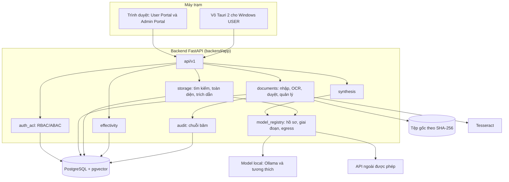

# Tổng quan kiến trúc

**Ngôn ngữ / Language:** Tiếng Việt · [English](../en/ARCHITECTURE_OVERVIEW.md)

Tóm tắt kiến trúc lập ngày 09/11/2026 từ mã nguồn và tài liệu trong repository; mốc sử dụng Kiro và lịch sử cập nhật spec được bổ sung ngày 11/11/2026. Chi tiết: [Mô tả hệ thống](../TAI_LIEU_MO_TA_HE_THONG.md), các ADR trong `docs/architecture-decisions/` và các spec trong `.kiro/specs/` (tiếng Anh; bản dịch ở [`docs/vi/kiro/`](kiro/README.vi.md)).

## Thành phần

## Luồng chính

1. **Nhập tài liệu**: tệp → kiểm định dạng và mã băm → bản nháp → trích chữ/OCR → cây cấu trúc và span theo trang → người khác rà soát → phê duyệt → đề xuất hiệu lực → snapshot.
2. **Tra cứu**: câu hỏi → chuẩn hóa → ACL trong SQL → bốn kênh hợp bằng RRF → nhóm kết quả → thẻ căn cứ.
3. **Mở nguồn**: mã căn cứ → kiểm lại ACL, trạng thái tra cứu, phiên bản và SHA-256 → trang PDF hoặc tệp gốc.
4. **Diễn giải AI** (tùy chọn): căn cứ được phép → model giai đoạn `summarize` → kiểm tra bằng mã → câu trả lời kèm căn cứ hỗ trợ.

## Nguyên tắc và nơi thực hiện

| Nguyên tắc | Nơi thực hiện |
|---|---|
| Phân quyền trước khi truy xuất | `storage/authorized_search.py` |
| Trích dẫn lấy từ văn bản đã lưu | `storage/citations.py`, `evidence/validators.py`, `synthesis/checks.py` |
| Tệp gốc bất biến theo mã băm | `documents/provenance.py` |
| Tách biệt nhiệm vụ khi duyệt | `documents/review.py`, `documents/management_access.py` |
| Hiệu lực hai trục; "đã xác minh" chỉ do người | `effectivity/resolver.py`, ADR-008 |
| Egress chặn mặc định; embedding và rerank chỉ local | `model_registry/stages.py`, ADR-004, ADR-007 |
| Nhật ký kiểm toán chống sửa | `audit.py` |

## Dạng triển khai

- Stack phát triển: `scripts/start-local-stack.ps1` (tùy chọn `-Lan`).
- Gói portable sạch: `deploy/portable/`.
- Gói LAN offline kèm model local: `deploy/lan-portable/`.

## Vị trí của Kiro

Theo chủ dự án, Kiro (Claude Sonnet 5.5 và Claude Opus 5.5) tiếp tục được dùng đến mốc cập nhật 11/11/2026; Kiroween còn diễn ra đến hạn nộp 04/12/2026. Nhật ký còn lưu gồm 7 phiên từ 05/11 đến phiên rà soát 09/11 trên một máy. Xem [`KIRO_WORK_SUMMARY.vi.md`](../../KIRO_WORK_SUMMARY.vi.md) để biết phần nào có bằng chứng và phần nào dựa trên xác nhận. Các spec trong `.kiro/specs` được dựng lại ban đầu ngày 09/11; spec hiệu lực và ghim trích dẫn có cập nhật ngày 11/11.
